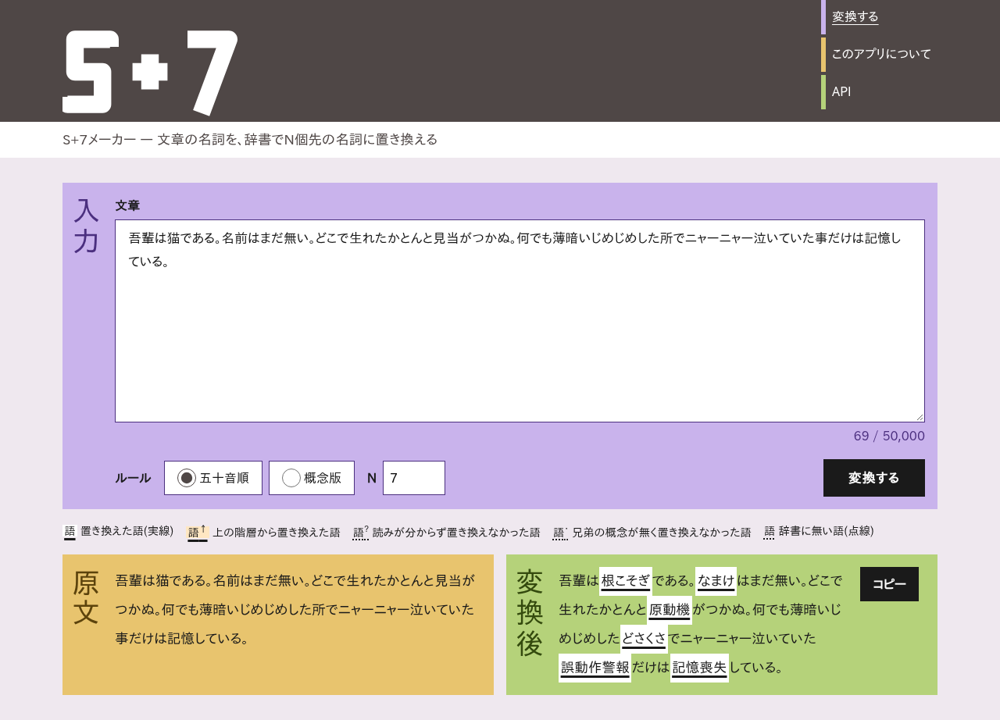

# S+7メーカー

文章中の名詞を、辞書でN個先の名詞に置き換えるWebアプリです。ウリポ(OuLiPo、潜在文学工房)の言葉遊び「S+7」を、日本語の文章で試せます。



> ウリポとは関係の無い、個人による非公式のアプリです。

## できること

- **2つのルール**
  - **五十音順**: 日本語WordNetの名詞を読みの五十音順に並べた一覧で、N個先の語に置き換えます(例: 猫 → 根こそぎ)
  - **概念版**: 意味のつながり(概念の木)をたどり、同じ上位の概念を持つ兄弟の概念の中でN個先の語に置き換えます(例: 猫 → 大型ネコ科動物)
- **N**: いくつ先に進むかを1〜99で選べます(既定は7)
- **結果の見比べ**: 原文と変換後を並べて表示します。置き換えた語を選ぶと、元の語を確かめられます
- **Web API**: 同じ変換をプログラムから呼べます(認証なし。利用制限あり)
- 入力できる文章は50,000文字までです。入力した文章はサーバーに保存せず、ログにも残しません

## Web API

```bash
curl -X POST http://localhost:8000/api/v1/transform \
  -H 'Content-Type: application/json' \
  -d '{"text": "吾輩は猫である。名前はまだ無い。", "mode": "gojuon", "n": 7}'
```

```json
{
  "text": "吾輩は根こそぎである。なまけはまだ無い。",
  "segments": [
    { "type": "text", "text": "吾輩は" },
    { "type": "noun", "nounIndex": 0, "original": "猫", "replaced": "根こそぎ", "status": "replaced", "lemma": "猫", "route": { "…": "…" } },
    "…"
  ],
  "meta": { "mode": "gojuon", "n": 7, "nounCount": 2, "replacedCount": 2, "dictionaryVersion": "2026.10.0", "attribution": "日本語WordNet 1.1(…)を使用しています。…", "…": "…" }
}
```

`mode` は `gojuon`(五十音順)か `concept`(概念版)です。エンドポイントの一覧、エラーコード、利用制限は、サーバーを起動して API仕様書(`/api/docs`)を見てください。結果を公開する場合は、応答の `meta.attribution`(辞書の出典)を表示してください。

## セットアップ

Dev Containerで開くと、依存関係とE2Eテスト用のブラウザの導入まで自動で行います(`.devcontainer/post-create.sh`)。詳しくは[開発ガイドライン「開発環境セットアップ」](docs/development-guidelines.md#開発環境セットアップ)を見てください。

```bash
# 1. 依存関係を入れる(Dev Containerでは自動)
uv sync --directory server
npm ci --prefix web
npm run e2e:install --prefix web

# 2. 日本語WordNetを取得し、変換用辞書を作る(初回のみ。数分かかる)
scripts/fetch-wordnet.sh
scripts/build-dictionary.sh

# 3. 開発サーバーを起動する(画面: http://localhost:5173、API: http://localhost:8000)
scripts/dev.sh
```

- 手順2を省くと、サーバーは起動しますが変換はできません(テストは小さな辞書を自動で作るため、手順2は要りません)
- 環境変数は不要です(既定値で動きます)。変える場合は `.env.example` を `.env` にコピーして編集してください

### よく使うコマンド

| 目的 | コマンド |
|------|---------|
| プルリクエストを出す前の確認(リント、型チェック、テスト、ビルド) | `scripts/check.sh` |
| Pythonのテスト | `uv run --directory server pytest` |
| 画面のテスト | `npm test --prefix web` |
| E2Eテスト | `npm run e2e --prefix web` |

## 技術スタック

- サーバー: Python 3.13、FastAPI、SudachiPy(形態素解析)
- 辞書: 日本語WordNet 1.1から、辞書ビルダー(`server/src/s7builder/`)で変換用辞書(SQLite)を作る
- 画面: TypeScript、React 19、Vite
- テスト: pytest、Vitest、Testing Library、Playwright

## ドキュメント

| ドキュメント | 内容 |
|--------------|------|
| [プロダクト要求定義書](docs/product-requirements.md) | 何を作るか、なぜ作るか |
| [機能設計書](docs/functional-design.md) | 機能、アルゴリズム、API、画面 |
| [技術仕様書](docs/architecture.md) | 技術スタック、構成、性能、セキュリティ |
| [リポジトリ構造定義書](docs/repository-structure.md) | ディレクトリとファイルの置き場所、依存の向き |
| [開発ガイドライン](docs/development-guidelines.md) | コーディング規約、Git運用、テスト、手元の確認とCI |
| [用語集](docs/glossary.md) | このプロジェクトの用語 |

## ライセンスとクレジット

このリポジトリのソースコードと文書は、[MITライセンス](LICENSE)で公開しています。

次の辞書データとライブラリは、それぞれのライセンスに従います。MITライセンスの対象ではありません。

| データ・ソフトウェア | ライセンス |
|----------------------|------------|
| [日本語WordNet](https://bond-lab.github.io/wnja/) 1.1(© 2009-2011 NICT、© 2012-2020 Francis Bond ほか) | [日本語WordNetのライセンス](licenses/wordnet-ja.txt) |
| [SudachiDict](https://github.com/WorksApplications/SudachiDict)(© Works Applications Co., Ltd.。UniDic などを含む) | Apache License 2.0([LICENSE](licenses/sudachidict-LICENSE.txt)、[NOTICE](licenses/sudachidict-NOTICE.txt)) |
| [SudachiPy](https://github.com/WorksApplications/sudachi.rs)(© Works Applications Co., Ltd.) | Apache License 2.0([LICENSE](licenses/sudachipy-LICENSE.txt)) |
| そのほかの依存ライブラリ | [Python](licenses/generated/python.txt)、[画面(npm)](licenses/generated/web.txt) の一覧のとおり |

- 変換用辞書(`data/build/s7dict.sqlite`)は日本語WordNetとSudachiDictから作るため、これらのライセンスに従います。Gitには入れていません
- アプリの「このアプリについて」の画面にも、出典とライセンスの全文を載せています
