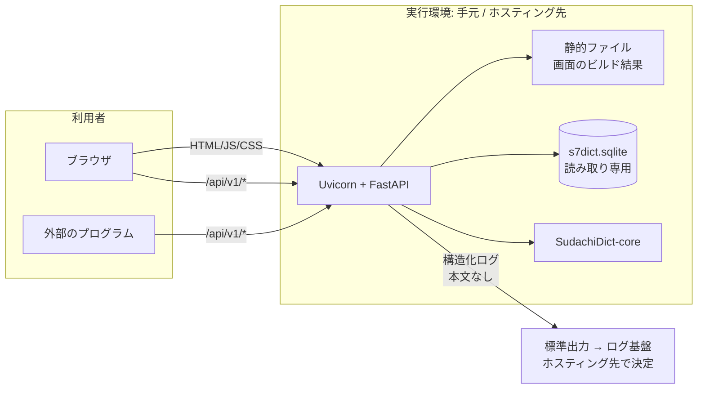

# 技術仕様書 (Architecture Design Document)

> 対象: `docs/product-requirements.md`、`docs/functional-design.md`(2026-10-24)
> 技術スタックはPRDの設計判断#8(Python API + TypeScript画面)に基づく。
> **ホスティング先は未確定**(Cloud Runは候補)。まず手元で開発し、動く状態になってから決める。アプリはどのホスティング先にも依存しない作りにする(「手元での開発とホスティングに依存しない作り」)。
> 2026-10-24: アーキテクチャ設計書のレビュー(3.6/5)の指摘を反映。「可用性と運用」「リスクと技術的負債」の節を追加し、機能設計書の改訂(品質の報告、ミドルウェアの処理順、CORSなど)に合わせた。
> 2026-10-25: リポジトリ構造定義書のレビューに合わせ、処理の順番、CIのワークフロー名(`main.yml`)、コンテナのビルドの入力、標準の文章の置き場所を更新した。
> 2026-10-31: 辞書ビルダーの実装時に、Dev Containerで「設計前の検証結果」を計測し直した(読みの付与率、兄弟グループ、変換用辞書の大きさとビルド時間)。
> 2026-10-31: 画面の実装に合わせ、開発ツール(APIの型の生成、ライセンス一覧の作り方)と、`main.yml` の現状(E2Eだけ)を追記した。
> 2026-10-31: APIの実装に合わせ、出典の文言、辞書の読み込みの失敗の扱い、CSPを付けるパスを確定した。
> 2026-10-31: 変換の処理の実装時に、Sudachiの初期化、変換用辞書の読み込み、変換の時間を計測し直した。Sudachiの `Tokenizer` はスレッドごとに作ると決めた。

## 設計前の検証結果

設計の前提を確かめるため、2026-10-24に実データで計測した結果です(Dev Containerではなく、ホストのmacOS上で計測。Python 3.12、SudachiPy 0.7.0、SudachiDict 20261015)。
件数・割合はデータそのものの性質なので環境によらないが、速度とメモリは参考値。
2026-10-31に、辞書ビルダーの実装とあわせてDev Container内(Python 3.13、SudachiPy 0.7.0、SudachiDict-core 20261015)で読みの付与率と兄弟グループを計測し直した(表の「再計測」)。

| 項目 | 結果 | 設計への影響 |
|------|------|--------------|
| 日本語WordNet 1.1の名詞 | 日本語の名詞の見出し語 65,788語、日本語の見出し語を持つ名詞の概念 42,697件 | 変換用辞書の規模の目安 |
| 読みの有無 | `word.pron` は日本語の名詞すべてで空 | 読みはSudachiで付ける必要がある(PRDの想定どおり) |
| 英語の語義頻度 | `sense.freq` は英語の語義206,941件のうち36,332件で値あり。語義が複数ある日本語の名詞17,489語のうち、82%(14,381語)で少なくとも1つの語義に頻度があり、76%(13,330語)で最頻の語義が1つに決まる | 語義の選択に頻度を使う(PRDのリスク2は許容範囲) |
| 日本語の定義文 | 日本語の見出し語を持つ名詞の概念すべて(42,697件)に日本語の定義文あり | 置換経路の表示(F6)は日本語の定義文だけで足りる |
| 読みの付与率(SudachiDict core) | 91.9%(60,480語)。読みが付かなかった5,308語のうち、未知語を含むものが4,771語(うち3,188語は、かなだけの表記。例: 「アイサ」)。残りの537語は、未知語ではないが読みにかな以外が混ざるものと見られる。**再計測**(機能設計書「5. 見出し語の読みの決定」の手順。モードC): Sudachiの読みだけで92.7%。かなだけの表記の18,306語を加えて **97.5%(64,155語)**。決まらない1,633語の内訳は、未知語を含む1,583語、記号・空白の仮の読み「キゴウ」を含む22語、読みにかな以外が混ざる28語 | かなだけの語は表記をそのまま読みにする。読みが決まらない残り(約2.5%)は五十音順リストに入れず、概念版でだけ使う(機能設計書「Lemma」)。記号・空白の仮の読みは使わない |
| 読みの付与率(SudachiDict full) | 92.6%。辞書サイズはcore 193MBに対してfull 315MB | **coreを採用**(0.7ポイントの差に対してサイズの増加が大きい) |
| Sudachiの初期化 | core: 0.16秒、メモリ約93MB。**再計測**: 0.17秒、94MB | コールドスタートへの影響は小さい |
| 形態素解析の速度 | 50,000文字(モードA)で約0.02秒(同じ文の繰り返しによる参考値)。**再計測**: 変換全体(名詞抽出と置き換え、N=7)で、10,000文字0.04〜0.05秒、50,000文字0.27秒(五十音順)・0.32秒(概念版)(5回の中央値。文章は日本語WordNetの日本語の定義文をつなげたもの) | 変換API(50,000文字、サーバー処理のみ)の目標1秒に収まる。標準の文章での計測は性能テストで行う |
| 変換用辞書の読み込み(再計測) | 1.0〜1.7秒(ばらつきが大きく、ファイルを初めて読む回は2.8〜3.5秒のこともあった)。読み込み後のメモリは、Sudachiと合わせて約220MB。変換中の最大は約310MB | コールドスタートの内訳(2秒以内)とメモリ(512MiB)に収まる見込み。ホスティング先で計測し直す |
| Sudachiの入力の上限 | 1回の入力がUTF-8で49,149バイトを超えると例外になる(機能設計書のレビュー時に実測) | 1回40,000バイト以下に分けて解析する(機能設計書「7. 長文の分割」) |
| 兄弟グループの大きさ | 日本語の名詞の概念のうち、兄弟が自分だけ12%、2〜7個42%、8〜20個24%、21個以上22%。**再計測**(除外リストの適用後、42,692件): 同じ割合。兄弟グループは11,848個 | 12%で階層を上がる。42%は7個先が循環する(PRDのリスク3) |
| 上位語が複数ある概念 | 2,213件(再計測でも同じ) | 「概念IDが最小の上位語を選ぶ」ルールが必要(機能設計どおり) |
| 変換用辞書の大きさとビルド時間(再計測) | `s7dict.sqlite` は約34MB(見出し語65,774、概念82,115、語義99,306)。ビルドは約6秒、最大メモリ約350MB | Dev Container(メモリ4GB)で問題なく作れる。サーバーでの読み込み時間とメモリは変換の処理の作業で計測する |

再計測のスクリプトは `tools/analysis/` にある(`measure_reading_coverage.py`、`measure_sibling_groups.py`、`measure_transform.py`)。最初の計測のスクリプトは残していない。

## テクノロジースタック

### 言語・ランタイム

| 技術 | バージョン | 選定理由 |
|------|-----------|----------|
| Python | 3.13 | SudachiPy、FastAPIが対応済みの安定版。型ヒント(`X \| None` など)を全面的に使える |
| Node.js | 24 LTS | 画面のビルド専用(本番では動かさない)。LTSで長期の保守が受けられる |
| TypeScript | 5.9系(typescript-eslint が対応するのは6.0系までのため、当面は5系のままにする) | 画面の型安全。APIの型(機能設計書の `TransformResponse` など)を共有しやすい |

### パッケージ管理

| 技術 | 用途 | 選定理由 |
|------|------|----------|
| uv | Pythonの依存関係と仮想環境 | 高速で、ロックファイル(`uv.lock`)で依存関係を固定できる。Python本体のバージョンも管理できる |
| npm | 画面の依存関係 | Node.jsに標準で入っている。`package-lock.json` で固定できる |

### フレームワーク・ライブラリ(サーバー)

| 技術 | バージョン | 用途 | 選定理由 |
|------|-----------|------|----------|
| FastAPI | 0.143系(ロックファイルで固定) | APIサーバー | Pydanticで入力検証とレスポンスの型を一元化でき、OpenAPI仕様書(F9のAPI仕様書)を自動生成できる |
| Pydantic | v2(2.14系) | リクエスト・レスポンスの型と検証 | FastAPIの標準。JSONのキー名を `camelCase` に変換する設定ができる |
| Uvicorn | 0.54系(ロックファイルで固定) | ASGIサーバー | FastAPIの標準的な実行環境 |
| SudachiPy | 0.7.0(完全固定) | 形態素解析 | 読み(`reading_form`)、正規化表記、区切りの細かさの切り替えが使える。Rust実装で速い |
| SudachiDict-core | 20261015(完全固定) | 形態素解析の辞書 | 上記の検証結果による。Apache 2.0 |
| sqlite3 | Python標準 | 変換用辞書の読み込み・ビルド | 追加の依存が要らない |

### フレームワーク・ライブラリ(画面)

| 技術 | バージョン | 用途 | 選定理由 |
|------|-----------|------|----------|
| React | 19.3系 | 画面 | 部品(`NounToken` など)を組み合わせる作りに向く。情報が多い |
| Vite | 8.3系(ロックファイルで固定) | ビルドと開発サーバー | 設定が少なく速い。静的ファイルとして出力できる |
| React Router | 8.4系(ロックファイルで固定) | `/` と `/about` の切り替え | 画面数が少ないため、ライブラリモード(データ取得機能を使わない)で十分 |

状態管理ライブラリは使わない。状態は変換画面の中だけで完結するため、Reactの標準機能(`useState`、`useReducer`)で足りる。

### 開発ツール

| 技術 | 用途 | 選定理由 |
|------|------|----------|
| Ruff | Pythonのリントと整形 | 1つのツールでリントと整形ができ、速い |
| mypy(strict) | Pythonの型チェック | 型ヒントの誤りをCIで検出する |
| import-linter | Pythonのレイヤーの依存の向きの検査 | 依存のルール(`docs/repository-structure.md`)を機械的に守る |
| pytest | Pythonのテスト | 標準的。フィクスチャで小さな辞書を差し替えやすい |
| ESLint + Prettier | 画面のリントと整形 | TypeScript・Reactの標準的な組み合わせ |
| Vitest + Testing Library | 画面のユニットテスト | Viteと設定を共有できる |
| Playwright | E2Eテスト | PC幅とスマートフォン幅、キーボード操作を自動で確かめられる |
| pip-audit、npm audit | 依存関係の既知の脆弱性の検査 | CIで自動で確かめる |
| ShellCheck | `scripts/` のシェルスクリプトの検査 | `set -euo pipefail` 以外の誤りも見つける |
| `@axe-core/playwright` | E2Eでのアクセシビリティの自動検査 | WCAG 2.2 AAの機械的に確かめられる部分を毎回見る |
| openapi-typescript | サーバーのOpenAPI仕様から画面のAPIの型を生成する(`scripts/generate-api-types.sh`) | 手書きの型とサーバーのずれを防ぐ。型だけを作り、実行時の依存関係を増やさない |
| (自前のスクリプト) | 依存ライブラリのライセンス一覧(`scripts/generate-licenses.sh`) | Pythonは `importlib.metadata`、npmは `npm ls` と各パッケージの `package.json` から作る。一覧のためだけに依存関係を増やさない |
| Dev Container | 開発環境 | Python・Node.js・Claude Codeを同じ環境で揃える(決定済み) |
| GitHub Actions | CI/CD | テスト、辞書のビルド、コンテナのビルドとデプロイ |

> バージョンは実装開始時(2026-10-25、土台の作業)に決めた。画面の作業(2026-10-31)で openapi-typescript 7.13、Playwright 1.64、`@axe-core/playwright` 4.14 を足した。公開から2週間以上たった版から選び(`uv lock --exclude-newer`、`npm install --before`)、正確な版はロックファイル(`server/uv.lock`、`web/package-lock.json`)にある。ESLintは、eslint-plugin-react と eslint-plugin-jsx-a11y がESLint 10に未対応のため9系にしている。

## アーキテクチャパターン

### 全体構成

1つのプロセス(本番ではコンテナ)で、APIと画面(ビルド済みの静的ファイル)の両方を配信する。図の実行環境とログ基盤はホスティング先によって変わる(候補のCloud Runなら、実行環境がCloud Run、ログ基盤がCloud Logging)。



**1つのコンテナにまとめる理由**:
- 画面とAPIが同じオリジンになり、画面からの呼び出しにCORSが要らない(外部向けにはCORSを許可する)
- 配信先が1つで済み、固定費とデプロイの手間が最小になる
- 静的ファイルの配信はFastAPIで十分な量(1画面のアプリ)

### サーバーのレイヤードアーキテクチャ

```
┌──────────────────────────────┐
│ APIレイヤー (api/)            │ ← HTTPの入出力、入力検証、利用制限、エラー形式
├──────────────────────────────┤
│ サービスレイヤー (services/)  │ ← 長文の分割、名詞抽出、五十音順S+N、概念版S+N、語義の選択
├──────────────────────────────┤
│ データレイヤー (repositories/)│ ← 変換用辞書の読み込みと検索
└──────────────────────────────┘
  外部ライブラリの境界 (adapters/) ← Sudachiの呼び出しを包む
```

#### APIレイヤー
- **責務**: リクエストの受付、Pydanticによる入力検証、利用制限、レスポンスの組み立て、エラーの形式の統一
- **処理の順番**: CORS → セキュリティヘッダー → gzip → リクエストログ → 本文のサイズ(413) → 起動中の判定(503) → 利用制限の回数(429) → 入力検証(400) → 利用制限の文字数(429) → ルーター。詳細は機能設計書「ミドルウェアと処理の順番」。413と起動中の503は利用制限の回数に数えない
- **許可される操作**: サービスレイヤーの呼び出し
- **禁止される操作**: データレイヤーやSudachiの直接呼び出し、置換のロジックを書くこと

#### サービスレイヤー
- **責務**: 変換のロジック(機能設計書のアルゴリズム)
- **許可される操作**: データレイヤーと、`adapters/` 経由のSudachiの呼び出し
- **禁止される操作**: FastAPIやHTTPへの依存(`Request` や `HTTPException` を使わない)。サービスはHTTPを知らない例外(`DomainError` の派生)を投げ、APIレイヤーが変換する

#### データレイヤー
- **責務**: 変換用辞書を起動時に読み込み、メモリ上の索引から引く
- **許可される操作**: SQLiteの読み取り
- **禁止される操作**: 置換のロジック、書き込み

#### 外部ライブラリの境界(adapters/)
- Sudachiを `Tokenizer` インターフェースで包み、サービスレイヤーはこのインターフェースだけに依存する
- テストでは、決まった形態素を返す偽物の `Tokenizer` に差し替える

#### 同期処理と非同期処理

- 変換・語義の一覧など、CPUを使う処理のルーターは同期関数(`def`)で書く。FastAPIがスレッドプールで動かすため、処理中もイベントループは止まらない
- `/healthz`、`/api/v1/meta`、`/api/v1/events`、静的ファイルは非同期関数(`async def`)で書く。変換が混んでいても、起動確認と画面の配信が詰まらないようにするため
- 変換を同時に実行する数は、1プロセスあたり2つまでに制限する(`TransformService` が持つセマフォ)。1 vCPUでCPU主体の処理を多く並べても速くならず、メモリの使用量だけが増えるため。超えた分は順番に待つ
- SudachiPyの `Tokenizer` は同時に使うと例外(`Tokenizer is already in use`)になるため、Sudachiの辞書は1つを共有し、`Tokenizer` はスレッドごとに作る(`SudachiTokenizer`。2026-10-31にSudachiPy 0.7.0で確認)

### 辞書ビルダー(s7builder/)

実行時のサーバーとは別のプログラムとして、同じリポジトリに置く(`server/src/s7builder/`)。

- 入力: `wnjpn.db`(日本語WordNet 1.1)、SudachiDict-core、置換先から除外する語のリスト(`data/excluded-lemmas.txt`、リポジトリで管理)
- 出力:
  - `s7dict.sqlite`(変換用辞書)
  - ビルドの報告 `data/reports/build-report.json`(件数、除外した語の数、読みの決め方ごとの数、読みが決まらなかった数)
  - 品質の報告 `data/reports/quality-report.json`(標準の文章3本での両モードの置換率。`QualityReporter`)
- サーバーのコード(`services/` の照合規則など)を共有してよい。逆向き(サーバーがビルダーに依存すること)は禁止。変換処理を動かす品質の報告だけは、例外として `s7.services` に依存してよい(`docs/repository-structure.md`)

### 画面の構成

- ビルド結果は静的ファイル(HTML/JS/CSS)だけ。サーバー側で画面を描画しない
- APIの呼び出しは `ApiClient` に集約し、部品からは直接 `fetch` を呼ばない
- APIの型(`TransformResponse` など)は、FastAPIが出力するOpenAPI仕様から自動生成し、手書きとのずれを防ぐ

## データ永続化戦略

### ストレージ方式

| データ種別 | ストレージ | フォーマット | 理由 |
|-----------|----------|-------------|------|
| 変換用辞書 | アプリの配布物(候補ではコンテナイメージ)に同梱 | SQLite(読み取り専用) | 実行時に書き込まない。配布物のバージョンと辞書のバージョンが一致し、決定性を守れる |
| 形態素解析の辞書 | 同上(Pythonパッケージ) | SudachiDictのバイナリ | 同上 |
| 日本語WordNetの元データ | ビルド時にダウンロード(リポジトリに入れない) | SQLite(`wnjpn.db`、約200MB) | 大きいため。SHA-256で中身を確かめる |
| 利用制限の状態 | 各コンテナのメモリ | Pythonの辞書 | 下記「利用制限」を参照 |
| アクセス記録・匿名の集計 | 標準出力に出し、ホスティング先のログ基盤で集める(候補: Cloud Logging) | 構造化ログ(JSON。項目は機能設計書「ログの形式」) | 追加のデータベースが要らない。本文は含めない |
| 入力文・変換結果 | 保存しない | - | PRDのプライバシー要件 |

利用者のデータを保存しないため、バックアップは不要。変換用辞書は、ビルドを再実行すれば同じものを作れる(元データとSudachiPy・SudachiDictのバージョンを固定しているため)。

### 変換用辞書のバージョン管理

- `dictionaryVersion` は `YYYY.MM.patch` 形式(例: `2026.10.0`)。照合規則、形式名詞の除外リスト、置換先から除外する語のリスト、元データ(日本語WordNet)、SudachiPy・SudachiDictのバージョンのいずれかを変えたら上げる(開発ガイドライン「変換用辞書を変えるときの手順」)
- 辞書のバージョンが変わると、同じ入力でも結果が変わることがある。変わる場合は更新履歴(`data/dictionary-history.md`。「このアプリについて」とAPI仕様書から参照する)に書く
- ビルドの報告と品質の報告をリポジトリに保存し、変更の影響を差分で確認できるようにする
- 置換率の基準値は `data/reports/quality-baseline.json` に置く。標準の文章での置換率が基準から5ポイント以上下がる変更は、プルリクエストで理由を説明する(PRDの「辞書の品質の基準」)

## 利用制限

### 方式

各コンテナのメモリ上で、接続元ごとに直近60秒間の「回数」と「文字数」を数える(スライディングウィンドウ)。判定の細かい規則(429にしたリクエストは数えない、`Retry-After` の計算など)は機能設計書「RateLimiter」。

| 制限 | 値 | 対象 |
|------|-----|------|
| 回数(変換など) | 30回/分 | `/api/v1/transform`、`/api/v1/senses` |
| 回数(画面の補助) | 120回/分 | `/api/v1/meta`、`/api/v1/events`(画面が自動で送る呼び出し。準備中の確認で変換の枠を消費しないように分ける) |
| 文字数 | 200,000文字/分 | `/api/v1/transform` の `text` の合計 |

- **接続元の取り方**: 前段のプロキシ(ホスティング先のロードバランサーなど)が付ける `X-Forwarded-For` の値から取る。偽装されうる先頭ではなく、信頼するプロキシが追加した値(末尾から数えた位置)を使う。信頼するプロキシの段数は環境変数 `S7_TRUSTED_PROXY_HOPS` で指定し、手元では0(接続元のアドレスをそのまま使う)にする
- **`X-Forwarded-For` が無い・段数が足りない・アドレスとして読めない場合**: 直接の接続元アドレスを使い、`WARNING` のログを出す(IPアドレスは出さない)。本番でこれが続くのは設定の誤り(すべての利用者が前段のプロキシの1つのアドレスにまとまり、全員で上限を分け合う状態)なので、「可用性と運用」のアラートで気付けるようにする
- **キーの単位**: IPv4はアドレスそのもの、IPv6は先頭64ビット(/64)。IPv6では1つの利用者が/64の中のアドレスを自由に変えられるため。IPv4射影アドレス(`::ffff:a.b.c.d`。デュアルスタックで待ち受けたとき)はIPv4として扱う
- **メモリの上限**: キーは最大10,000個。超えたら最も長く使われていないキーを捨てる。既知の制限: IPv6の/48などの広い範囲を持つ利用者は、/64を変えながら送ることでキーを使い切り、ほかの利用者の記録を捨てさせられる。最大台数の制限で費用の上限は守られるため、許容する
- **`X-Forwarded-For`**: 複数の行で届いた場合も、すべての行を順につなげてから末尾から数える。読めないときの `WARNING` は1分に1回だけ出す
- 接続元IPアドレスは、利用制限のために直近1分間の分だけメモリに持ち、それより古いものは捨てる。アプリのログには出さない。ホスティング先が自動で残すアクセスログの内容と保存期間は、ホスティング先の決定時に確認し、プライバシーポリシーに書く(PRDの「接続元IPアドレスの扱い」)
- メモリ上で数えるため、コンテナが複数台に増えると実質的な上限は台数倍になる。**最大台数を3台に制限**し、上限は最大でも想定の3倍に収める

### 外部ストア(Redisなど)を使わない理由

- 固定費が増える(PRDの運用要件「低い固定費」に反する)
- 最大台数の制限と組み合わせれば、乱用によるサービス停止と費用の増加は防げる
- 利用が増えて台数を増やす必要が出たら、外部ストア(候補のGoogle CloudならMemorystore)への移行を検討する(APIの仕様は変わらない)

## パフォーマンス要件

### レスポンスタイム

| 操作 | 目標時間 | 測定方法 |
|------|---------|---------|
| 変換(10,000文字) | 2秒以内(画面の描画まで) | PlaywrightでボタンからDOMの更新までを計測。本番相当の環境(ホスティング先の決定後。それまでは手元で目安を測る)、PCのChromium、下り10Mbps・往復遅延50ms相当に制限 |
| 変換(50,000文字) | 5秒以内(画面の描画まで) | 同上 |
| 変換(スマートフォン、10,000文字) | 4秒以内(画面の描画まで) | Playwrightで、ChromiumのCPUを4倍遅くし、低速4G相当の回線に制限して計測(Lighthouseのモバイル設定と同じ条件) |
| 変換(スマートフォン、50,000文字) | 目標なし(計測して記録) | 同上 |
| 変換API(50,000文字、サーバー処理のみ) | 1秒以内 | pytestの性能テスト。目標値はDev Container内で確かめる。CI(GitHubのホスト型ランナー)は速度がばらつくため、2秒を超えたら失敗とする(性能の大きな劣化を見つけるための値) |
| 初回表示 | LCP 2.5秒以内 | Lighthouse(モバイル、4G相当) |
| コールドスタート | 10秒以内(最初の変換結果まで) | 台数0の状態でページを開いた時点から、自動操作で10,000文字を入力してすぐ変換し、結果が表示されるまで。5回測った最大値(ホスティング先の決定後に実施) |

- 変換と初回表示の目標は、サーバーが起動済みの状態での95パーセンタイル値(PRDの測定条件)。各20回以上計測する
- コールドスタートは上の目標の対象外とし、別の基準(10秒以内、準備中の表示)で確かめる
- 文章は、スナップショット用の標準の文章を目標の文字数まで繰り返したものを使う(同じ文の繰り返しより名詞の種類が実際に近い)

### 予算の内訳

| 処理 | 10,000文字(PC) | 50,000文字(PC) |
|------|-----------------|-----------------|
| 長文の分割 | 0.01秒未満 | 0.01秒未満(4分割程度) |
| 形態素解析 | 0.05秒未満 | 0.1秒未満(検証結果より。実際の文章で再計測する) |
| 名詞ごとの置換 | 0.05秒未満 | 0.1秒未満(1語あたり辞書を数回引くだけ) |
| JSONの生成と圧縮 | 0.1秒程度 | 0.3秒程度(名詞が1万個を超えると、レスポンスは圧縮前で1MB程度になる) |
| 通信 | 圧縮後40KB程度。0.3秒程度 | 圧縮後200KB程度。1秒未満 |
| 画面の描画 | 0.5秒程度 | 1〜2秒(段落ごとの描画と `content-visibility` で抑える) |
| 合計(目標) | 1.1秒程度(目標2秒) | 3.5秒程度(目標5秒) |

- スマートフォン(10,000文字、目標4秒): CPUを4倍遅くすると描画が2秒程度、低速4Gで通信が1秒程度と見込む。サーバー処理は変わらない
- レスポンスはgzipで圧縮する(FastAPIの `GZipMiddleware`、1KB以上が対象)
- どれも見込みで、実装時に計測してこの表を更新する

### 負荷が高いときの見込み

- 1コンテナで変換を同時に実行するのは2つまで(「同期処理と非同期処理」)。50,000文字の変換が1秒かかるとすると、同時に20件届いた場合、最後の1件は約10秒待つ。目標の5秒は超えるが、タイムアウト(30秒)より短い
- この状態が続くと、ホスティング先が台数を増やす(最大3台)。それでも足りない負荷は、利用制限(1接続元あたり200,000文字/分)と最大台数で受け止め、待ち時間が延びることを許容する
- 負荷テスト(同時に20件の50,000文字の変換)で、待ち時間、メモリ、`/healthz` が遅れないことを確かめ、同時リクエスト数と同時実行数を見直す(ホスティング先の決定後)

### リソース使用量

| リソース | 上限 | 理由 |
|---------|------|------|
| メモリ | 1コンテナあたり512MiB以下(割り当ては1GiB) | Sudachi(約93MB)と、メモリに展開した変換用辞書(見込み200MB以下)。辞書の読み込み後に、50,000文字の変換を2つ同時に実行したときの最大の使用量(RSSのピーク)で測る。超える場合は辞書の持ち方を見直す |
| CPU | 1 vCPU | 1リクエストの処理が短いため |
| 同時リクエスト数 | 1コンテナあたり20(うち変換の同時実行は2) | 軽いリクエスト(画面、`meta`、`events`)は多く受け、CPUを使う変換だけ絞る |
| コンテナイメージ | 1GB以下 | SudachiDict-core(193MB)と変換用辞書が大半 |

### コールドスタート対策

- 変換用辞書は、ビルド時に実行時の形(索引済み)にしておき、起動時の処理を読み込みだけにする
- ホスティング先に起動時の処理を速める設定があれば使う(候補のCloud Runなら「起動時のCPUブースト」)
- **画面は辞書の読み込みを待たずに配信する**: Uvicornが起動したらすぐに静的ファイルを返せるようにし、変換用辞書の読み込みはその後に別スレッドで行う。利用者は待ち時間の間も画面を見て文章を入力できる(PRDのコールドスタートの要件)
- 辞書の読み込みが終わるまでは、`/api/v1/*` に503(`SERVICE_STARTING`、`Retry-After: 1`)を返す。ただし `/api/v1/events` は辞書を使わないため起動中も受け付け、コールドスタート時のイベントも記録する。画面はこれを受けて「準備中」を表示し、自動で再試行する(機能設計書「コールドスタート時の画面」)
- `/healthz` は、HTTPサーバーが応答できれば成功を返す(辞書の読み込み完了は待たない)。ホスティング先の起動確認(候補のCloud Runならstartup probe)にはこれを使う。辞書の読み込みが失敗した場合は、例外のクラス名と場所を `ERROR` で記録してから、プロセスを終了コード1で終え(`os._exit(1)`。読み込みは別スレッドのため例外では止まらない)、ホスティング先に再起動させる
- **台数が増えるときの影響**: 2台目以降の起動時も、新しいコンテナは辞書の読み込み中に503を返す。外部のAPI利用者は503を受けたら `Retry-After` に従って再試行する必要があるため、API仕様書に明記する
- 最小台数は0(固定費をかけない)。コールドスタートが体験を損なうと分かったら、最小台数1を検討する(月額費用が発生する)

**コールドスタート10秒の内訳(見込み)**:

| 段階 | 見込み | 確かめ方 |
|------|--------|----------|
| コンテナの起動(イメージの取得を含む) | 2〜4秒 | ホスティング先の決定後に計測(ホスティング先に依存) |
| Pythonの起動とUvicornの待ち受け開始 | 1秒程度 | 手元で計測 |
| 画面の表示(静的ファイル) | 1秒程度 | 上と並行。画面はこの時点で入力できる |
| 変換用辞書の読み込みとSudachiの初期化 | 2秒以内(手元の計測で、辞書の読み込み1.0〜1.7秒、Sudachi 0.17秒) | ホスティング先で計測し直す。超える場合は辞書の持ち方を見直す |
| 最初の変換(10,000文字、描画まで) | 1.5秒程度 | 上の「予算の内訳」 |
| 合計 | 7.5〜9.5秒程度(目標10秒) | ホスティング先の決定後に計測 |

## 手元での開発とホスティングに依存しない作り

ホスティング先が決まる前から、手元(Dev Container)だけで開発・テストを完結させる。クラウドのアカウントや認証情報は不要。

### 手元での動かし方

| 方法 | 用途 | 内容 |
|------|------|------|
| 開発サーバー | 普段の開発 | Uvicorn(`--reload`)でAPI、Viteの開発サーバーで画面を起動する(`scripts/dev.sh`)。Viteが `/api` をUvicornへ中継するため、画面とAPIは同じオリジンに見える |
| 本番と同じ構成 | 公開前の確認 | 画面をビルドし、Uvicorn1つでAPIと静的ファイルを配信する(本番と同じ形)。コールドスタート時の準備中の画面もこれで確かめる |
| コンテナ | 任意 | Dockerfileでイメージを作って動かす(`docker build -t s7-maker .`、`docker run -p 8000:8000 s7-maker`)。Dev ContainerにはDockerが入っていないため、ホスト側で行う。CIでは `docker.yml` が確かめる |

### アプリが守ること

どのホスティング先でも動き、手元と本番で動作が変わらないように、次を守る。

| 項目 | 方針 |
|------|------|
| ログ | JSON形式で標準出力に出すだけにする。クラウドのログ用ライブラリは使わない。手元では読みやすい形式に切り替えられる(`S7_LOG_FORMAT=text`) |
| 待ち受けるポート | 環境変数 `PORT` に従う。多くのホスティング先がこの方法でポートを渡す |
| 接続元IP | `S7_TRUSTED_PROXY_HOPS` で、信頼するプロキシの段数を指定する(上記「利用制限」) |
| プロセスの数 | Uvicornのワーカーは1つ。利用制限をメモリで数えるため、ワーカーが増えると上限がその数だけ増える |
| ファイルの置き場所 | 変換用辞書と静的ファイルのパスは環境変数で指定する |
| 秘密情報 | アプリには無い。デプロイ用の認証はホスティング先の決定後に決める |

### 環境変数

`server/src/s7/config.py` で読む。どれも既定値があり、手元では設定しなくても動く(`.env.example` に同じ一覧を書く)。

| 名前 | 既定値 | 用途 |
|------|--------|------|
| `PORT` | `8000` | 待ち受けるポート。ホスティング先の慣習に合わせるため、`S7_` で始めない唯一の例外 |
| `S7_DICTIONARY_PATH` | `data/build/s7dict.sqlite` | 変換用辞書のパス |
| `S7_STATIC_DIR` | `web/dist` | 画面のビルド結果のディレクトリ |
| `S7_LOG_FORMAT` | `json` | `json` か `text`(手元で読みやすくする) |
| `S7_LOG_LEVEL` | `INFO` | ログの出力レベル |
| `S7_TRUSTED_PROXY_HOPS` | `0` | 信頼する前段のプロキシの段数 |

- 利用制限の値と入力の上限は、API仕様(`GET /api/v1/meta` で公開する値)の一部なので、環境変数ではなくコードで持つ

### ホスティング先が無いと確かめられないこと

次は、ホスティング先を決めた後に確かめる。手元の開発は妨げない。

- 本番の回線・マシンでの性能(手元では、Playwrightで回線を制限して目安を測る)
- 0台からのコールドスタートにかかる時間(手元では、サーバーを起動し直して準備中の画面の動きだけ確かめる)
- 負荷が高いときの待ち時間と台数の増え方
- アクセス解析の集計と、監視・アラート(手元では、ログが決まった形式で出ることを統合テストで確かめる)

## 可用性と運用

### 可用性の目標

- 稼働率の数値目標は設けない(ベストエフォート)。個人規模の無償の公開サービスで、PRDにも稼働率の要求は無いため。PRDの信頼性要件(決定性、エラー時に入力を残す)と、変換エラー率(PRDの品質指標)で品質を見る
- 止まった場合の影響は「一時的に変換できない」だけで、利用者のデータは失われない(保存しないため)

### 監視とアラート

ホスティング先のログ基盤で、構造化ログ(機能設計書「ログの形式」)から次を集計する。仕組みはホスティング先の決定時に決め、公開までに用意する。

| 指標 | アラートの条件 | 想定する原因 |
|------|----------------|--------------|
| 500の割合 | 15分間で1%を超える | 不具合、辞書の不備 |
| 503(`SERVICE_STARTING`)の割合 | 15分間で5%を超える | 起動が遅い、起動を繰り返している |
| 変換のp95処理時間(`durationMs`) | 15分間で5秒を超える | 負荷、性能の劣化 |
| 接続元を取れなかった `WARNING` | 1件でも出たら | `S7_TRUSTED_PROXY_HOPS` の設定の誤り |
| メモリの使用量 | 割り当ての80%を超える | 辞書の肥大、メモリの使いすぎ |
| 月額費用 | 上限の50%・90%・100% | 乱用、想定外の利用 |

- 429の割合は、アラートにはせず週に1度見る(乱用か、利用制限が厳しすぎるかの判断に使う)
- アラートの通知先は、開発者のメールとする

### デプロイの確認と戻し方

1. 新しい版を、利用者のリクエストを受けない状態でデプロイする(候補のCloud Runなら、トラフィックを割り当てないリビジョン)
2. その版に対して `/healthz`、`/api/v1/meta`、決まった文章の変換結果(スナップショット)を確かめる
3. 確かめられたら、利用者のリクエストを新しい版へ切り替える。失敗したら切り替えず、デプロイを失敗として通知する
4. 切り替えた後に問題が見つかったら、前の版へ戻す(候補のCloud Runなら、トラフィックを前のリビジョンへ戻す)。前の版のイメージは、少なくとも直近3つを残す

## インフラとデプロイ(候補: Cloud Run。未確定)

ここから下は、ホスティング先をCloud Runにした場合の案。ホスティング先を決めるときに見直す。ほかの候補を選ぶ場合も、次の条件を満たせば上記のアプリの作りは変えずに済む。

- コンテナ(またはPythonのプロセス)を動かせる
- 使われていないときの費用が小さい(PRDの「低い固定費」)
- 1GiB程度のメモリを割り当てられる
- HTTPSで公開できる
- **同時に動く台数の上限を設定できる**。利用制限は台数ごとにメモリで数えるため、実効の上限は「1台の上限 × 台数」になる。台数を制限できない場合は、利用制限の状態を外部ストアに移す(「利用制限」の節)
- **アプリの標準出力のログを集めて集計でき、アラートを設定できる**(KPIの集計と「可用性と運用」に使う)
- **新しい版を、利用者のリクエストを受けない状態で確かめてから切り替えられ、前の版に戻せる**(「デプロイの確認と戻し方」)
- 前段のプロキシが接続元IPを `X-Forwarded-For` で渡す(段数が決まっている)

### Cloud Runの設定

| 項目 | 値 | 理由 |
|------|-----|------|
| リージョン | asia-northeast1(東京) | 主な利用者が日本 |
| 最小台数 | 0 | 固定費をかけない |
| 最大台数 | 3 | 費用の上限と、メモリ上の利用制限の実効値を抑える |
| メモリ / CPU | 1GiB / 1 vCPU | 上記のリソース使用量による |
| 同時リクエスト数 | 20 | 同上 |
| リクエストのタイムアウト | 30秒 | 変換は5秒以内の想定。負荷が高いときの待ち(最大10秒程度)を含めても収まる。異常時に早く打ち切る |
| 認証 | 未認証の呼び出しを許可 | ログイン不要の公開API |
| デプロイ用の認証 | GitHub ActionsからWorkload Identity連携 | サービスアカウントの鍵ファイルを作らない |

### コンテナのビルド(マルチステージ)

```
ステージ1 (node:24)     画面をビルド → dist/
ステージ2 (python:3.13) wnjpn.dbをダウンロード・SHA-256確認 → 辞書ビルダーを実行(build のみ) → s7dict.sqlite
ステージ3 (python:3.13-slim) 実行用。サーバーのコード(s7/)、実行時の依存関係(SudachiDict-coreを含む)、s7dict.sqlite、dist/ だけを入れる
```

- 各ステージで取り込むファイルと `.dockerignore` は `docs/repository-structure.md`「Dockerfile」「除外設定」

- 実行用のイメージには、`wnjpn.db`、Node.js、辞書ビルダー、開発用の依存関係、uv を入れない
- 実行ユーザーはroot以外にする
- ベースイメージは、タグとダイジェスト(`@sha256:...`)の両方で固定する。更新はDependabot(Dockerの更新)のプルリクエストで行う
- 版: `node:24.22.1-trixie-slim`、`python:3.13.17-trixie`、`python:3.13.17-slim-trixie`、`ghcr.io/astral-sh/uv:0.13.1`(uv は公開から2週間以上たった版)。Dependabot は Python を3.13、Node.js を24に留める
- 確認: `.github/workflows/docker.yml` がイメージをビルドし、`scripts/smoke-test-image.sh` で起動して確かめる(`PORT` での待ち受け、辞書の読み込み後の変換、画面のCSP、root以外での実行、要らないものが無いこと、1GB以下)。Dev ContainerにはDockerが無いため、イメージの確認はCIで行う(Dockerのあるホスト側でも同じスクリプトを使える)

### CI/CD(GitHub Actions)

| タイミング | ワークフロー | 内容 |
|------------|--------------|------|
| プルリクエスト | `ci.yml` | Python: Ruff、mypy、import-linter、pytest(ユニット・統合。小さな辞書と本物のSudachi)、pip-audit。画面: ESLint(ディレクトリ間の依存の検査を含む)、型チェック、Vitest、ビルド、npm audit。APIの型とライセンス一覧を生成し直して差分が無いことの確認(ジョブ `generated`) |
| mainへのマージ | `main.yml` | 上記に加えて、本物の辞書のビルド、品質の報告の生成(`scripts/check-reports.sh`。コミット済みの `build-report.json`・`quality-report.json` と一致することを確かめ、更新忘れを見つける)、スナップショットテスト、性能テスト(サーバー)、E2Eテスト。**いまはE2Eテストだけ**(PC幅のChromium・WebKit、スマートフォン幅360px。APIはモックで返す)。辞書のビルド以降は品質の報告の作業で足す |
| mainへのマージ、イメージの中身に関わるファイル(`Dockerfile`・`.dockerignore`・依存関係のファイルなど)を変えたプルリクエスト、手動実行 | `docker.yml` | イメージのビルドと起動の確認(上の「コンテナのビルド」)。数分かかるため、すべてのプルリクエストでは動かさない。パスで絞るため、ルールセットの必須チェックには入れない |
| `main.yml` の成功後 | `deploy.yml`(ホスティング先の決定後に作る) | コンテナのビルドとデプロイ(「デプロイの確認と戻し方」) |

- 依存関係の脆弱性の検査は、Pythonは実行時の依存関係に既知の脆弱性が1つでもあれば、画面は深刻度が高(high)以上があれば失敗させる(`pip-audit` は深刻度で絞れないため。詳細は開発ガイドライン「依存関係の更新」)
- 辞書に関わるファイル(開発ガイドライン「手元で確かめることとCI」)を変えたプルリクエストでは、`ci.yml` でも辞書のビルド、報告の一致、スナップショットを実行する。辞書の更新忘れをマージ前に見つけるため
- `main.yml` が失敗したら、まずそのプルリクエストを戻す(revert)
- 置換率が基準から5ポイント以上下がることは、CIでは失敗にしない。辞書を変えるプルリクエストで、手元で作った品質の報告を見て説明する(開発ガイドライン「変換用辞書を変えるときの手順」)

### 費用の見込み

最小台数0のため、利用が無い時間は費用がほぼかからない。主な費用は、リクエストを処理している時間のCPU・メモリと、コンテナイメージの保存(Artifact Registry)。
Cloud Runの無料枠の範囲に収まる利用量を想定するが、実際の金額は公開後に請求額で確かめる。月額費用の上限はホスティング先の決定時に決め(PRDの「運用」)、その額で予算アラートを設定する(「監視とアラート」)。

## セキュリティアーキテクチャ

### データ保護

- **入力文を残さない**: アプリのログに本文を出さない。リクエストのログは、パス、ステータス、処理時間、文字数だけ(機能設計書「ログの形式」)。例外の記録でも本文を含む変数を出さない(ログ出力用の関数で除外する)
- **秘密情報**: アプリに秘密情報は無い(APIキーも認証も無い)。デプロイ用の認証は、ホスティング先の仕組みで鍵ファイルを保存しない方式にする(候補のCloud Runなら、Workload Identity連携。「Cloud Runの設定」)
- **HTTPS**: ホスティング先のHTTPSを使う(アプリ自体はHTTPで待ち受け、TLSは前段で終端する)。公開時にHTTPは受け付けない

### 入力検証

- **バリデーション**: Pydanticで型、`text` の文字数(1〜50,000、コードポイント数)、`mode`、`n`(1〜99)、`exclusions`・`senseOverrides` の形式と個数を確かめる。型の自動変換はしない(strictモード)。単独のサロゲートを含む文字列は断る
- **本文のサイズ**: 1MBを超えるリクエストは413で断る。`Content-Length` があれば本文を読む前に判定し、無い場合(chunked)は読みながら数えて1MBを超えた時点で打ち切る。50,000文字をすべて `\uXXXX` で書いた場合(最大600,000バイト)も受け付けるための値(機能設計書「API設計」)
- **処理量の上限**: 最長一致で1回に試すのは8形態素まで。Sudachiは1回の入力がUTF-8で約49KB(実測49,149バイト)を超えると例外になるため、1回40,000バイト以下に分ける(改行 → 句点 → 空白 → 文字種の境目の順で切る。機能設計書「7. 長文の分割」)。`exclusions`・`senseOverrides` は各1,000個まで
- **エラーの表示**: 500エラーの応答には内部の情報(スタックトレース、パス)を含めない

### HTTPヘッダー

| ヘッダー | 値 | 対象 |
|----------|-----|------|
| `Content-Security-Policy` | `default-src 'self'`(画面に必要な分だけ追加) | 画面(`/api/` と `/healthz` を除くパス。API仕様書 `/api/docs` は外部のスクリプトを読み込むため付けない) |
| `X-Content-Type-Options` | `nosniff` | すべて |
| `Referrer-Policy` | `strict-origin-when-cross-origin` | すべて |
| `Strict-Transport-Security` | `max-age=31536000` | すべて(HTTPで受けたブラウザは無視するため、手元でも害は無い) |
| `Access-Control-Allow-Origin` | `*` | `/api/v1/*` のすべての応答(413・429・503を含む) |
| `Access-Control-Expose-Headers` | `Retry-After` | 同上 |
| `Access-Control-Allow-Methods` / `-Allow-Headers` / `-Max-Age` | `GET, POST, OPTIONS` / `Content-Type, X-S7-Client` / `86400` | `/api/v1/*` のプリフライト(利用制限で数えない) |
| `Cache-Control` | `public, max-age=31536000, immutable` | ファイル名にハッシュが付いた静的ファイル(`/assets/*`)。LCPの目標に効く |
| `Cache-Control` | `no-cache` | `index.html` など、ファイル名にハッシュが付かない静的ファイル |
| `Cache-Control` | `no-store` | `/api/v1/*` |

CORSの詳細は機能設計書「API設計」の共通事項。

### 依存関係の脆弱性

- CIで pip-audit と npm audit を実行する(「CI/CD」)
- Dependabotのセキュリティ更新を有効にする。SudachiPy・SudachiDictに脆弱性の修正が出た場合は、自動では取り込まず、辞書のバージョンを上げる手順(開発ガイドライン)で更新する

### ライセンスとクレジット

| データ・ソフトウェア | ライセンス | 対応 |
|----------------------|------------|------|
| このアプリ(リポジトリのソースコードと文書) | MIT License(Copyright (c) 2026 Tomohiko Ariki) | 全文をリポジトリ直下の `LICENSE` に置く。`web/package.json`・`server/pyproject.toml` の `license` にも書く。下の辞書データと依存ライブラリは対象外で、それぞれのライセンスに従う(README と「このアプリについて」に書く) |
| 日本語WordNet 1.1 | NICTの日本語WordNetライセンス(いかなる目的でも無償で使用・複製・改変・頒布可。著作権表示とライセンス文を全コピーに残す。NICTの名称を宣伝に使わない) | ライセンス文の全文を `licenses/` に置き、「このアプリについて」とAPI仕様書に掲載する。変換用辞書にもライセンス文を含める |
| SudachiDict | Apache License 2.0(UniDic、NEologdの一部を含む) | 同上。NOTICEの内容も掲載する |
| SudachiPy | Apache License 2.0 | 同上 |
| その他の依存ライブラリ | 各ライブラリによる | ビルド時に一覧を自動生成して掲載する |

APIレスポンスの `meta.attribution` には、出典の短い表記と、ライセンス全文のURL(`/about#credits`)を入れる。文言は次のとおり(`server/src/s7/services/meta_service.py` の `ATTRIBUTION`)。

> 日本語WordNet 1.1(© 2009-2011 NICT、© 2012-2020 Francis Bond ほか)、SudachiDict(© Works Applications Co., Ltd.、Apache License 2.0)を使用しています。ライセンス全文: /about#credits

## 匿名のアクセス解析

外部の解析サービスは使わず、自前の最小限の仕組みにする(Cookieを使わず、第三者にデータを送らないため)。

- 画面は `POST /api/v1/events` に、機能設計書で定めたイベント(`page_view`、`transform`、`copy`)だけを送る。IPアドレスやUser-Agentは記録しない
- イベントを結び付ける `pageViewId` は、画面のメモリ上だけに持つランダム値。Cookieや端末の保存領域を使わないため、別の訪問とは結び付かない
- サーバーはイベントを構造化ログとして標準出力に出す。集計の仕組みはホスティング先の決定時に、そのログ基盤に合わせて決める(候補のCloud Runなら、Cloud Loggingのログベースの指標)。公開までに用意する
- Web画面以外からのAPI呼び出し数は、`X-S7-Client: web` ヘッダー(画面だけが付ける)の有無で区別して数える
- 収集する項目は、プライバシーポリシーとして「このアプリについて」に掲載する

(`/api/v1/events` は画面専用の補助的なエンドポイントとして、API仕様書には「解析用」と明記する。利用制限の対象に含める)

## スケーラビリティ設計

### データ増加への対応

- **想定データ量**: 辞書は固定(見出し語は約6.6万。置換先から除外する語の分だけ減る。うち五十音順リストは約6.4万。概念約4.3万)。利用者のデータは保存しないため、利用者数によってデータは増えない
- **アクセス増加**: 最大台数を上げれば処理能力は増える。その場合、利用制限の状態を外部ストアへ移す
- **辞書の更新**: 日本語WordNetやSudachiDictの更新時は、変換用辞書を作り直し、`dictionaryVersion` を上げる

### 機能拡張性

- **派生ルールの追加**(PRDのP2): `Shifter` を共通のインターフェースにしておき、`mode` の値を増やすだけで追加できるようにする。既存の `mode` の結果は変えない
- **他の品詞(V+7など)**: `NounExtractor` の品詞の判定を設定で切り替えられるようにしておく。活用の扱いは別途設計する
- **APIのバージョン**: 互換性のない変更は `/api/v2` として追加し、`/api/v1` は告知のうえ最低6ヶ月残す(PRDのF9)。項目の追加は互換性のある変更とし、`v1` のまま行う

## テスト戦略

### ユニットテスト
- **フレームワーク**: pytest(サーバー・辞書ビルダー)、Vitest + Testing Library(画面)
- **対象**: 機能設計書「テスト戦略」のユニットテストの項目。照合規則、読みの決定、最長一致、品詞の判定、長文の分割、各Shifter、語義の選択、変換の組み立て、画面の部品
- **カバレッジ目標**: サービスレイヤーと辞書ビルダーは90%以上、全体で80%以上

### 統合テスト
- **方法**: FastAPIの `TestClient` で、小さな変換用辞書(テスト用フィクスチャ)を読み込んだサーバーにリクエストを送る
- **対象**: APIの入出力、エラーコード、利用制限、CORSヘッダー、ログの形式、`segments` の連結で元の文章に戻ること、決定性
- **辞書ビルダー**: 数十語の小さな `wnjpn.db` のサンプルを作り、件数・並び順・兄弟グループを確かめる。同じ入力から2回ビルドして中身が一致することも確かめる

### スナップショットテスト
- 本物の変換用辞書で、標準の文章3本(著作権の切れた作品の一節。`data/standard-texts/`)を両モードで変換し、結果をリポジトリに保存する
- 同じ3本を、品質の報告(`QualityReporter`)の置換率の計測と、性能テストの文章にも使う
- 辞書のバージョンを上げたときに差分を確認し、意図した変更かどうかを判断する

### E2Eテスト
- **ツール**: Playwright(Chromium、WebKit。PC幅とスマートフォン幅360px)
- **シナリオ**: 機能設計書「E2Eテスト」の項目と、変換時間の計測

### 負荷テスト
- ホスティング先の決定後に、同時に20件の50,000文字の変換を送り、待ち時間、メモリ、`/healthz` の応答を確かめる(「負荷が高いときの見込み」)

## 技術的制約

### 環境要件
- **開発**: Dev Container(Docker)。メモリ4GB以上を推奨(`wnjpn.db` からのビルドで使う)
- **必要ディスク容量**: 開発環境で2GB程度(`wnjpn.db` 約200MB、SudachiDict、依存関係)
- **必要な外部依存**: 日本語WordNetの配布元(ビルド時のみ)、PyPI、npm。手元の開発にはこれだけでよい。公開時は、これにホスティング先が加わる(候補のCloud Runなら、Cloud Run、Artifact Registry、Cloud Logging)

### パフォーマンス制約
- 変換は1リクエストで完結させ、途中経過を返す仕組み(ストリーミング)は使わない(5秒以内に収まるため)
- 実行時にSQLiteへ問い合わせない(すべてメモリ上の索引で引く)

### セキュリティ制約
- 入力文・変換結果をディスク、ログ、外部サービスのどこにも保存しない
- 画面ではHTMLを直接差し込む機能(`dangerouslySetInnerHTML`)を使わない

## リスクと技術的負債

| リスク・負債 | 影響 | 兆候 | 対応 | 見直す時期 |
|--------------|------|------|------|------------|
| 日本語WordNetの配布元が使えなくなる | 辞書をビルドできない | ダウンロードの失敗 | SHA-256で確かめた原本を、ライセンスの条件(ライセンス文を残す)を守って別の場所にも保管する | 公開前 |
| 変換用辞書のメモリが見込み(200MB以下)を超える | 512MiBを超え、メモリ不足で落ちる | 実装時の計測値 | 索引の持ち方(文字列の共有、配列化)を見直す。それでも足りなければ割り当てを増やす | 実装の初回 |
| 実際の文章での速度が検証の参考値より遅い | 変換時間の目標を超える | 性能テスト | 形態素解析と組み立ての処理を計測して見直す | 実装の初回 |
| 最大台数の設定を誤る、または台数を制限できないホスティング先を選ぶ | 利用制限の実効値が3倍を超える。費用が増える | 予算アラート、台数の監視 | ホスティング先の条件として確かめる。できなければ外部ストアへ移す | ホスティング先の決定時 |
| `S7_TRUSTED_PROXY_HOPS` の設定を誤る | 全利用者が1つのキーにまとまり、互いの利用で429になる。または利用制限を回避される | 接続元を取れなかった `WARNING` | アラートで気付く。デプロイ後の確認で、接続元の取り方を確かめる | ホスティング先の決定時 |
| 台数が増えるときに外部のAPI利用者が503を受ける | 利用者のプログラムが失敗する | 503の割合 | API仕様書に再試行を明記する。多い場合は最小台数1を検討する | 公開後 |
| SudachiPyの入力の上限(約49KB)が版によって変わる | 分割の値が合わなくなり、例外になる | テストの失敗 | 上限の値を確かめるテストを置き、SudachiPyを上げるときに見直す | SudachiPyの更新時 |
| 読みの付与率がSudachiDictの更新で下がる | 五十音順で置き換えられる語が減る | ビルドの報告(`build-report.json` の差分) | 辞書のバージョンを上げる手順で差分を確かめる。大きく下がれば手順を見直す | SudachiDictの更新時 |
| SudachiPyの版によって `Tokenizer` の同時利用の扱いが変わる | 同時に2つの変換で例外になる | `sudachi` マーカーのテスト(複数のスレッドから同時に解析する)、エラーログ | いまはスレッドごとに作っている(0.7.0で、1つの `Tokenizer` を同時に使うと例外になることを確認)。SudachiPyを上げるときにテストを通す | SudachiPyの更新時 |
| SudachiPy・SudachiDictを完全固定にしている | 脆弱性の修正や改善を取り込むのが遅れる | Dependabotのセキュリティ警告 | 辞書のバージョンを上げる手順で、警告から2週間以内に取り込むかを判断する | 警告のたび |

## 依存関係管理

| ライブラリ | 用途 | バージョン管理方針 |
|-----------|------|-------------------|
| SudachiPy、SudachiDict-core | 形態素解析 | **完全固定**(パッチバージョンまで)。変換結果が変わるため、更新は辞書のバージョンを上げる作業として行う |
| 日本語WordNet | 辞書の元データ | **完全固定**(v1.1、SHA-256で確認) |
| FastAPI、Pydantic、Uvicorn | APIサーバー | ロックファイルで固定。Dependabotで週1回、グループにまとめて更新する。メジャーバージョンの更新は個別に判断する |
| React、Vite、React Router | 画面 | ロックファイルで固定。メジャーバージョンの更新は個別に判断する |
| 開発ツール(Ruff、mypy、import-linter、pytest、ESLint、Vitest、Playwright) | 開発 | ロックファイルで固定。自動更新のプルリクエスト(Dependabot)で更新する |
| ベースイメージ(`node:24`、`python:3.13`、`python:3.13-slim`) | コンテナのビルド | タグとダイジェストで固定。Dependabotで更新する |

- Pythonは `uv.lock`、画面は `package-lock.json` をリポジトリに含める
- 変換結果に影響する依存関係(SudachiPy、SudachiDict、日本語WordNet)は、自動更新の対象から外す

## 機能設計書からの申し送りへの回答

| # | 項目 | 結論 |
|---|------|------|
| 1 | 英語の語義頻度が取れるか | 取れる。語義が複数ある語の82%で頻度がある(上記の検証結果) |
| 2 | 利用制限の状態の保存先 | 各コンテナのメモリ。最大台数3台で実効値を抑える |
| 3 | 辞書の大きさと起動時間 | SudachiDict-coreは193MB、初期化0.17秒。変換用辞書は約34MBで、読み込みは1.0〜1.7秒。変換中の最大メモリは約310MB。使用メモリ512MiB以下、コールドスタート10秒以内を目標とする |
| 4 | SudachiDictの種類 | core |
| 5 | 匿名のアクセス解析 | 自前の `/api/v1/events` と構造化ログ。集計の仕組みはホスティング先の決定時に決める(候補: Cloud Loggingのログベースの指標) |
