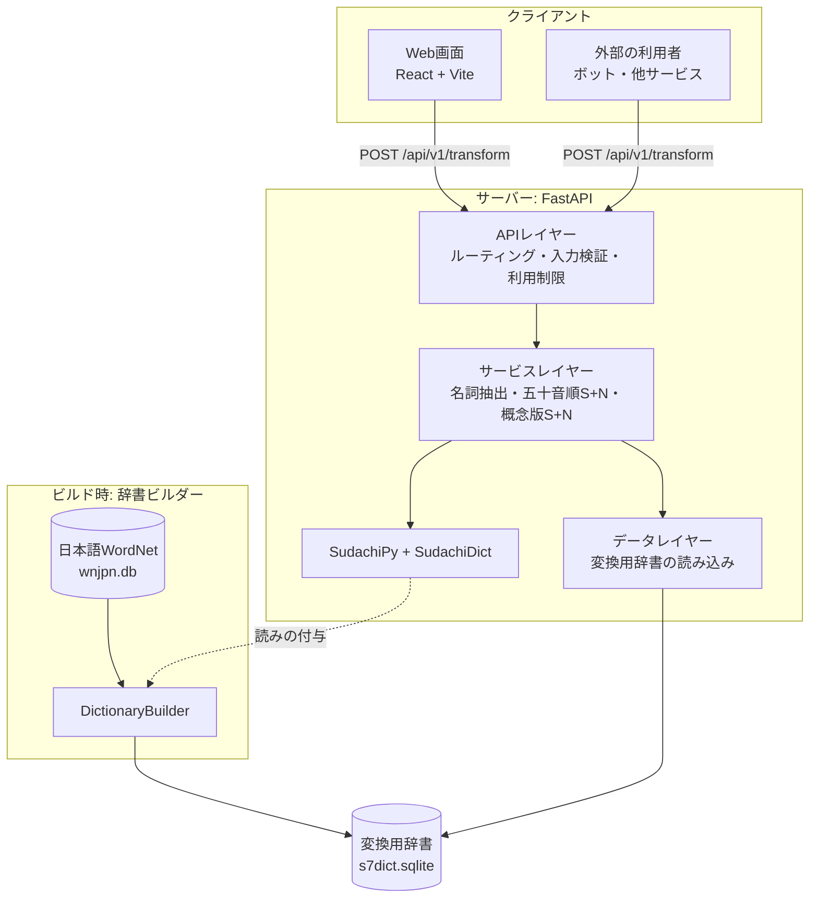
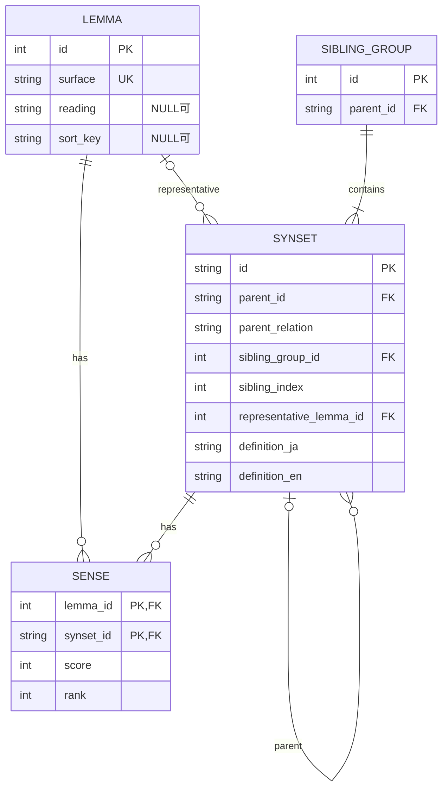
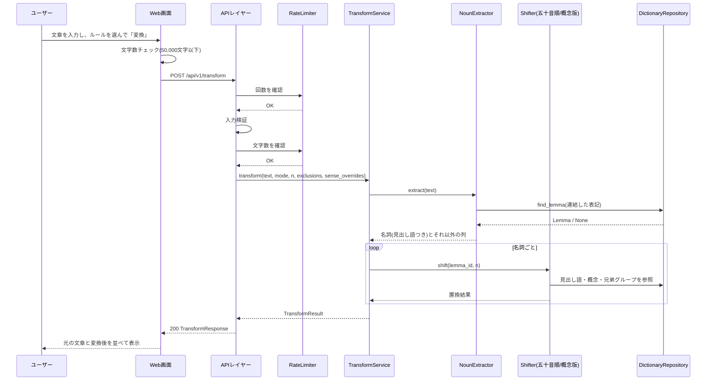
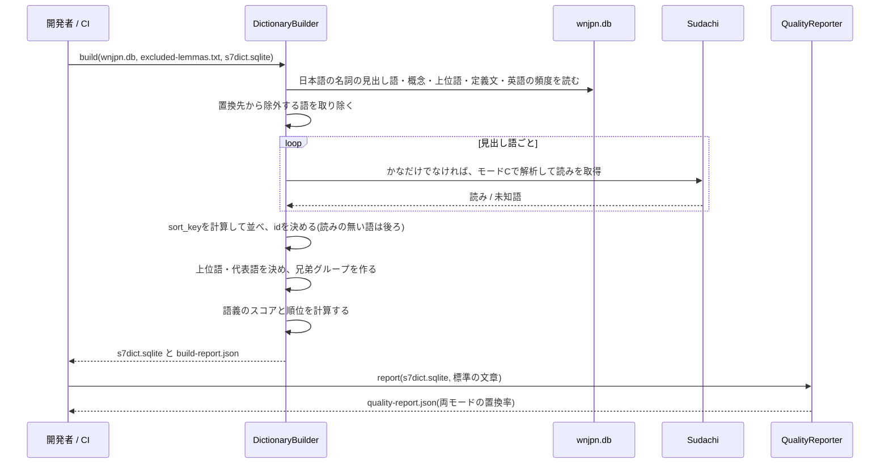
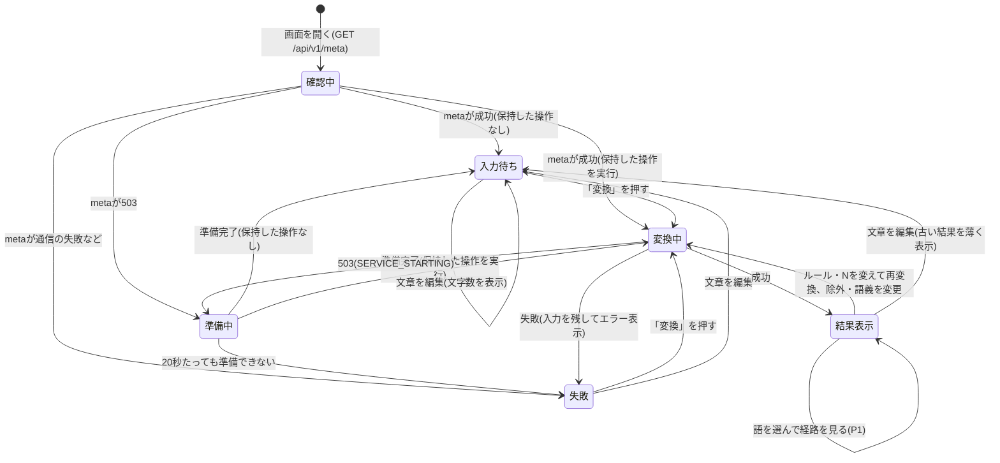

# 機能設計書 (Functional Design Document)

> 対象: `docs/product-requirements.md`(2026-10-24 承認版)
> P0(F1〜F5、F9)を中心に設計し、P1(F6〜F8)は後から足せるようにインターフェースだけ先に用意する(F5は2回目のPRDレビューでP0に変更)。
> 2026-10-24: 機能設計書のレビュー(3.5/5)の指摘を反映。あわせて、読みが決まらない見出し語も概念版では置き換えに使うように変更した。
> 2026-10-25: 用語集・開発ガイドラインのレビューに合わせ、`INVALID_REQUEST` の条件と画面遷移図(確認中からの自動変換、20秒の数え始め)を補った。
> 2026-10-25: リポジトリ構造定義書のレビューに合わせ、`Morpheme` の置き場所、ミドルウェアの処理順(セキュリティヘッダー・gzip・リクエストログ)、画面のフックと部品、標準の文章の置き場所(`data/standard-texts/`)を更新した。
> 2026-10-31: 変換の処理の実装に合わせ、中間の型(置換経路、`ConceptRef`、`ConceptShift`、`SenseChoice`)、`ConceptShifter.select_sense`、`TransformService` のコンストラクタ、`DictionaryRepository` の読み込みと整合性の検査を追記した。
> 2026-10-31: 辞書ビルダーの実装に合わせ、`Morpheme`(`reading_form`・`is_oov`)と `Tokenizer` の分割モード、`built_at` の値、定義文のつなぎ方、読みの決定(記号の仮の読み「キゴウ」を使わない、検査の範囲)、読みの付与率(97.5%)を更新した。

## システム構成図

変換処理はすべてサーバー側の1か所にまとめ、Web画面も公開Web APIを使う(画面専用の内部APIは作らない)。
辞書データは実行時に作らず、ビルド時に日本語WordNetとSudachiから「変換用辞書」を作っておく。



## 技術スタック

詳細な選定理由とバージョンは `docs/architecture.md` で定義する。

| 分類 | 技術 | 選定理由 |
|------|------|----------|
| API | Python + FastAPI | 日本語処理のライブラリが豊富。OpenAPI仕様書を自動生成でき、F9のAPI仕様書に使える |
| 形態素解析 | SudachiPy + SudachiDict | 読み(`reading_form`)が取れる。区切りの細かさを選べ、複合名詞の最長一致に使える。Apache 2.0 |
| 辞書 | 日本語WordNet 1.1(`wnjpn.db`) | 概念ツリー(上位語・下位語)を持つ。商用を含め無償利用可 |
| 変換用辞書の保存形式 | SQLite | ビルド時に作り、アプリの配布物(候補のCloud Runならコンテナイメージ)に同梱して読み取り専用で使う |
| 画面 | TypeScript + React + Vite | 1画面のアプリなので静的ファイルとして配信できる |
| ホスティング | 未確定(候補: Cloud Run) | 手元での開発を先に進めてから決める。候補のCloud Runは使われていないときにゼロ台まで縮み、固定費が低い |

## データモデル定義

データは2種類に分かれる。

1. **変換用辞書**: ビルド時に作る読み取り専用のデータ。サーバーが起動時にメモリへ読み込む
2. **変換のリクエストとレスポンス**: 実行時に作られ、保存しない(入力文はサーバーに残さない)

### 変換用辞書のエンティティ

Pythonの型で示す(実装では `dataclass` を使う)。

#### エンティティ: Lemma(見出し語)

日本語WordNetの名詞の見出し語1つに当たる。同じ表記の語は、語義が複数あっても1つのLemmaにまとめる。

読みが決まった見出し語は、五十音順S+N(F2)のリストの1行になる。読みが決まらない見出し語も、概念版S+N(F3)で使うためLemmaに含める(約2.5%、1,633語。`docs/architecture.md`「設計前の検証結果」)。

```python
@dataclass(frozen=True)
class Lemma:
    id: int                 # 見出し語の番号(0始まり)。下の「並び順」の位置
    surface: str            # 表記(例: "図書館")。日本語WordNetの見出し語そのまま
    reading: str | None     # 読み(ひらがな。例: "としょかん")。決まらない場合はNone
    sort_key: str | None    # 並び替え用のキー(「五十音順の照合規則」で計算)。読みが無ければNone
```

**並び順(`id` の決め方)**:
1. 読みのある見出し語を、`sort_key` → `surface`(コードポイント順)の順に並べる
2. その後ろに、読みの無い見出し語を `surface`(コードポイント順)の順に並べる
3. 並べた位置を `id` にする

この並び方により、次のことが成り立つ。
- `id` が `0` 〜 `gojuon_lemma_count - 1` の見出し語が、そのまま**五十音順リスト**になる(`id` がリスト上の位置)
- 「`id` が最小の見出し語」は、読みのある語を優先し、その中で五十音順で先頭の語になる。代表語の決め方(Synset)に使う

**制約**:
- `surface` は一意
- 読みの決め方は、辞書ビルダーの `ReadingAssigner`(「5. 見出し語の読みの決定」)だけで定める
- **置換先から除外する語のリスト**(PRDのF2・F3、`data/excluded-lemmas.txt`)に載っている表記はLemmaに含めない。入力文でその語が単独で現れたら `not_in_dictionary` になる。その語を含む複合語は、構成する形態素ごとに置き換えられうる(例: リストの語Xを含む「X団体」が辞書に無ければ、「X」は `not_in_dictionary`、「団体」は置き換える)

#### エンティティ: Synset(概念)

```python
@dataclass(frozen=True)
class Synset:
    id: str                         # 日本語WordNetの概念ID(例: "02084071-n")。英語WordNetと共通
    parent_id: str | None           # 選ばれた上位語の概念ID。最上位ならNone
    parent_relation: Literal['hypernym', 'instance_hypernym'] | None  # parent_idを選んだ関係。parent_idがNoneならNone
    sibling_group_id: int | None    # 所属する兄弟グループ
    sibling_index: int | None       # 兄弟グループ内での位置(0始まり)
    representative_lemma_id: int | None  # 代表語(日本語の見出し語のうちLemma.idが最小のもの)
    definition_ja: str | None       # 日本語の定義文(収録されている場合)
    definition_en: str | None       # 英語の定義文(日本語が無いときの表示用)
```

**制約**:
- 名詞の概念(IDの末尾が `-n`)だけを持つ
- `parent_id` は、上位語(`hype`、`parent_relation = 'hypernym'`)と、インスタンスの上位語(`inst`、`parent_relation = 'instance_hypernym'`)を合わせた中で、概念IDが最小のもの
- 代表語は、その概念の日本語の見出し語(Lemmaにあるもの)のうち `Lemma.id` が最小のもの。読みの無い見出し語しか無い概念も代表語を持つ
- `representative_lemma_id` がNone、または `parent_id` がNoneの概念は、兄弟グループに入らない。`sibling_group_id`・`sibling_index` もNone
- 日本語の見出し語を持たない概念も、階層を上がる途中で通るため保持する

#### エンティティ: SiblingGroup(兄弟グループ)

```python
@dataclass(frozen=True)
class SiblingGroup:
    id: int
    parent_id: str                  # 共通の上位語の概念ID
    member_ids: tuple[str, ...]     # 兄弟概念の概念ID。並び順どおり
```

**制約**:
- メンバーは、同じ `parent_id` を持ち、代表語を持つ概念だけ
- 並び順は、代表語の `Lemma.id` → 概念ID の順。`Lemma.id` の順は「読みのある語の五十音順 → 読みの無い語の表記順」なので、PRDのF3の「代表語の読みの五十音順」に、読みの無い語の扱いを加えたものになる
- メンバーが1つだけのグループも作る(`shift_concept` が「兄弟が自分だけ」と判定するため)

#### エンティティ: Sense(語義)

```python
@dataclass(frozen=True)
class Sense:
    lemma_id: int
    synset_id: str
    score: int        # 語義の選択に使う頻度スコア(「語義の選択」で計算)
    rank: int         # 同じLemmaの語義の中での順位(0が既定で選ばれる語義)
```

#### エンティティ: DictionaryMeta(辞書のメタ情報)

```python
@dataclass(frozen=True)
class DictionaryMeta:
    dictionary_version: str     # 変換用辞書のバージョン(例: "2026.10.0")
    wordnet_version: str        # "wnjpn-1.1"
    sudachidict_version: str    # 例: "core-20261015"
    built_at: str               # 辞書のバージョンを決めた日(ISO 8601。例: "2026-10-31")。ビルドの決定性のため実行時刻は使わない
    lemma_count: int            # 見出し語の数(読みの無い語を含む)
    gojuon_lemma_count: int     # 五十音順リストの語数(読みのある見出し語の数)
    synset_count: int
```

### ER図



- 1つの見出し語は、複数の概念の代表語になりうる(`LEMMA |o--o{ SYNSET`)
- 兄弟グループに入らない概念がある(代表語や上位語が無い概念)。グループの側から見ると、メンバーは1つ以上(`SIBLING_GROUP ||--|{ SYNSET`)

### 変換用辞書のテーブル定義

`server/src/s7/repositories/dictionary_schema.py` に次のDDLを置き、辞書ビルダーとサーバーで共有する。

```sql
CREATE TABLE lemma (
  id        INTEGER PRIMARY KEY,
  surface   TEXT NOT NULL UNIQUE,
  reading   TEXT,
  sort_key  TEXT
);
CREATE TABLE synset (
  id                      TEXT PRIMARY KEY,
  parent_id               TEXT REFERENCES synset(id),
  parent_relation         TEXT CHECK (parent_relation IN ('hypernym', 'instance_hypernym')),
  sibling_group_id        INTEGER REFERENCES sibling_group(id),
  sibling_index           INTEGER,
  representative_lemma_id INTEGER REFERENCES lemma(id),
  definition_ja           TEXT,
  definition_en           TEXT
);
CREATE TABLE sibling_group (
  id        INTEGER PRIMARY KEY,
  parent_id TEXT NOT NULL REFERENCES synset(id)
);
CREATE TABLE sense (
  lemma_id  INTEGER NOT NULL REFERENCES lemma(id),
  synset_id TEXT NOT NULL REFERENCES synset(id),
  score     INTEGER NOT NULL,
  rank      INTEGER NOT NULL,
  PRIMARY KEY (lemma_id, synset_id)
);
-- キーと値の組で持つ。DictionaryMetaの各項目と、license_wordnet(日本語WordNetのライセンス全文)
CREATE TABLE meta (
  key   TEXT PRIMARY KEY,
  value TEXT NOT NULL
);
```

- 兄弟グループのメンバーは、`synset` の `sibling_group_id` と `sibling_index` から組み立てる(別のテーブルは持たない)
- 日本語WordNetのライセンス全文(`licenses/wordnet-ja.txt`)を `meta` に入れ、変換用辞書だけを配布しても出典が分かるようにする

### 変換リクエストとレスポンス(APIの型)

画面側もこの型を使う。TypeScriptで示す(サーバー側はPydanticで同じ形を定義する)。

```typescript
type Mode = 'gojuon' | 'concept';

interface TransformRequest {
  text: string;                 // 1〜50,000文字(Unicodeのコードポイント数で数える)
  mode: Mode;                   // 'gojuon' = 五十音順S+N(F2)、'concept' = 概念版S+N(F3)
  n?: number;                   // 1〜99の整数。省略時は7
  exclusions?: number[];        // [P1: F7] 置き換えない名詞のnounIndex。最大1,000個
  senseOverrides?: Record<string, string>; // [P1: F8] nounIndex(10進の文字列) → 使う概念ID。最大1,000個
}

interface TransformResponse {
  text: string;                 // 変換後の文章
  segments: Segment[];          // 元の文章を区切ったもの。順に連結すると元の文章になる
  meta: TransformMeta;
}

// 文章の区切り。名詞以外はTextSegment、置換対象の名詞はNounSegment
type Segment = TextSegment | NounSegment;

interface TextSegment {
  type: 'text';
  text: string;                 // 空文字にはならない
}

interface NounSegment {
  type: 'noun';
  nounIndex: number;            // 文章中の名詞の通し番号(0始まり)。同じ入力文・同じ辞書バージョンなら安定
  original: string;             // 元の語(入力文のまま)
  replaced: string;             // 変換後の語。置き換えなかった場合はoriginalと同じ
  status: NounStatus;
  lemma?: string;               // 引き当てた見出し語の表記(例: 元の語「子ども」→「子供」)。not_in_dictionaryのときは無い。F8の語義の一覧はこの値で引く
  synsetId?: string;            // 元の名詞に選ばれた語義の概念ID。mode='concept'で、lemmaがあるときだけ入る。置換先の概念は route.to で見る
  route?: Route;                // [P1: F6] 置換経路。statusがreplaced/climbedのときのみ
}

type NounStatus =
  | 'replaced'          // 置き換えた
  | 'climbed'           // 概念版で、階層を上がってから置き換えた
  | 'not_in_dictionary' // 辞書に無いので置き換えなかった
  | 'no_reading'        // 五十音順で、読みが決まらない見出し語なので置き換えなかった(概念版では置き換えられる)
  | 'no_sibling'        // 概念版で、最上位まで上がっても兄弟が無いので置き換えなかった
  | 'excluded';         // [P1: F7] ユーザーが除外した

type Route = GojuonRoute | ConceptRoute;

interface GojuonRoute {
  type: 'gojuon';
  fromIndex: number;            // 元の語の五十音順リスト上の位置
  toIndex: number;              // 変換後の語の位置
  wrapped: boolean;             // 末尾から先頭に戻ったか
  neighbors: string[];          // 間にある見出し語(リストの並び順。末尾から先頭に戻る場合もその順)
  neighborsOmitted: number;     // neighborsから省いた語の数(省いていなければ0)
}

interface ConceptRoute {
  type: 'concept';
  climbs: ConceptStep[];        // 階層を上がった経路(上がっていなければ空)
  parent: ConceptRef;           // 兄弟グループの共通の上位語
  from: ConceptRef;             // 元の概念(上がった場合は上がった先の概念)
  to: ConceptRef;               // 変換後の概念
  groupSize: number;            // 兄弟グループの大きさ
  wrapped: boolean;
}

interface ConceptStep {
  from: ConceptRef;
  to: ConceptRef;
  relation: 'hypernym' | 'instance_hypernym';  // Synset.parent_relation
}

interface ConceptRef {
  synsetId: string;
  lemma: string | null;         // 代表語(日本語の見出し語が無い概念はnull)
  definition: string | null;    // 日本語の定義文。無ければ英語の定義文
}

interface TransformMeta {
  mode: Mode;
  n: number;
  nounCount: number;            // NounSegmentの数(除外・辞書に無い語を含む)
  excludedCount: number;        // statusがexcludedの数
  replacedCount: number;        // statusがreplacedかclimbedの数
  ignoredExclusions: number[];  // [P1: F7] 使わなかったexclusionsの値(範囲外など)。無ければ空
  ignoredSenseOverrides: number[]; // [P1: F8] 使わなかったsenseOverridesのnounIndex。無ければ空
  dictionaryVersion: string;
  attribution: string;          // 辞書データの出典とライセンス表示(F9)
}

// GET /api/v1/senses?lemma=...([P1: F8])
interface SenseListResponse {
  lemma: string;
  senses: SenseItem[];          // rankの順
}

interface SenseItem {
  synsetId: string;
  rank: number;                 // 0が既定で選ばれる語義
  definition: string | null;    // 日本語の定義文。無ければ英語の定義文
  lemmas: string[];             // その概念の日本語の見出し語(Lemma.idの順)
}

// GET /api/v1/meta
interface MetaResponse {
  dictionaryVersion: string;
  limits: {
    maxChars: number;           // 50000
    nMin: number;               // 1
    nMax: number;               // 99
    maxExclusions: number;      // 1000
    maxSenseOverrides: number;  // 1000
    transformRequestsPerMinute: number;  // 30(変換などの枠)
    auxiliaryRequestsPerMinute: number;  // 120(画面の補助の枠)
    charsPerMinute: number;     // 200000
  };
  attribution: string;
}

// POST /api/v1/events(画面専用の解析用)
type AnalyticsEvent = PageViewEvent | TransformEvent | CopyEvent;

interface PageViewEvent { event: 'page_view'; pageViewId: string; }

interface TransformEvent {
  event: 'transform';
  pageViewId: string;
  transformSeq: number;
  mode: Mode;
  n: number;
  charsBucket: 'le1000' | 'le10000' | 'le50000';
  success: boolean;
  nounCount?: number;           // 成功時のみ。TransformMetaの値
  excludedCount?: number;       // 成功時のみ
  replacedCount?: number;       // 成功時のみ
  errorCode?: ErrorCode | 'NETWORK_ERROR'; // 失敗時のみ
}

interface CopyEvent { event: 'copy'; pageViewId: string; transformSeq: number; }

// 「エラーレスポンスの形式」の表のコード
type ErrorCode =
  | 'TEXT_EMPTY' | 'TEXT_TOO_LONG' | 'INVALID_MODE' | 'INVALID_N' | 'INVALID_REQUEST'
  | 'PAYLOAD_TOO_LARGE' | 'RATE_LIMITED' | 'LEMMA_NOT_FOUND' | 'SERVICE_STARTING' | 'INTERNAL_ERROR';
```

**設計上のポイント**:
- **位置ではなく区切りで返す**: 「文章中の位置」(F9)は `segments` の並びで表す。文字の位置(オフセット)で返すと、Python(コードポイント)とJavaScript(UTF-16)で数え方がずれて絵文字などで壊れるため
- **画面は `segments` だけで描画できる**: 元の文章は `type` を問わず `text`/`original` を、変換後は `text`/`replaced` を連結すれば得られる。HTMLを組み立てないので、XSSの心配が無い
- **`nounIndex` は入力文と辞書バージョンが同じなら変わらない**: F7(除外)とF8(語義の選び直し)で、どの名詞を指すかの識別に使う。辞書バージョンが変わると最長一致の結果が変わりうるため、画面は `dictionaryVersion` が変わったら除外と語義の指定を消す
- **`synsetId` は元の語の語義**: 置換先の概念ではない。置換先は `route.to`(F6)で返す

## コンポーネント設計

### APIレイヤー

#### TransformRouter

**責務**:
- `POST /api/v1/transform` を受け付け、入力を検証してTransformServiceに渡す
- 結果をレスポンスの型に変換して返す

```python
@router.post("/api/v1/transform", response_model=TransformResponse)
def transform(req: TransformRequest) -> TransformResponse: ...
```

**依存関係**: TransformService、RateLimiter(文字数の枠)

#### SenseRouter([P1: F8])

**責務**: 見出し語が持つ語義の一覧を、定義文付きで返す。見出し語はURLのパスではなくクエリパラメータで受け取る(見出し語に `/` や `?` などが含まれても壊れないようにするため)

```python
@router.get("/api/v1/senses", response_model=SenseListResponse)
def list_senses(lemma: str) -> SenseListResponse: ...
```

**依存関係**: SenseService

#### MetaRouter

**責務**: 辞書のバージョン、入力の上限、利用制限、出典とライセンス表示を返す。画面の準備中の確認と「このアプリについて」もこれを使う

```python
@router.get("/api/v1/meta", response_model=MetaResponse)
def get_meta() -> MetaResponse: ...
```

**依存関係**: MetaService

#### EventsRouter

**責務**: 匿名のアクセス解析のイベント(`POST /api/v1/events`)を検証し、構造化ログに1行出して204を返す。辞書を使わない

#### HealthRouter

**責務**: `GET /healthz`。HTTPが応答できれば200を返す(辞書の読み込み中も200。ホスティング先の起動確認用で、API仕様書には載せない)

#### ミドルウェアと処理の順番

リクエストは、次の順に処理する(外側から内側へ)。どの段階で返した応答にも、1のCORSヘッダーと2のセキュリティヘッダーが付く。`/api/v1/*` では、どの段階で返しても4のリクエストログが出る。

1. **CORS**: すべての応答にCORSヘッダーを付け、プリフライト(`OPTIONS`)に応答する(「API設計」の共通事項)
2. **SecurityHeaders**: CSPなどのヘッダーと、パスごとの `Cache-Control` を付ける(`docs/architecture.md`「HTTPヘッダー」)
3. **GZip**: 1KB以上の応答を圧縮する
4. **RequestLogging**: `/api/v1/*` の呼び出しごとに `kind = request` のログを1行出す(「ログの形式」)。内側で決まった `errorCode` を受け取って含める
5. **BodySizeLimit**: 本文が1MBを超えたら413(`PAYLOAD_TOO_LARGE`)。`Content-Length` があれば本文を読む前に判定し、無い場合(chunked)は読みながら数えて1MBを超えた時点で打ち切る
6. **StartupGate**: 辞書の読み込み中は、`/api/v1/events` と `/healthz` を除く `/api/v1/*` に503(`SERVICE_STARTING`、`Retry-After: 1`)を返す
7. **RateLimiter(回数)**: 回数の枠を超えたら429(`RATE_LIMITED`)
8. **入力検証**(Pydantic): 400
9. **RateLimiter(文字数)**: `POST /api/v1/transform` だけ。`text` の文字数を数え、枠を超えたら429(入力検証の後に行うため、ミドルウェアではなくルーターの依存関数で判定する)
10. **ルーターとサービス**

#### RateLimiter

**責務**:
- 接続元ごとに「1分あたりの回数」と「1分あたりの合計文字数」を数え、超えたら429を返す
- 回数は2つの枠に分けて数える。画面を普通に使うだけで変換の上限に近づかないようにするため(PRDの「セキュリティとプライバシー」)

| 枠 | 対象 | 上限 |
|----|------|------|
| 変換など | `/api/v1/transform`、`/api/v1/senses` | 30回/分 |
| 画面の補助 | `/api/v1/meta`(準備中の確認)、`/api/v1/events` | 120回/分 |
| 文字数 | `/api/v1/transform` の `text` の合計 | 200,000文字/分 |

**判定の規則**:
- 直近60秒間のスライディングウィンドウで数える(接続元ごとに、受け付けた時刻と文字数の列を持つ)
- **回数**: 枠の中の受け付けた回数が上限に達していたら429。429にしたリクエストは数えない
- **文字数**: 「枠の中の合計 + 今回の文字数」が200,000を超えるなら429にし、今回の分は加えない。1回で50,000文字までなので、空いていれば必ず受け付けられる
- 文字数で429にしたリクエストも、回数の枠ではすでに1回として数えている(4で受け付けた後のため)
- **`Retry-After`**: 枠の中で最も古い記録が60秒の外に出るまでの秒数(切り上げ、最小1)。文字数の場合は、今回の分が収まるまで古い記録が出ていく秒数
- **接続元のキー**: IPv4はアドレスそのもの、IPv6は先頭64ビット(/64)。接続元の取り方は `docs/architecture.md`「利用制限」(`S7_TRUSTED_PROXY_HOPS`)
- **メモリの上限**: キーは最大10,000個。超えたら最も長く使われていないキーを捨てる。60秒より古い記録は、そのキーにアクセスしたときと、1分ごとの掃除で捨てる
- 接続元IPアドレスは直近1分間の分だけメモリに持ち、古いものは捨てる。ログには出さない

**依存関係**: 各コンテナのメモリ(外部ストアは使わない。最大台数3台と組み合わせる。`docs/architecture.md`「利用制限」)

#### ErrorHandler

**責務**: すべてのエラーを「エラーレスポンス」の形式にそろえる。FastAPI標準の入力検証エラー(422)も400に変換する

### サービスレイヤー

#### TransformService

**責務**: 変換全体の流れをまとめる。名詞を抽出し、モードに応じたShifterで置き換え、Segmentの列を組み立てる(「6. 変換の組み立て」)

```python
class TransformService:
    def __init__(self, extractor: NounExtractor, gojuon: GojuonShifter, concept: ConceptShifter,
                 dictionary_version: str, max_concurrency: int = 2) -> None: ...
    def transform(self, text: str, mode: Mode, n: int,
                  exclusions: frozenset[int] = frozenset(),
                  sense_overrides: Mapping[int, str] | None = None) -> TransformResult: ...
```

**依存関係**: NounExtractor、GojuonShifter、ConceptShifter

#### NounExtractor

**責務**:
- 文章をSudachiに渡せる長さに分け(「7. 長文の分割」)、最も細かい単位(モードA)で区切る
- 名詞の候補区間を、辞書との最長一致でまとめ、見出し語を引き当てる(F1)
- 名詞と、それ以外の文字列を交互に並べた列を返す

```python
class NounExtractor:
    def extract(self, text: str) -> list[RawSegment]: ...
```

**依存関係**: Tokenizer(Sudachi)、DictionaryRepository(見出し語の引き当て)

#### GojuonShifter

**責務**: 五十音順リスト上でN個先の見出し語を返す(F2)

```python
class GojuonShifter:
    def shift(self, lemma_id: int, n: int) -> GojuonShift | None: ...  # 読みが無ければNone
```

#### ConceptShifter

**責務**: 語義を選び、兄弟グループ内でN個先の概念の代表語を返す。兄弟がいなければ階層を上がる(F3)

```python
class ConceptShifter:
    def shift(self, lemma_id: int, n: int,
              synset_override: str | None = None) -> ConceptShiftResult: ...
    def select_sense(self, lemma_id: int,
                     synset_override: str | None = None) -> SenseChoice: ...  # 除外した名詞の語義を示すため
```

#### SenseSelector

**責務**: 見出し語の語義の中から使う1つを選ぶ。上書き指定(F8)が、その見出し語の語義であれば優先する

```python
class SenseSelector:
    def select(self, lemma_id: int, override: str | None = None) -> SenseChoice: ...
```

#### SenseService([P1: F8])

**責務**: 見出し語の表記から語義の一覧(順位、定義文、その概念の日本語の見出し語)を作る。見出し語が無ければ `LemmaNotFoundError`

#### MetaService

**責務**: 辞書のメタ情報、入力の上限、利用制限の値、出典とライセンス表示をまとめる

#### 形式名詞の除外リスト(`formal_nouns.py`)

**責務**: 形式名詞の除外リスト(「1. 名詞抽出と最長一致」ステップ2)の**唯一の正**。この設計書と `docs/glossary.md` の一覧は写しで、食い違ったらこのファイルが正しい

### データレイヤー

#### DictionaryRepository

**責務**:
- 起動時に変換用辞書(SQLite)を一度だけ読み込み、メモリ上の辞書(dict)に展開する
- 実行時の検索はすべてメモリ上で行う(1回あたりO(1))
- 読み込み時に整合性を検査し、不備があれば `DictionaryIntegrityError` で起動を止める(上位語・兄弟グループのメンバー・代表語・語義の参照先があること、見出し語の `id` が0からの連番で読みのある語が先に並ぶこと、すべての見出し語に語義があること、メタ情報の項目がそろっていること)。ファイルが無ければ `FileNotFoundError`

```python
class DictionaryRepository:
    @classmethod
    def load(cls, path: Path) -> "DictionaryRepository": ...   # 起動時に1回だけ呼ぶ
    def find_lemma(self, surface: str) -> Lemma | None: ...
    def lemma(self, lemma_id: int) -> Lemma: ...
    def gojuon_lemma_count(self) -> int: ...          # 五十音順リストの語数
    def senses_of(self, lemma_id: int) -> list[Sense]: ...   # rankの順
    def synset(self, synset_id: str) -> Synset | None: ...
    def lemmas_of_synset(self, synset_id: str) -> list[Lemma]: ...  # Lemma.idの順
    def sibling_group(self, group_id: int) -> SiblingGroup: ...
    def meta(self) -> DictionaryMeta: ...
```

### 辞書ビルダー(ビルド時のみ)

#### DictionaryBuilder

**責務**: 日本語WordNetとSudachiから変換用辞書を作る。実行時のサーバーには含めない

```python
@dataclass(frozen=True)
class BuildReport:
    meta: DictionaryMeta
    wordnet_lemma_count: int        # 日本語WordNetの名詞の見出し語の数
    excluded_list_size: int         # 置換先から除外する語のリストの語数
    excluded_lemma_count: int       # リストにより実際に除外した見出し語の数
    reading_by_kana_count: int      # かなだけの表記から読みを決めた数
    reading_by_sudachi_count: int   # Sudachiで読みを決めた数
    no_reading_count: int           # 読みが決まらなかった数(概念版だけで使う)
    sibling_group_count: int

class DictionaryBuilder:
    def build(self, wordnet_db: Path, excluded_lemmas: Path, output: Path) -> BuildReport: ...
```

- コマンド(`python -m s7builder build`)は、`BuildReport` を `data/reports/build-report.json` に書く
- 置換率は辞書ビルダーでは計らない(変換処理が必要なため)。下の「品質の報告」で計る

内部で以下を順に行う。

| 処理 | 内容 |
|------|------|
| WordNetReader | `wnjpn.db` から日本語の名詞の見出し語、名詞の概念、上位語の関係(`hype`・`inst`)、定義文、英語の語義頻度を読む。定義文が複数の文(`sid`)に分かれていれば、`sid` の順に日本語は「；」、英語は「; 」でつなぐ。同じ `sid` に複数の版がある(英語は全概念で2行。同じ文の繰り返し、または例文付きと例文なし)ときは、最も短い版(同じ長さなら文字コード順で先)を使う。別の `sid` と同じ文は1回だけつなぐ |
| LemmaFilter | 置換先から除外する語のリスト(`data/excluded-lemmas.txt`)に載っている見出し語を除外する。リストのファイルが無い、または1語も無い場合はビルドを失敗させる |
| ReadingAssigner | 見出し語の読みを決める(「5. 見出し語の読みの決定」)。読みが決まらない語も除外せず、読みをNoneにする |
| GojuonCollation | 読みから `sort_key` を計算し、見出し語を並べて `id` を決める |
| SiblingIndexer | 上位語を1つに決め、代表語を決め、兄弟グループを作って並べる |
| SenseRanker | 語義ごとのスコアを計算し、順位を付ける |

#### 品質の報告(QualityReporter)

**責務**: 作った変換用辞書で、標準の文章3本(`data/standard-texts/`)を両モード・N=7で変換し、置換率を `data/reports/quality-report.json` に書く(下記「辞書の品質の基準」)

```python
class QualityReporter:
    def report(self, dictionary: Path, texts_dir: Path) -> QualityReport: ...
```

- コマンド: `python -m s7builder quality --dictionary data/build/s7dict.sqlite --output data/reports/quality-report.json`
- 変換処理(`s7.services`、`s7.adapters`)を使う。辞書ビルダーの中でこれらに依存してよいのは、このモジュール(`s7builder/quality_report.py`)だけ(`docs/repository-structure.md`)
- 基準値は `data/reports/quality-baseline.json` に置き、手で更新する

### 画面(React)

| コンポーネント | 責務 |
|----------------|------|
| `TransformPage` | 変換画面全体。下の2つのフックと部品をつなぎ、解析のイベントを送る |
| `useServerReadiness` | 準備中の確認(`checking`・`starting`)、`meta` の再試行、20秒の上限(「コールドスタート時の画面」) |
| `useTransform` | 画面の状態(`TransformState`)、保持した変換操作とその破棄、503後の再試行、除外と語義の指定 |
| `SkipLink` | 結果へのスキップリンク |
| `TextInput` | 入力欄と文字数カウンター。上限超過時のメッセージ |
| `ModeSelector` | 五十音順/概念版の選択 |
| `NInput` | Nの入力(1〜99、F5)。範囲外なら変換ボタンを押せなくする |
| `TransformButton` | 変換の実行。処理中は押せなくする。準備中は「準備ができ次第変換します」 |
| `StatusBanner` | 「準備中です」、時間切れ、エラーの表示 |
| `ResultView` | 元の文章と変換後の文章を並べて表示(PCは左右、スマートフォンは上下) |
| `ParagraphView` | 段落1つ。`memo` し、2,000文字を超える段落は分けて描画する |
| `NounToken` | 名詞1つ。状態ごとの表示(「語の表示」)と、元の語のツールチップ |
| `Legend` | 語の表示の凡例 |
| `RoutePanel` | [P1: F6] 選んだ語の置換経路 |
| `SensePicker` | [P1: F8] 語義の選び直し(`NounSegment.lemma` で語義の一覧を取る) |
| `CopyButton` | 変換後の文章をクリップボードへコピー。コピーの解析イベントは `onCopy` を受けた `TransformPage` が送る |
| `AboutPage` | このアプリについて(「『このアプリについて』の構成」) |
| `ApiClient` | `/api/v1/*` の呼び出しとエラーの変換。すべてのリクエストに `X-S7-Client: web` を付ける |

## アルゴリズム設計

### 1. 名詞抽出と最長一致(F1)

**目的**: 文章から置換対象の名詞を見つけ、複合名詞は辞書にあれば1語として扱う

#### ステップ1: 形態素解析

- 「7. 長文の分割」で分けた部分ごとに、Sudachiの**モードA**(最も細かい単位)で区切る。細かく区切ってから最長一致でつなげるほうが、辞書にある複合語を拾いやすいため

#### ステップ2: 形態素の分類

各形態素を、品詞(Sudachiの品詞体系)で次の3つに分ける。

| 品詞 | 候補区間に入るか | 1形態素で名詞になるか |
|------|------------------|----------------------|
| 名詞,普通名詞,*(一般、サ変可能、形状詞可能、副詞可能、助数詞可能) | 入る | なる(形式名詞を除く) |
| 名詞,固有名詞,* | 入る | ならない |
| 名詞,数詞 | 入る | ならない |
| 接頭辞 | 入る | ならない |
| 接尾辞,名詞的,* | 入る | ならない |
| 代名詞 | 入らない | ならない |
| 上記以外(助詞、動詞、形容詞、接尾辞の名詞的以外、記号、空白など) | 入らない | ならない |

**形式名詞**: 1形態素の普通名詞のうち、**表記(`surface`)が形式名詞の除外リストと完全に一致するもの**は名詞にしない。読みや正規化表記では照合しない。Sudachiの品詞では形式名詞を区別できないため、リストで持つ。

```
こと、もの、ところ、わけ、はず、ため、よう、とき、うち、ほう、まま、つもり、ほか、たび、ぶん、くせ、ころ、さ
```

- リストはひらがなの表記だけを持つ。漢字の表記(「事」「物」「所」「時」など)は、実質的な意味で使われることが多いため置換対象にする(例: 「物を運ぶ」の「物」)
- 正は `server/src/s7/services/formal_nouns.py`。上の一覧と `docs/glossary.md` は写し。変えたら辞書のバージョンを上げる

#### ステップ3: 最長一致によるまとめ

「候補区間に入る」形態素が連続する範囲を**候補区間**とし、区間ごとに左から最長一致でまとめる。

```python
MAX_MERGE_MORPHEMES = 8

def merge_longest(run: list[Morpheme], repo: DictionaryRepository) -> list[Noun | Morpheme]:
    """候補区間を、辞書との最長一致で名詞にまとめる。名詞にならない形態素はそのまま返す(呼び出し側で文字列に戻す)。"""
    nouns, i = [], 0
    while i < len(run):
        matched = None
        # 先頭から最大8形態素までの連結を、長い方から試す
        for j in range(min(len(run), i + MAX_MERGE_MORPHEMES), i + 1, -1):
            part = run[i:j]
            lemma = lookup(part, repo)
            if lemma is not None and any(is_common_noun_or_suffix(m) for m in part):
                matched = Noun(morphemes=part, lemma=lemma)
                break
        if matched is None and is_single_noun(run[i]):   # 普通名詞で、形式名詞でない
            matched = Noun(morphemes=run[i:i + 1], lemma=lookup(run[i:i + 1], repo))
        if matched is not None:
            nouns.append(matched)
            i += len(matched.morphemes)
        else:
            nouns.append(run[i])   # 名詞にならない形態素(固有名詞、数詞、接頭辞、接尾辞、形式名詞)
            i += 1
    return nouns
```

- **2形態素以上の連結**は、辞書にあり、かつ普通名詞か名詞的接尾辞の形態素を1つ以上含むときだけ1語にする。数詞・固有名詞・接頭辞を含んでいてもよい(例: 「三角形」= 三(数詞)+角形(接尾辞)、「アメリカ人」)
- **1形態素**は、普通名詞で形式名詞でなければ、辞書に無くても名詞として扱う(`not_in_dictionary` として表示するため)。単独の固有名詞・数詞・接頭辞・接尾辞(「館」「者」など)は名詞にしない
- 1回に試すのは、先頭から最大8形態素まで(`MAX_MERGE_MORPHEMES`)。区間をあらかじめ8個ずつに切ることはしないため、区間がどれだけ長くても、境界をまたぐ辞書語を取りこぼさない。1区間の計算量は「形態素数 × 8」に抑えられる
- 固有名詞を含む複合語が辞書にあれば置き換わる(例: 日本語WordNetに「東京湾」があれば1語として置き換える)。単独の固有名詞は置き換えない(PRDのF1)

**例**(実測したSudachiの区切り):

| 入力 | 区切り | 結果 |
|------|--------|------|
| 図書館司書 | 図書 / 館(接尾辞) / 司書 | 「図書館」が辞書にあれば「図書館」+「司書」 |
| 科学者 | 科学 / 者(接尾辞) | 「科学者」 |
| ネコ科 | ネコ / 科(接尾辞) | 「ネコ科」 |
| 三角形 | 三(数詞) / 角形(接尾辞) | 「三角形」 |
| 子供たち | 子供 / たち(接尾辞) | 「子供たち」が辞書に無ければ「子供」(「たち」は文字列として残る) |

#### ステップ4: 見出し語の引き当て(`lookup`)

形態素の並びから見出し語を探す順番は次のとおり。最初に見つかったものを使う。

1. 表記をつなげたもの(`surface`)
2. 1をUnicodeのNFKCで正規化したもの(全角英数字など。例: 「ＤＮＡ」→「DNA」)。1と同じなら省く
3. Sudachiの正規化表記(`normalized_form`。例: 「子ども」→「子供」)をつなげたもの。1形態素の場合のみ

見つからなければ `lemma` をNoneにし、`not_in_dictionary` とする。

- 引き当てた見出し語の `id` を `Noun.lemma` に持たせ、Shifterには見出し語の `id` を渡す。Shifterで表記から引き直さない(正規化表記で見つけた語も確実に置き換えるため)
- 引き当てた見出し語の表記は、レスポンスの `NounSegment.lemma` に入れる。F8の語義の一覧はこの値で引く(元の語「子ども」でも「子供」の語義が出る)

### 2. 五十音順の照合規則(F2)

**目的**: 国語辞典の慣例に沿った並び順を、機械的に決められるようにする

入力は「5. 見出し語の読みの決定」で決めた読み(ひらがな、`ぁ`〜`ゖ`、`ゔ`、`ー` だけ)。

#### 比べ方

| 段階 | 比べ方 | 例 |
|------|--------|-----|
| 第1キー | 濁点・半濁点を外し、小書き文字を大きな文字にし、長音を直前の母音に置き換えた文字列を、五十音順(あ〜ん)で比べる | 「がっこう」→「かつこう」 |
| 第2キー | 第1キーが同じとき、先頭から1文字ずつ、清音 < 濁音 < 半濁音 で比べる | はは < ばば < ぱぱ |
| 第3キー | 第2キーまで同じとき、先頭から1文字ずつ、直音 < 小書き文字 < 長音 で比べる | しよう < しょう、ああ < あー |
| 最後 | 読みまで同じなら、表記をコードポイント順で比べる | - |

#### `compute_sort_key` の仕様

読みの1文字ずつに、3つのキーの文字を決める。

| 読みの文字 | 第1キー | 第2キー | 第3キー |
|------------|---------|---------|---------|
| 清音の大きな文字(あ〜ん、ゐ・ゑを除く) | その文字 | `0` | `0` |
| 濁音(が・ざ・だ・ば行) | 濁点を外した文字(が→か) | `1` | `0` |
| `ゔ` | `う` | `1` | `0` |
| 半濁音(ぱ行) | 半濁点を外した文字(ぱ→は) | `2` | `0` |
| 小書き文字(ぁぃぅぇぉっゃゅょゎゕゖ) | 大きな文字(ゃ→や、ゎ→わ、ゕ→か、ゖ→け) | `0` | `1` |
| `ゐ`・`ゑ` | `い`・`え` | `0` | `0` |
| `ー`(直前の文字の第1キーに母音がある) | 直前の文字の第1キーの母音(あ・い・う・え・お) | `0` | `2` |
| `ー`(先頭、または直前の第1キーが `ん` か母音の無い `ー`) | `ー`(U+30FC)のまま | `0` | `2` |

- 母音は、第1キーの文字の段で決める(か→あ、し→い、つ→う、や→あ、を→お)。小書き文字や促音のあとの長音も、置き換えた後の第1キーで決める(「ちゃー」→ ち・や・**あ**、「っー」→ つ・**う**)
- 長音が続く場合は、直前の長音を置き換えた後の文字の母音を使う(「あーー」→ あ・あ・あ)
- `ー`(U+30FC)は、どのひらがな(〜U+3096)より大きい。そのため、母音の無い長音は第1キーで「ん」より後に並ぶ(「末尾扱い」)
- 第1キーの文字は、ゐ・ゑを置き換えた後の清音の大きな文字だけになる。これらのコードポイント順は五十音順と一致する

```python
def compute_sort_key(reading: str) -> str:
    primary, secondary, tertiary = to_keys(reading)   # 上の表で1文字ずつ変換した3つの文字列
    return primary + "\u0000" + secondary + "\u0000" + tertiary
```

- 3つのキーを区切り文字 U+0000 でつなぐ。U+0000はどの文字より小さいため、短い読みが先に並ぶ(「あ」<「ああ」)
- `sort_key` はPythonの文字列の比較(コードポイント順)で比べる。並べた結果の位置を `Lemma.id` にし、実行時は比較しない

**比較の例**(設計書の例として、そのままユニットテストにする):

| 小さい方 | 大きい方 | 決まる段階 |
|----------|----------|------------|
| あ | ああ | 第1キー(短い方が先) |
| ああ | あー | 第3キー(母音 < 長音) |
| あー | あい | 第1キー(ああ < あい) |
| かつこう | がっこう | 第2キー |
| しよう | しょう | 第3キー |
| はは | ばば | 第2キー |
| ばば | ぱぱ | 第2キー |
| はば | ばは | 第2キー(先頭の文字から比べる) |
| ん | んー | 第1キー(短い方が先) |
| んん | んー | 第1キー(ん < ー) |
| わ | ゎ | 第3キー |

- 性質テストも置く: ランダムな読みの組について、「`sort_key` の大小」と「上の比べ方を素直に実装した比較関数」の結果が一致すること

#### N個先の計算

五十音順S+NとConceptShifterで同じ関数を使う。

```python
def shift_index(index: int, n: int, size: int) -> tuple[int, bool]:
    """リストの位置indexからn個先の位置と、末尾から先頭に戻ったかを返す。"""
    return (index + n) % size, index + n >= size
```

- 五十音順では `index = Lemma.id`、`size = gojuon_lemma_count`。読みの無い見出し語(`id >= gojuon_lemma_count`)は五十音順リストに無いため、`no_reading` として置き換えない

#### 経路の間の語(`neighbors`、[P1: F6])

- 元の語から変換後の語までの間にある見出し語を、リストの並び順(末尾を超えたら先頭から)で並べる。N-1個
- N-1が6以下なら全部を入れ、`neighborsOmitted = 0`
- N-1が6を超えたら、最初の3語と最後の3語だけを入れ、`neighborsOmitted = N - 1 - 6`。画面は3語目と4語目の間に「…(○語省略)」と表示する

### 3. 語義の選択(F3)

**目的**: 1つの見出し語が複数の概念を持つとき、よく使われる語義を選ぶ

#### ステップ1: 語義のスコア

- 概念ごとに、`wnjpn.db` の英語の語義(`lang = 'eng'`)の頻度(`freq`)を合計した値をスコアとする
- 英語の頻度が無い概念のスコアは0

#### ステップ2: 順位付け

- スコアの大きい順。同じなら概念IDの文字列の小さい順
- 順位0の語義を既定で使う。F8で上書きされ、それがその見出し語の語義であれば、上書きされた概念を使う。語義でなければ上書きを使わず、`ignoredSenseOverrides` に入れる(「6. 変換の組み立て」)

> 英語の頻度データは `wnjpn.db` から取れることを確認済み(`docs/architecture.md`「設計前の検証結果」)。

### 4. 概念版S+N(兄弟概念方式、F3)

**目的**: 概念ツリー上で、同じ上位語を持つ兄弟概念の中をN個先に進む

#### ステップ1: 上位語を1つに決める(ビルド時)

- 概念の上位語(`hype`)とインスタンスの上位語(`inst`)を集め、概念IDが最小のものを `parent_id` にする。どちらの関係だったかを `parent_relation` に残す

#### ステップ2: 代表語と兄弟グループを決める(ビルド時)

- 代表語: その概念の日本語の見出し語のうち、`Lemma.id` が最小のもの。読みのある語が優先され、読みの無い語しか無い概念も代表語を持つ
- 同じ `parent_id` を持ち、代表語を持つ概念を集めて兄弟グループにする
- 代表語の `Lemma.id` → 概念ID の順に並べる

#### ステップ3: N個先に進む(実行時)

```python
def shift_concept(start: Synset, n: int, repo: DictionaryRepository) -> ConceptShift | None:
    current, climbs = start, []
    while True:
        if current.sibling_group_id is not None:
            group = repo.sibling_group(current.sibling_group_id)
            size = len(group.member_ids)
            if size >= 2:
                to_index, wrapped = shift_index(current.sibling_index, n, size)
                to = repo.synset(group.member_ids[to_index])
                assert to is not None   # ビルド時と読み込み時に保証する
                route = ConceptRoute(climbs=climbs, parent=ref(group.parent_id), from_=ref(current),
                                     to=ref(to), group_size=size, wrapped=wrapped)
                return ConceptShift(to_lemma=repo.lemma(to.representative_lemma_id), route=route)
        if current.parent_id is None:
            return None  # 最上位まで兄弟が無い → no_sibling
        parent = repo.synset(current.parent_id)
        if parent is None:
            raise DictionaryIntegrityError(current.parent_id)   # ビルド時と読み込み時に検査するため、起きたら辞書の不備
        climbs.append(ConceptStep(from_=ref(current), to=ref(parent), relation=current.parent_relation))
        current = parent
```

- `ref(synset)` は経路の表示用の `ConceptRef`(概念ID、代表語の表記、日本語の定義文。日本語が無ければ英語)を作る。APIレイヤーは辞書を引けないため、表示に要る値をサービスが詰める
- 置換後の語は、置換先の概念の代表語。読みの無い見出し語も置換後の語になりうる
- 元の語に読みが無くても、語義と概念が分かれば置き換えられる(読みは使わない)
- 階層を上がった場合、上がった先の概念が代表語を持たないと兄弟グループに入っていない。その場合はさらに上がる(上のループで `sibling_group_id` がNoneになるため自然に続く)
- `n % size == 0` のときは元の概念に戻る。この場合も `replaced` とし、置換経路で「一周して元に戻った」ことが分かるようにする
- 置換先の代表語が元の語と同じ表記になる場合も、そのまま返す
- ビルド時に、すべての `parent_id` が `synset` にあること、すべての兄弟グループのメンバーが `synset` にあることを検査し、無ければビルドを失敗させる

#### 出力される語の範囲

五十音順リストと兄弟グループには、日本語WordNetの名詞の見出し語がそのまま入る。そのため、入力側では置換対象にしない種類の語(固有名詞に当たる語、数詞、インスタンスの概念の語。例: 人名・地名)も、置換後の語として出ることがある。

- 日本語WordNetの名詞として収録された語であり、S+7の意外性の一部として許容する
- 一般公開の出力としてふさわしくない語は、品詞ではなく「置換先から除外する語のリスト」で防ぐ

### 5. 見出し語の読みの決定(ビルド時、ReadingAssigner)

見出し語の読みは、次の手順だけで決める(PRDのF2)。最初に決まった時点で終える。

1. **かなだけの表記**: 表記がひらがな・カタカナ・長音符(`ー`)・中黒(`・`)だけでできていれば、中黒を取り除き、カタカナをひらがなに変えたものを読みにする(`ヴ`→`ゔ`、`ヵ`→`ゕ`、`ヶ`→`ゖ`)
2. **Sudachiの読み**: 表記をSudachiの**モードC**(最も長い単位)で解析し、すべての形態素の読み(`reading_form`)をつなげる
   - 形態素のうち1つでも未知語(`is_oov()`)なら、読みは決まらない
   - 品詞が補助記号・空白の形態素の読みが「キゴウ」なら、読みは決まらない(Sudachiが読めない記号・空白に付ける仮の読み。例: 「夫々」→「おっときごう」、「$」→「きごう」。実データで22語)
   - つなげた読みから中黒を取り除き、カタカナをひらがなに変える
3. **検査**: 1・2で作った読みに `ぁ`〜`ゖ`、`ゔ`、`ー` 以外の文字が混ざっていれば、読みは決まらない(かなだけの表記でも、ひらがなに無い `ヷ`〜`ヺ` を含めば決まらない)
4. **空**: 1・2の結果が空文字なら(表記が「・」だけ、など)、読みは決まらない

- 読みが決まらない見出し語は、`reading`・`sort_key` をNoneにしてLemmaに含める。五十音順S+Nでは置き換えず(`no_reading`)、概念版S+Nでは置き換えに使う
- 先頭や途中に長音が来る読み(「ーあ」など)も、手順3を満たせば読みとして使う(並び方は「2. 五十音順の照合規則」)
- モードCを使うのは、見出し語1つを1語として読むほうが、連濁などの読みが自然になるため。この手順での付与率は97.5%(`tools/analysis/measure_reading_coverage.py`。`docs/architecture.md`「設計前の検証結果」)

### 6. 変換の組み立て(TransformService)

#### 中間の型

```python
@dataclass(frozen=True)
class Morpheme:                 # domain/text.py(Tokenizerが返す)
    surface: str
    normalized_form: str
    reading_form: str           # 読み(カタカナ)。見出し語の読みの決定で使う
    pos: tuple[str, ...]        # Sudachiの品詞(6要素)
    is_oov: bool                # 未知語か。見出し語の読みの決定で使う

SplitMode = Literal["A", "C"]   # domain/text.py。名詞抽出はA、見出し語の読みの決定はC

class Tokenizer(Protocol):      # adapters/tokenizer.py
    def tokenize(self, text: str, mode: SplitMode) -> list[Morpheme]: ...

@dataclass(frozen=True)
class Noun:
    morphemes: tuple[Morpheme, ...]
    lemma: Lemma | None         # 引き当てた見出し語。無ければNone

    @property
    def surface(self) -> str: ...   # 形態素の表記をつなげたもの

RawSegment = str | Noun         # 名詞以外の文字列、または名詞

# 置換経路(APIの GojuonRoute・ConceptRoute・ConceptStep・ConceptRef と同じ項目。名前はsnake_case)
@dataclass(frozen=True)
class GojuonRoute:
    from_index: int
    to_index: int
    wrapped: bool
    neighbors: tuple[str, ...]
    neighbors_omitted: int

@dataclass(frozen=True)
class ConceptRef:
    synset_id: str
    lemma: str | None           # 代表語の表記
    definition: str | None      # 日本語の定義文。無ければ英語

@dataclass(frozen=True)
class ConceptStep:
    from_: ConceptRef
    to: ConceptRef
    relation: ParentRelation

@dataclass(frozen=True)
class ConceptRoute:
    climbs: tuple[ConceptStep, ...]
    parent: ConceptRef
    from_: ConceptRef
    to: ConceptRef
    group_size: int
    wrapped: bool

@dataclass(frozen=True)
class GojuonShift:
    to_lemma: Lemma
    route: GojuonRoute

@dataclass(frozen=True)
class ConceptShift:
    to_lemma: Lemma             # 置換先の概念の代表語
    route: ConceptRoute

@dataclass(frozen=True)
class SenseChoice:
    synset_id: str
    is_override_applied: bool   # 語義の上書き指定(F8)を使ったか

@dataclass(frozen=True)
class ConceptShiftResult:
    sense: SenseChoice                  # 使った語義(元の語の概念)と、上書きを使ったか
    shift: ConceptShift | None          # Noneなら兄弟が無い(no_sibling)

@dataclass(frozen=True)
class NounResult:
    noun_index: int
    original: str
    replaced: str
    status: NounStatus
    lemma: Lemma | None
    synset_id: str | None
    route: GojuonRoute | ConceptRoute | None

@dataclass(frozen=True)
class TransformResult:
    segments: tuple[str | NounResult, ...]
    meta: TransformResultMeta   # TransformMetaと同じ項目(attributionを除く)。ignored_* は小さい順

    @property
    def text(self) -> str: ...  # 変換後の文章(手順5)
```

#### 手順

1. `NounExtractor.extract(text)` で `RawSegment` の列を得る。名詞にならなかった形態素は、前後の文字列とつなげて1つの文字列にする。空の文字列は作らない
2. 名詞に、文章の先頭から0, 1, 2, … と `nounIndex` を振る。辞書に無い語も含め、名詞はすべて番号を持つ
3. 名詞ごとに状態を決める(上から順に判定する)

| 順 | 条件 | 状態 | `replaced` |
|----|------|------|------------|
| 1 | `nounIndex` が `exclusions` にある | `excluded` | 元の語 |
| 2 | 見出し語が無い | `not_in_dictionary` | 元の語 |
| 3 | 五十音順で、見出し語に読みが無い | `no_reading` | 元の語 |
| 4 | 五十音順 | `replaced` | N個先の見出し語 |
| 5 | 概念版で、語義を選び、兄弟グループでN個先に進めた(上がっていない) | `replaced` | 置換先の代表語 |
| 6 | 概念版で、階層を上がってから進めた | `climbed` | 置換先の代表語 |
| 7 | 概念版で、最上位まで兄弟が無い | `no_sibling` | 元の語 |

   - `excluded` の名詞も、見出し語があれば `lemma` を入れ、概念版なら選ばれた語義の `synsetId` を入れる(除外を外したときの語義を画面が示せるようにするため)
   - 概念版の語義は、`senseOverrides` にその `nounIndex` があり、その見出し語の語義であれば、その概念を使う
4. `meta` を集計する: `nounCount` = 名詞の数、`excludedCount` = `excluded` の数、`replacedCount` = `replaced` と `climbed` の数
5. `text`(変換後の文章)は、文字列と各名詞の `replaced` を順につなげたもの

#### 除外と語義の指定の検証

形式の誤りは400で断り、内容が今の文章に合わないものは無視して `meta` で知らせる。文章を編集した後の古い指定や、辞書バージョンの更新で、変換全体が失敗しないようにするため。

| 入力 | 扱い |
|------|------|
| `exclusions` が整数の配列でない。負の数がある。1,000個を超える | 400 `INVALID_REQUEST` |
| `senseOverrides` のキーが10進の整数の文字列(`"0"`、`"12"` など)でない。値が概念IDの形式(`^[0-9]{8}-n$`)でない。1,000個を超える | 400 `INVALID_REQUEST` |
| `exclusions` の値が `nounCount` 以上 | 使わず `ignoredExclusions` に入れる |
| `exclusions` の値の重複 | 1つとして扱う(エラーにしない) |
| `senseOverrides` の `nounIndex` が `nounCount` 以上、辞書に無い語、または指定の概念がその見出し語の語義でない | 使わず `ignoredSenseOverrides` に入れる |
| `mode = gojuon` のときの `senseOverrides` | 使わない。`ignoredSenseOverrides` にも入れない(画面がモードを切り替えても指定を保てるように) |
| `excluded` の名詞への `senseOverrides` | 除外が優先される。`ignoredSenseOverrides` には入れない |

- 画面は、本文を編集したとき、または `dictionaryVersion` が変わったときに、除外と語義の指定を消す(PRDのF7・F8「同じ入力文の間のみ」)

### 7. 長文の分割(Sudachiへの入力)

Sudachiは、1回の入力がUTF-8で約49KB(実測で49,149バイト)を超えると例外になる。50,000文字の日本語は約150KBになるため、分けてから解析する。

- 1回の解析は、UTF-8で**40,000バイト以下**にする(`MAX_TOKENIZE_BYTES`)
- 40,000バイトに収まる範囲で、できるだけ後ろの、次の優先順の位置で切る
  1. 改行の直後
  2. 句点など(`。`、`．`、`！`、`？`、`!`、`?`)の直後
  3. 空白(全角空白を含む)の直後
  4. 文字の種類(漢字・ひらがな・カタカナ・英数字・その他)が変わる位置
  5. 上のどれも無ければ、コードポイントの境界。ただし、結合文字・異体字セレクタ(U+FE00〜U+FE0F、U+E0100〜U+E01EF)・ゼロ幅接合子(U+200D)の直前では切らない
- 切った位置をまたぐ語は、別々の語として扱う(候補区間も切った位置で終わる)。5で切るのは1文が約13,000文字を超える場合だけで、実際の文章ではほぼ起きないため許容する
- 分けた部分の結果を順につなげる。つなげた文字列は元の文章と一致する(テストで確かめる)
- Sudachiが例外を出した場合は、本文をログに出さずに500 `INTERNAL_ERROR` とする

## ユースケース図

### ユースケース1: 文章を変換する(Web画面)



**フロー説明**:
1. 画面で文字数を確認し、上限を超えていれば送信しない
2. 回数の利用制限を確認してから本文を検証し、その後に文字数の利用制限を確認する(「ミドルウェアと処理の順番」)
3. 名詞を抽出し、名詞ごとに選んだルールで置き換える
4. 名詞とそれ以外を `segments` として返し、画面はそれだけで描画する

### ユースケース2: 外部からAPIを呼ぶ(F9)

ユースケース1と同じ流れ。違いは次のとおり。
- 画面での文字数チェックが無いため、上限を超えた入力はサーバー側の入力検証で弾く(50,000文字超は400 `TEXT_TOO_LONG`、本文が1MB超は413 `PAYLOAD_TOO_LARGE`)
- 他のサイトのブラウザからの呼び出しに備え、CORSのプリフライト(`OPTIONS`)に応答する。429の `Retry-After` も他のサイトのJavaScriptから読める(「API設計」の共通事項)

### ユースケース3: 変換用辞書を作る(ビルド時)



## 画面遷移図

`TransformState`(`docs/glossary.md`)の状態と1対1に対応する。



- 状態のコード上の名前: 確認中 `checking`、準備中 `starting`、入力待ち `idle`、変換中 `loading`、結果表示 `success`、失敗 `error`
- **確認中**: 画面を開いた直後。変換ボタンは押せるが、押した操作は準備中と同じく保持する。`meta` が成功したら、保持した操作があればそのまま変換する
- **20秒の数え始め**: 画面を開いた時点。ただし変換のリクエストが503になって準備中に戻った場合は、その最初の503を受けた時点(「コールドスタート時の画面」)
- **準備中で保持する操作**: 変換ボタンを押した時点の入力(文章・ルール・N・除外・語義の指定)の写しを1件だけ持つ。待っている間に文章・ルール・Nを変えたら、保持した操作を捨ててボタンの表示を戻す。20秒たったら捨てる
- **結果表示中に文章を編集した場合**: 古い結果は消さずに薄く表示し、「文章が変わりました。変換し直すと結果が更新されます」と出す。除外と語義の指定は消し、古い結果の語は選べなくする
- **失敗**: 入力欄の文章は消さない。エラーの内容は「エラーハンドリング」の表のとおり

画面は3つ(URLで切り替え)。

| URL | 画面 |
|-----|------|
| `/` | 変換画面 |
| `/about` | このアプリについて(下記「『このアプリについて』の構成」) |
| `/api/docs` | API仕様書(下記「API仕様書」) |

## API設計

共通事項:
- ベースURL: `/api/v1`
- 文字コード: UTF-8。リクエストとレスポンスは `application/json`
- 認証: なし
- CORS: Cookieは使わない
  - すべての応答に `Access-Control-Allow-Origin: *` と `Access-Control-Expose-Headers: Retry-After` を付ける。413・429・503など、ミドルウェアが返す応答にも付ける(付けないと、他のサイトのJavaScriptからは本文を読めない通信エラーに見えるため)
  - プリフライト(`OPTIONS`)には、`Access-Control-Allow-Methods: GET, POST, OPTIONS`、`Access-Control-Allow-Headers: Content-Type, X-S7-Client`、`Access-Control-Max-Age: 86400` で応答する。プリフライトは利用制限で数えない
- 画面からの呼び出しには `X-S7-Client: web` ヘッダーを付ける(KPIの集計で画面とそれ以外を分けるため。認証ではない)
- 本文の最大サイズ: 1MB(1,048,576バイト)
  - 根拠: `text` の最悪のケースは、すべての文字を `\uXXXX` で書いた場合。絵文字などの補助面の文字はサロゲートペア2つで12バイトになり、50,000文字 × 12バイト = 600,000バイト
  - `exclusions` は最大1,000個(1個あたり最大7バイト。約7KB)、`senseOverrides` は最大1,000個(1個あたり約25バイト。約25KB)。項目名や余白を加えても1MBに収まる
  - Pythonの `json.dumps` の既定(`ensure_ascii=True`)では、日本語は1文字6バイトになる。UTF-8のままなら約150KBで、どちらも上限内に収まる
  - 本文の上限は大きな入力を早く断るためのもの。文字数の上限は `TEXT_TOO_LONG`(コードポイント数)で判定する

### 入力の型の厳しさ

型の自動変換はしない(Pydanticのstrictモード)。API仕様書に載せる。

| 項目 | 受け付ける | 断る(400) |
|------|------------|-----------|
| `text` | 文字列 | 文字列以外、単独のサロゲート(U+D800〜U+DFFF)を含む文字列(`INVALID_REQUEST`) |
| `mode` | `"gojuon"`、`"concept"` | それ以外(`INVALID_MODE`) |
| `n` | JSONの整数 1〜99 | `"7"`、`7.0`、`true`、範囲外(`INVALID_N`) |
| `exclusions`、`senseOverrides` | 「除外と語義の指定の検証」のとおり | 同左 |

- `TEXT_EMPTY` の「空白だけ」は、Pythonの `str.isspace()` が真になる文字(半角・全角空白、改行、タブなど)だけでできている場合
- 単独のサロゲートは、JSONの `\ud800` のような書き方で送れてしまう。Sudachiやログで例外になるのを防ぐため、入力検証で断る

### APIの互換性(PRDのF9)

P1の機能(F6〜F8)は `/api/v1` のまま追加する。そのため、互換性のある変更の範囲を次のとおり定め、API仕様書に載せる。

| 変更 | 扱い | 例 |
|------|------|-----|
| レスポンスへの項目の追加 | 互換性あり(`v1` のまま) | F6の `route` |
| リクエストへの省略できる項目の追加 | 互換性あり | F7の `exclusions`、F8の `senseOverrides` |
| エンドポイントの追加 | 互換性あり | F8の `GET /api/v1/senses` |
| 項目の削除・名前の変更・意味の変更 | 互換性なし(`v2` で行う) | - |
| 既存のリクエストへの応答で、新しい値(`status`、エラーコードなど)を返すこと | 互換性なし(`v2` で行う) | - |

- `NounStatus` の値は、MVPの時点で `excluded` を含む6つすべてをAPI仕様書に載せる。`excluded` は `exclusions` を指定したリクエストにだけ返すため、指定しない利用者が受け取ることは無い
- `meta.ignoredExclusions`・`meta.ignoredSenseOverrides` は、MVPの時点から常に空の配列として返す
- 利用者のプログラムは、知らない項目を無視する前提とする。API仕様書に明記する
- サーバーは、リクエストの知らない項目を無視する(エラーにしない)。P1の項目を、提供前のサーバーに送っても400にならない

### API仕様書(`/api/docs`)

FastAPIが生成するOpenAPIをもとに表示する。自動生成だけでは載らない文章を、次のとおり置く(PRDのF9)。

| 内容 | 置き場所 |
|------|----------|
| エンドポイント、パラメータ、レスポンス例 | OpenAPI(各エンドポイントとスキーマの説明) |
| 入力の型の厳しさ、エラーコードの一覧 | OpenAPI(全体の `description`、Markdown) |
| 利用制限(2つの回数の枠と文字数)と、429の `Retry-After` に従って再試行すること | OpenAPI(全体の `description`) |
| 起動中の503と、`Retry-After` の秒数後に再試行すること | OpenAPI(全体の `description`) |
| 互換性の方針(上の表)と、知らない項目を無視すること | OpenAPI(全体の `description`) |
| 利用規約(禁止事項、無保証、予告なく利用制限を変える可能性があること) | `/about#api-terms`。`description` の冒頭からリンクする |
| 辞書データの出典とライセンス表示 | `/about#credits`。`description` からリンクし、レスポンスの `attribution` にも入れる |
| 辞書バージョンの更新履歴 | `/about#dictionary-history`。`description` からリンクする |

- `POST /api/v1/events` は「画面専用の解析用。外部からの利用は想定しない」と説明に書く
- `/healthz` はAPI仕様書に載せない

### POST /api/v1/transform

**リクエスト**:
```json
{
  "text": "吾輩は猫である。名前はまだ無い。",
  "mode": "concept",
  "n": 7
}
```

**レスポンス**(200):
```json
{
  "text": "吾輩は獅子である。名字はまだ無い。",
  "segments": [
    { "type": "text", "text": "吾輩は" },
    { "type": "noun", "nounIndex": 0, "original": "猫", "replaced": "獅子",
      "status": "replaced", "lemma": "猫", "synsetId": "02121620-n" },
    { "type": "text", "text": "である。" },
    { "type": "noun", "nounIndex": 1, "original": "名前", "replaced": "名字",
      "status": "replaced", "lemma": "名前", "synsetId": "06333653-n" },
    { "type": "text", "text": "はまだ無い。" }
  ],
  "meta": {
    "mode": "concept",
    "n": 7,
    "nounCount": 2,
    "excludedCount": 0,
    "replacedCount": 2,
    "ignoredExclusions": [],
    "ignoredSenseOverrides": [],
    "dictionaryVersion": "2026.10.0",
    "attribution": "日本語WordNet (v1.1) © NICT ほか / SudachiDict © Works Applications Co., Ltd. ..."
  }
}
```

(置換後の語と概念IDは説明用の架空の例。`synsetId` は元の語「猫」の語義。「吾輩」は代名詞のため対象外。`attribution` の正式な文言は、各ライセンス文をもとに `docs/architecture.md` で確定する)

**エラーレスポンス**:
- 400 Bad Request: 入力の不備(下記のエラーコード)
- 413 Payload Too Large: 本文が1MBを超える
- 429 Too Many Requests: 利用制限を超えた。`Retry-After` ヘッダーに秒数を入れる
- 500 Internal Server Error: 想定外のエラー
- 503 Service Unavailable: 起動中(辞書の読み込み中)

### GET /api/v1/senses([P1: F8])

**リクエスト**: `GET /api/v1/senses?lemma=%E7%8C%AB`(`lemma` は `NounSegment.lemma` の値をURLエンコードしたもの)

**レスポンス**(200):
```json
{
  "lemma": "猫",
  "senses": [
    { "synsetId": "02121620-n", "rank": 0, "definition": "...", "lemmas": ["猫", "ネコ"] },
    { "synsetId": "...", "rank": 1, "definition": "...", "lemmas": ["..."] }
  ]
}
```

- 400 Bad Request: `lemma` が無い、空、または100文字を超える(`INVALID_REQUEST`)
- 404 Not Found: 見出し語が辞書に無い(`LEMMA_NOT_FOUND`)
- `lemma` は表記の完全一致で引く(正規化しない)。画面はレスポンスの `NounSegment.lemma` をそのまま使う

### GET /api/v1/meta

**レスポンス**(200):
```json
{
  "dictionaryVersion": "2026.10.0",
  "limits": {
    "maxChars": 50000, "nMin": 1, "nMax": 99,
    "maxExclusions": 1000, "maxSenseOverrides": 1000,
    "transformRequestsPerMinute": 30, "auxiliaryRequestsPerMinute": 120,
    "charsPerMinute": 200000
  },
  "attribution": "..."
}
```

### POST /api/v1/events(画面専用の解析用)

匿名のアクセス解析(下記「アクセス解析」)のイベントを受け取る。レスポンスは204(本文なし)。

```json
{ "event": "page_view", "pageViewId": "7f3a9c2e5b1d4a60" }
{ "event": "transform", "pageViewId": "7f3a9c2e5b1d4a60", "transformSeq": 2, "mode": "concept", "n": 7,
  "charsBucket": "le10000", "success": true, "nounCount": 412, "excludedCount": 0, "replacedCount": 371 }
{ "event": "transform", "pageViewId": "7f3a9c2e5b1d4a60", "transformSeq": 3, "mode": "gojuon", "n": 7,
  "charsBucket": "le1000", "success": false, "errorCode": "NETWORK_ERROR" }
{ "event": "copy", "pageViewId": "7f3a9c2e5b1d4a60", "transformSeq": 2 }
```

- 受け付けるイベントと項目は決まったものだけ(型は「変換リクエストとレスポンス」の `AnalyticsEvent`)。それ以外の項目は捨てる
- 各項目の形式も検証する。`pageViewId` は16桁の16進数、`transformSeq` は1以上の整数、件数は0以上の整数、`errorCode` はエラーコードの一覧にある値か `NETWORK_ERROR`。形式が違えば400 `INVALID_REQUEST`
- IPアドレス、User-Agentは記録しない
- 未認証で誰でも送れるため、集計値は目安として扱う(PRDの「測定方法」)

### エラーレスポンスの形式

```json
{
  "error": {
    "code": "TEXT_TOO_LONG",
    "message": "文章は50,000文字以内で入力してください(現在: 52,310文字)",
    "details": { "maxChars": 50000, "actualChars": 52310 }
  }
}
```

| コード | HTTP | 条件 |
|--------|------|------|
| `TEXT_EMPTY` | 400 | `text` が空、または空白類だけ |
| `TEXT_TOO_LONG` | 400 | 50,000文字を超える |
| `INVALID_MODE` | 400 | `mode` が `gojuon`/`concept` 以外 |
| `INVALID_N` | 400 | `n` が1〜99のJSONの整数でない |
| `INVALID_REQUEST` | 400 | JSONの形式が不正、必須項目が無い、型が違う、単独のサロゲートを含む、`exclusions`・`senseOverrides` の形式が不正か個数超過。語義の一覧で `lemma` が無い・空・100文字超。アクセス解析のイベントの項目の形式が違う |
| `PAYLOAD_TOO_LARGE` | 413 | 本文が1MBを超える |
| `RATE_LIMITED` | 429 | 利用制限を超えた。`Retry-After` を付ける |
| `LEMMA_NOT_FOUND` | 404 | 語義の一覧で、見出し語が辞書に無い |
| `SERVICE_STARTING` | 503 | 辞書の読み込み中(`/api/v1/events` を除く)。`Retry-After: 1` を付ける |
| `INTERNAL_ERROR` | 500 | 想定外のエラー |

- 語義の指定が見出し語の語義でない場合はエラーにせず、`meta.ignoredSenseOverrides` で知らせる(「除外と語義の指定の検証」)

## UI設計

### レイアウト

```
PC(幅768px以上)                       スマートフォン(幅768px未満)
┌──────────────────────────────┐      ┌────────────────┐
│ S+7メーカー        about | API │      │ S+7メーカー  ≡ │
├──────────────────────────────┤      ├────────────────┤
│ [入力欄                      ]│      │ [入力欄       ]│
│              12,345 / 50,000 │      │ 12,345 / 50,000│
│ ルール: (●)五十音順 ( )概念版 │      │ (●)五十音順    │
│ N: [7]           [ 変換する ] │      │ ( )概念版      │
├──────────────┬───────────────┤      │ N: [7]         │
│ 元の文章     │ 変換後  [コピー]│      │ [  変換する  ] │
│ …猫…         │ …獅子…        │      ├────────────────┤
│              │               │      │ 変換後 [コピー]│
└──────────────┴───────────────┘      │ …獅子…         │
                                      ├────────────────┤
                                      │ 元の文章       │
                                      └────────────────┘
```

- スマートフォンでは、変換後の文章を先に表示する(結果を見るのが主目的のため)

### 語の表示(F4)

色だけに頼らず、記号や線の種類でも区別する(WCAG 2.2 AA)。変換後の文章の側で、次のとおり表示する。

| status | 表示 | 要素 | 読み上げ名(`aria-label`) |
|--------|------|------|--------------------------|
| `replaced` | 背景色 + 実線の下線 | `button` | 「獅子、元の語は猫」 |
| `climbed` | 背景色 + 実線の下線 + 「↑」の印 | `button` | 「獅子、元の語は猫、上の階層から置き換え」 |
| `no_sibling` | 点線の下線 + 「・」の印 | `button` | 「猫、置き換えなし、兄弟の概念が無い」 |
| `no_reading` | 点線の下線 + 「?」の印 | `button` | 「猫、置き換えなし、読みが分からない」 |
| `not_in_dictionary` | 点線の下線(背景色なし) | `span`(選べない) | なし(画面上部の凡例で説明する) |
| `excluded` | [P1] 取り消し線つきの元の語 | `button` | 「猫、置き換えない指定」 |

- 「↑」「・」「?」の印は `aria-hidden="true"` にし、意味は読み上げ名で伝える
- `button` の語を選ぶと、元の語と状態の説明を表示する。P1では置換経路(F6)、除外の切り替え(F7)、語義の選び直し(F8)もここから行う。`no_sibling` は語義を選び直せば置き換わることがあるため選べるようにする。`no_reading` は、概念版なら置き換えられることを説明するために選べるようにする
- ツールチップはマウスのホバーとキーボードのフォーカスの両方で出す。スマートフォンではタップで出す
- 画面上部に、下線と印の意味の凡例を置く

### キーボード操作

- 結果の領域は、Tabキーでは1回で入る(ロービングタブインデックス)。中では矢印キー(左右)で前後の語に移る。名詞が1万個あっても、Tabキーで結果を通り過ぎられるようにするため
- 結果の領域の前に「結果へ移動」のスキップリンクを置く

### 長文の表示(パフォーマンス)

- 50,000文字の結果では名詞が1万個を超えることがある。段落(改行)ごとにまとめて描画し、画面外の段落には `content-visibility: auto` を指定して描画を省く
- 1つの段落が2,000文字を超える場合は、句点の直後で区切って2,000文字以下のまとまりに分け、同じように描画を省く(改行の無い長文でも効くように)
- 変換中は「変換中…」と表示し、ボタンを押せなくする(1秒を超えたら表示。二重送信の防止は即時)

### 「このアプリについて」の構成

| 節(アンカー) | 内容 | 根拠 |
|----------------|------|------|
| S+7法とは(`#about`) | S+7法と、五十音順・概念版の2つのルールの説明 | PRD「主要画面」 |
| 結果について(`#notes`) | 辞書から機械的に選んだ語であり、意図しない語が出る場合があること。読みは機械的に付けたもので誤りうること(例: 「生物」)。読みの分からない語は五十音順では置き換えないこと | PRDのF2・F3「置換先から除外する語」、リスク1・5 |
| 不適切な語の報告(`#report`) | 報告の窓口(GitHubのIssueのテンプレート)へのリンク | PRD「除外リストの公開前の完了条件」 |
| 出典とライセンス(`#credits`) | 日本語WordNet、SudachiDict、SudachiPyなどのクレジットとライセンス全文(`licenses/`) | PRD「ライセンス」 |
| 辞書バージョンの更新履歴(`#dictionary-history`) | 辞書のバージョンごとの日付と変更の概要(置換結果が変わったこと) | `docs/architecture.md`「変換用辞書のバージョン」 |
| APIの利用規約(`#api-terms`) | 禁止事項、無保証、予告なく利用制限を変える可能性があること。API仕様書へのリンク | PRDのF9 |
| プライバシーポリシー(`#privacy`) | 入力文を保存しないこと、匿名のアクセス解析、接続元IPアドレスの扱い | PRD「セキュリティとプライバシー」 |

- 更新履歴は `data/dictionary-history.md` に書き、画面のビルド時に読み込む(辞書のバージョンを上げるときに追記する)

### アクセス解析(匿名)

入力文の中身は送らない。送るのは次のイベントだけ(PRDの「測定方法」)。

| イベント | 送るタイミング | 項目 |
|----------|----------------|------|
| `page_view` | 変換画面を開いたとき | `pageViewId` |
| `transform` | 利用者の1回の変換の操作が終わったとき(成功・失敗とも) | `pageViewId`、`transformSeq`、モード、N、文字数の区分(〜1,000 / 〜10,000 / 〜50,000)、成否。成功なら `nounCount`・`excludedCount`・`replacedCount`、失敗なら `errorCode` |
| `copy` | 結果をコピーしたとき | `pageViewId`、コピーした結果の `transformSeq` |

- `pageViewId`: ページを開いたときに `crypto.getRandomValues` で作る64ビットのランダム値(16桁の16進数)。メモリ上だけに持ち、Cookie・`localStorage`・URLには入れない
- `transformSeq`: ページ表示の中で変換の操作ごとに1から振る番号。コピーを、どの変換の結果かに結び付ける
- 準備中の自動の再試行は、1回の操作として数える。最終的な結果(成功、または20秒での失敗)で `transform` を1件だけ送る
- 50,000文字を超える入力では変換ボタンを押せないため、`transform` は送られない(文字数の区分に「50,000超」は無い)
- 通信の失敗は `errorCode: "NETWORK_ERROR"` として送る(送れた場合)
- 画面は `POST /api/v1/events` にイベントを送る。送信の失敗は利用者に表示せず、再送もしない(変換の操作を妨げないため)
- `nounCount` などは名詞の個数だけで、語そのものは送らない
- `POST /api/v1/events` は辞書を使わないため、サーバーの起動中(辞書の読み込み中)も受け付ける。コールドスタート時の `page_view` と、起動待ちで失敗した `transform` も記録できる

#### ログの形式

サーバーは、標準出力に1行1つのJSONでログを出す。KPIの集計はこのログだけを入力にする。

| 項目 | 型 | 内容 |
|------|-----|------|
| `time` | string | ISO 8601(UTC) |
| `severity` | string | `INFO`、`WARNING`、`ERROR`(`S7_LOG_LEVEL=DEBUG` のときは `DEBUG` も) |
| `kind` | string | `request`(APIの呼び出し)、`analytics`(画面のイベント)、`app`(それ以外) |
| `message` | string | 人が読む説明。本文を含めない |

`kind = request` の行(`/api/v1/*` の呼び出しごとに1行):

| 項目 | 型 | 内容 |
|------|-----|------|
| `method`、`path` | string | クエリ文字列は含めない(見出し語が入るため) |
| `status` | number | HTTPステータス |
| `durationMs` | number | 処理時間 |
| `client` | string \| null | `X-S7-Client` の値(`web` など)。無ければnull |
| `mode`、`n`、`chars` | string、number、number | `/api/v1/transform` のみ。`chars` は文字数(本文は出さない) |
| `errorCode` | string \| null | エラーのときのコード |

`kind = analytics` の行: 受け付けたイベントの項目(`AnalyticsEvent`)を `event` の下にそのまま入れる。

- IPアドレス、User-Agent、本文、見出し語は、どの行にも出さない
- 形式は統合テストで確かめる(ログを読み、上の項目と型であること、本文が含まれないこと)

**KPIの集計方法**:

ログを集めて下の表のとおり集計する仕組みは、ホスティング先の決定時に、そのログ基盤に合わせて決める(候補のCloud Runなら、Cloud Loggingのログベースの指標を使う)。

| KPI・指標 | 集計方法 |
|-----------|----------|
| 画面からの変換実行数 | `success = true` の `transform` の数 |
| 1ページ表示あたりの変換回数 | `success = true` の `transform` を1回以上含む `pageViewId` ごとの、`success = true` の `transform` の数の平均 |
| 概念版の利用比率 | `success = true` の `transform` のうち、`mode = concept` の割合 |
| コピー率 | `success = true` の `transform` のうち、同じ `pageViewId` と `transformSeq` の `copy` があるものの割合 |
| Web画面以外からのAPI呼び出し | `kind = request` の `path = /api/v1/transform` のうち、`client` が `web` でなく、`status = 200` のもの。公開から3ヶ月目の1ヶ月間で数える |
| 置換率 | `success = true` の `transform` の `replacedCount` の合計 ÷ (`nounCount` − `excludedCount`)の合計 |
| 変換エラー率 | すべての `transform` のうち、`success = false` の割合(`errorCode` ごとの内訳つき) |

- `nounCount` は名詞の数(除外・辞書に無い語を含む)、`excludedCount` は利用者が除外を指定した名詞の数、`replacedCount` は状態が `replaced` か `climbed` の名詞の数。置換率の分母から除外した名詞を除く(PRDの「成功指標」)
- **辞書の品質の基準**(PRDの品質指標): 置換率は画面のイベントとは別に、スナップショット用の標準の文章3本でも測る。`QualityReporter` が両モードの置換率を `data/reports/quality-report.json` に記録し、最初の値を `data/reports/quality-baseline.json` に基準として残す。5ポイント以上下がった場合は、プルリクエストで理由を説明する

## パフォーマンス最適化

- **辞書はすべてメモリに載せる**: 起動時に変換用辞書をメモリへ展開し、実行時はSQLiteを引かない
- **計算はビルド時に済ませる**: 並び順、代表語、兄弟グループ、語義の順位はビルド時に決める。実行時の置き換えは1語あたり定数時間(階層を上がる場合も階層の深さまで)
- **Sudachiのインスタンスは使い回す**: 辞書の読み込みに時間がかかるため、起動時に1回だけ作る
- **変換の同時実行を絞る**: 変換は同期関数としてスレッドプールで動かし、1プロセスで同時に実行するのは2つまでにする。`/healthz` や画面の配信は非同期関数にして、変換が混んでも詰まらないようにする(`docs/architecture.md`「同期処理と非同期処理」)
- **長文は区切って解析する**: 「7. 長文の分割」のとおり、1回40,000バイト以下に分ける
- **画面は差分だけ描画する**: Nやルールを変えて再変換しても、入力欄は再描画しない

## セキュリティ考慮事項

- **入力文を保存しない**: アプリのログには本文を出さない。リクエストのログには文字数だけを記録する。エラー時も本文はログに含めない(「ログの形式」)
- **XSS対策**: 画面はReactの通常の描画(テキストとして挿入)だけを使い、HTMLを直接差し込む機能は使わない
- **乱用対策**: 利用制限(回数と文字数)、本文の最大サイズ(1MB)、除外と語義の指定の個数(各1,000個)、最長一致で1回に試す形態素数(8)で、1回のリクエストの処理量に上限を設ける。利用制限のメモリも、キーの数(10,000個)で上限を設ける
- **CORS**: 認証もCookieも使わないため、全送信元を許可しても情報漏えいにはつながらない
- **不正な文字**: 単独のサロゲートを含む入力は、入力検証で断る

## エラーハンドリング

### エラーの分類

| エラー種別 | 処理 | ユーザーへの表示 |
|-----------|------|-----------------|
| 入力検証エラー(空・文字数超過・不正なN) | 画面で事前に防ぐ。APIでは400を返す | 「文章は50,000文字以内で入力してください(現在: 52,310文字)」 |
| 利用制限 | 429と `Retry-After` を返す | 「混み合っています。○秒後にもう一度お試しください」 |
| 起動中 | 503と `Retry-After: 1` を返す | 「準備中です」と表示し、画面が自動で再試行する(下記「コールドスタート時の画面」) |
| ネットワークエラー | 入力を残してエラー表示 | 「通信に失敗しました。もう一度お試しください」 |
| 想定外のエラー | 500を返し、本文を含めずにエラーを記録 | 「変換に失敗しました。時間をおいてお試しください」 |
| 辞書に無い語 | エラーにしない。`not_in_dictionary` として返す | 点線の下線で表示 |
| 読みの分からない語(五十音順) | エラーにしない。`no_reading` として返す | 点線の下線 + 「?」で表示 |
| 使えない除外・語義の指定 | エラーにしない。`meta` の `ignored*` で返す | 画面はその指定を消す(表示はしない) |

- どのエラーでも、入力欄の文章は消さない(PRDの信頼性要件)

### コールドスタート時の画面

サーバーは、変換用辞書を読み込む前から画面(静的ファイル)を配信する(`docs/architecture.md`「コールドスタート対策」)。そのため、画面は表示されてもAPIがまだ使えない時間がある。

1. 画面は表示直後に `GET /api/v1/meta` を呼ぶ(確認中)。503(`SERVICE_STARTING`)なら、変換ボタンの近くに「準備中です」と表示する。入力欄は操作できる
2. 503の間は `Retry-After` の秒数ごとに `GET /api/v1/meta` を再試行する。成功したら「準備中」の表示を消す
3. 確認中・準備中に変換ボタンが押されたら、その時点の入力の写しを1件だけ保持し、準備ができ次第自動で変換する。待っている間はボタンの表示を「準備ができ次第変換します」に変える。待っている間に文章・ルール・Nを変えたら、保持した操作を捨てる
4. 画面を開いてから20秒たっても準備ができない場合は、再試行をやめ、保持した操作を捨てて「サーバーの準備に時間がかかっています。しばらくしてからもう一度お試しください」と表示する(PRDの目標は10秒以内。異常時に待たせ続けないための上限)
5. 変換のリクエスト自体が503になった場合も、準備中に戻って同じ手順で再試行する(20秒は、最初に503を受けた時点から数える)

## テスト戦略

### ユニットテスト
- **五十音順の照合規則**: 「比較の例」の表のすべての組。清音/濁音/半濁音、直音/小書き文字、長音(先頭、「ん」の後、小書き文字の後、連続)、「ゔ」「ゐ」「ゑ」「ゎ」「ゕ」「ゖ」、同じ読みの表記順。`sort_key` と素直な比較関数の結果が一致する性質テスト
- **読みの決定**: かなだけの語(カタカナ、中黒入り、長音入り)、モードCの読み、未知語、かな以外が混ざる読み、空になる読み
- **最長一致**: 複合名詞が辞書にある場合・無い場合、接尾辞・数詞を含む語(図書館、科学者、ネコ科、三角形、子供たち)、8形態素の窓を超える長い候補区間、窓の境界をまたぐ辞書語
- **見出し語の引き当て**: 表記、NFKC(全角英数字)、正規化表記(子ども→子供)の順
- **品詞の判定**: 単独の固有名詞・数詞・代名詞・接尾辞が対象外になること。形式名詞は表記で判定すること(「こと」は対象外、「事」は対象)
- **GojuonShifter**: 末尾からの循環、N=1とN=99、読みの無い見出し語(`no_reading`)、`neighbors` の省略(N=7とN=8の境目)
- **ConceptShifter**: 兄弟が2つ以上/自分だけで階層を上がる/最上位まで兄弟が無い/`n % size == 0`/読みの無い見出し語の置き換え/`relation` の種類
- **SenseSelector**: スコア順、同点時の概念ID順、上書き指定、その見出し語の語義でない上書き指定
- **変換の組み立て**: `nounIndex` の振り方、状態の判定順、空の文字列を作らないこと、`meta` の集計、除外と語義の指定の検証の表のすべての行
- **長文の分割**: 切る位置の優先順、分けた部分をつなげると元の文章に戻ること、40,000バイトを超える1文
- **辞書ビルダー**: `LemmaFilter` が無い・空のリストでビルドを失敗させること、代表語が `Lemma.id` 最小になること、整合性の検査

テスト用には、本物の日本語WordNetではなく、数十語の小さな変換用辞書(テスト用フィクスチャ)を使う。

### 統合テスト
- `POST /api/v1/transform` に正常な入力とエラーになる入力を送り、レスポンスの形とエラーコードを確認する(入力の型の厳しさの表、単独のサロゲートを含む)
- `segments` を連結すると元の文章に戻ること(絵文字、改行、全角空白を含む文章で)
- 同じ入力を2回送って同じ結果になること(決定性)
- 利用制限の回数と文字数で429が返ること。`Retry-After` の値
- 他のオリジンを想定した `Origin` ヘッダーつきのリクエストで、429・413・503の応答にもCORSヘッダー(`Access-Control-Expose-Headers: Retry-After` を含む)が付くこと
- ログの各行が「ログの形式」のとおりで、本文が含まれないこと
- 辞書ビルダーを小さな `wnjpn.db` のサンプルで動かし、件数と並び順を確認する
- 同じ入力から辞書を2回ビルドし、`s7dict.sqlite` の中身(全テーブルの行)が一致すること(決定性)

### E2Eテスト
- 文章を入力 → 五十音順で変換 → 結果のハイライトとツールチップ → コピー
- 概念版に切り替えて再変換し、入力が残っていること
- 50,000文字を超える入力で変換ボタンが押せないこと
- スマートフォン幅(360px)で全操作ができること
- キーボードだけで変換から語の選択まで操作できること(スキップリンク、矢印キーでの移動)
- サーバーが準備中(503を返すモック)のときに「準備中です」が表示され、準備中に押した変換が準備完了後に自動で実行されること。待っている間に文章を変えると、保持した操作が捨てられること

### 性能テスト
- PC: 10,000文字で2秒以内、50,000文字で5秒以内(サーバー処理と画面の描画を合わせて。サーバー起動済みの状態での95パーセンタイル値)
- スマートフォン相当(CPU 4倍減速、低速4G): 10,000文字で4秒以内。50,000文字は計測して記録する
- コールドスタート: 台数0の状態でページを開き、自動操作で10,000文字を入力してすぐ変換し、結果が出るまでを5回測る。最大値が10秒以内(ホスティング先の決定後に実施)
- 本文の上限: 50,000文字(補助面の文字を含む)を `\uXXXX` で書き、`exclusions`・`senseOverrides` を各1,000個付けたリクエストが413にならないこと(統合テスト)

## アーキテクチャ設計で検証・決定したこと

詳細は `docs/architecture.md` の「設計前の検証結果」と「機能設計書からの申し送りへの回答」を参照。

1. 英語の語義頻度: `wnjpn.db` から取れる。語義が複数ある語の82%で頻度がある
2. 利用制限の状態の保存先: 各コンテナのメモリ(最大台数3台)
3. 辞書の大きさと起動時間: SudachiDict-coreは193MB・初期化0.16秒。変換用辞書は約34MB(ビルド約6秒)。サーバーでの読み込み時間とメモリは変換の処理の作業で計測する
4. SudachiDictの種類: core(読みの付与率は、モードCのSudachiだけで92.7%、かなだけの語の扱いを加えて97.5%)。読みの決まらない残りの約2.5%も、概念版では置き換えに使う
5. 匿名のアクセス解析: `POST /api/v1/events` と構造化ログ。集計の仕組みはホスティング先の決定時に決める(候補: Cloud Loggingのログベースの指標)
6. Sudachiの入力の上限: 1回あたりUTF-8で約49KB(49,149バイト)。1回40,000バイト以下に分ける(機能設計書のレビュー時に実測)
