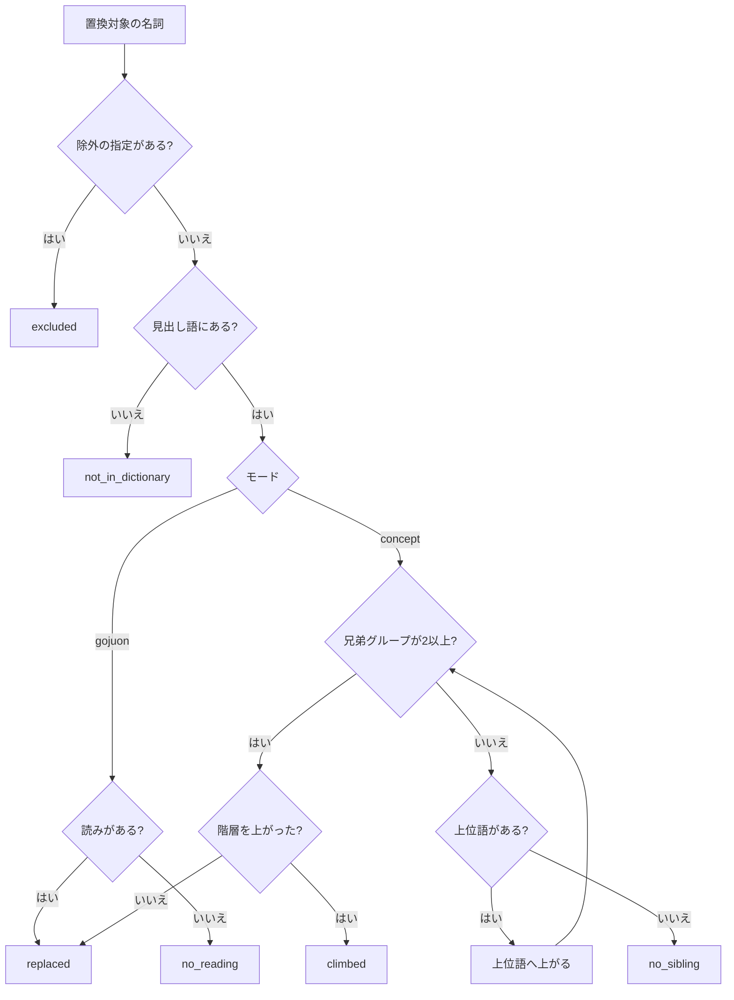
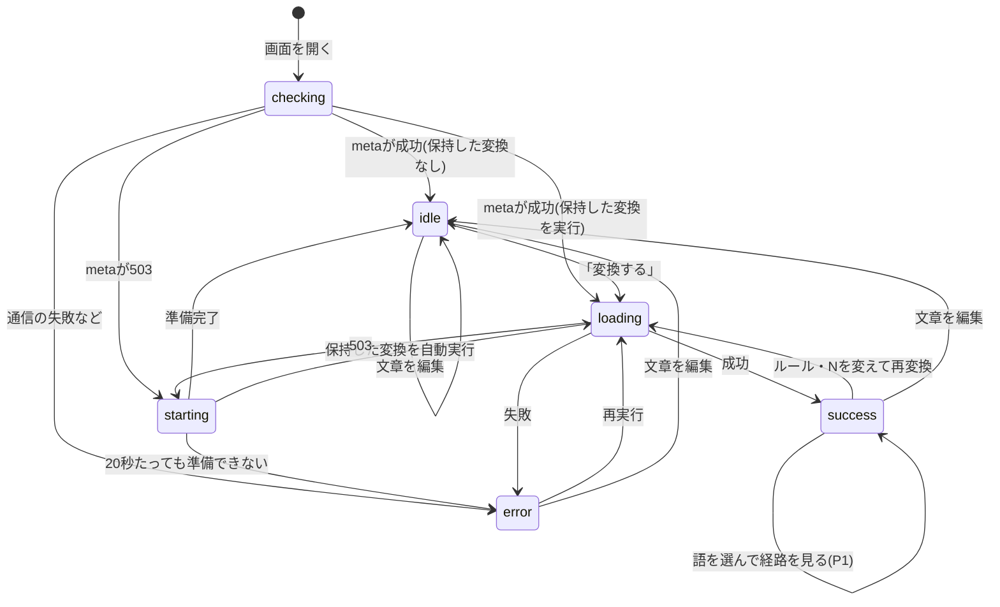

# プロジェクト用語集 (Glossary)

## 概要

S+7メーカーのドキュメントとコードで使う用語を定義する。
コード上の名前は、各用語の「英語表記・コード上の名前」に合わせる(開発ガイドライン「用語は用語集に合わせる」)。

各用語の項目は次の名前にそろえる: **定義**、**説明**、**関連用語**、**使用例**、**英語表記・コード上の名前**(英語での呼び方と、コード・APIで使う名前)、**データモデル**(型の項目)、**実装箇所**(ファイルのパス)。

**更新日**: 2026-10-25

## 索引

| 区分 | 用語 |
|------|------|
| S+7法 | [ウリポ](#ウリポ) / [S+7とS+N](#s7とsn) / [N](#n) / [五十音順S+N](#五十音順sn) / [概念版S+N](#概念版sn) / [モード](#モード) |
| 文章と名詞 | [置換対象の名詞](#置換対象の名詞) / [形式名詞](#形式名詞) / [複合名詞と最長一致](#複合名詞と最長一致) / [辞書に無い語](#辞書に無い語) / [置換先から除外する語](#置換先から除外する語) / [区切り](#区切り) / [名詞の通し番号](#名詞の通し番号) / [文字数](#文字数) |
| 辞書 | [日本語WordNet](#日本語wordnet) / [見出し語](#見出し語) / [読み](#読み) / [五十音順リスト](#五十音順リスト) / [概念](#概念) / [上位語](#上位語) / [兄弟概念と兄弟グループ](#兄弟概念と兄弟グループ) / [代表語](#代表語) / [語義](#語義) / [定義文](#定義文) |
| 置換の過程 | [循環](#循環) / [階層を上がる](#階層を上がる) / [置換経路](#置換経路) / [除外](#除外) / [語義の選び直し](#語義の選び直し) / [決定性](#決定性) |
| 辞書の作成 | [変換用辞書](#変換用辞書) / [辞書ビルダー](#辞書ビルダー) / [辞書のバージョン](#辞書のバージョン) / [ビルドの報告と品質の報告](#ビルドの報告と品質の報告) / [標準の文章](#標準の文章) |
| 運用 | [利用制限](#利用制限) / [匿名のアクセス解析](#匿名のアクセス解析) / [ページ表示IDと変換ID](#ページ表示idと変換id) / [置換率](#置換率) / [構造化ログ](#構造化ログ) / [このアプリについて](#このアプリについて) |
| 変換結果 | [変換結果のメタ情報](#変換結果のメタ情報) / [名詞の状態(NounStatus)](#名詞の状態nounstatus) / [変換画面の状態(TransformState)](#変換画面の状態transformstate) |
| エラー | [エラーコードの一覧](#エラー例外) / [ミドルウェアの処理順](#ミドルウェアの処理順) |
| 計算 | [照合規則とsort_key](#照合規則とsort_key) / [N個先の計算](#n個先の計算) / [語義のスコア](#語義のスコア) |
| アーキテクチャ | [レイヤー](#レイヤー) / [Shifter](#shifter) / [Tokenizer](#tokenizer) / [ミドルウェアの処理順](#ミドルウェアの処理順) |
| 技術・略語 | [技術用語](#技術用語)(Sudachi、分割モード、環境変数など) / [略語・頭字語](#略語頭字語) |

## ドメイン用語: S+7法

### ウリポ

**定義**: 1960年にフランスで結成された文学グループ「潜在的文学工房(Ouvroir de littérature potentielle)」。制約を課して文章を作る手法を探求した。

**説明**: S+7はウリポのジャン・レスキュールが考案した手法の1つ。本プロダクトは、その日本語版を作る。リポジトリ名 `oulipo-s-7` の由来。

**英語表記・コード上の名前**: Oulipo

### S+7とS+N

**定義**: 文章中の名詞(Substantif)を、辞書で7つ後ろ(N個後ろ)の名詞に置き換える手法。

**説明**:
- **S+7**: 原典の名前。プロダクト名(S+7メーカー)、PRDの機能名(F2「五十音順S+7」、F3「概念版S+7」)で使う
- **S+N**: 7以外のNも扱う一般形。機能設計書以降のドキュメントとコードでは、Nを変えられる(F5)ことを踏まえてS+Nと書く
- 「五十音順S+7」と「五十音順S+N(N=7)」は同じもの

**関連用語**: [N](#n)、[五十音順S+N](#五十音順sn)、[概念版S+N](#概念版sn)

**英語表記・コード上の名前**: S+7 / S+N

### N

**定義**: 何個先に進めるかを表す1〜99の整数。初期値は7。

**説明**: APIのパラメータ `n`。省略時は7(`DEFAULT_N`)。F5で画面から変えられる。

**使用例**:
- `{ "mode": "gojuon", "n": 3 }` → 五十音順で3つ後ろの見出し語に置き換える

**コード上の名前**: `n`、定数 `DEFAULT_N = 7`

### 五十音順S+N

**定義**: 名詞を、[五十音順リスト](#五十音順リスト)でN個後ろの[見出し語](#見出し語)に置き換えるルール(PRDのF2)。原典に忠実な方式。

**説明**: 綴り(読み)の近さによる偶然の置換を楽しむ。末尾を超えると先頭に[循環](#循環)する。

**関連用語**: [照合規則とsort_key](#照合規則とsort_key)、[N個先の計算](#n個先の計算)

**使用例**: 「猫」の読み「ねこ」から、五十音順リストを7つ進んだ見出し語に置き換える

**コード上の名前**: モード `gojuon`、`GojuonShifter`、`GojuonRoute`

### 概念版S+N

**定義**: 名詞の[概念](#概念)と同じ[上位語](#上位語)を持つ[兄弟概念](#兄弟概念と兄弟グループ)の中で、N個先の概念の[代表語](#代表語)に置き換えるルール(PRDのF3)。本プロダクト独自の派生ルール。

**説明**:
- 「意味のつながり」を保ったままずらす。例えば動物の名前は、別の動物の名前に変わりやすい
- PRDの設計判断で「兄弟概念方式」に決定した。他の辿り方(概念ツリー全体を並べる方式、リンクを7回辿る方式)は将来の派生ルール(P2)
- 兄弟が自分だけの場合は[階層を上がる](#階層を上がる)

**関連用語**: [語義](#語義)、[置換経路](#置換経路)

**コード上の名前**: モード `concept`、`ConceptShifter`、`ConceptRoute`

### モード

**定義**: 置換のルールの選択肢。`gojuon`(五十音順S+N)か `concept`(概念版S+N)。

**説明**: 画面では「ルール」と表示する。新しい派生ルールは、モードの値を増やして追加し、既存のモードの結果は変えない。Sudachiの区切り方の「分割モード(A・C)」とは別のもの。単に「モード」と書いたらこちらを指す。

**コード上の名前**: `Mode = 'gojuon' | 'concept'`

## ドメイン用語: 文章と名詞

### 置換対象の名詞

**定義**: 置き換えの対象になる語。次のどちらか。
- Sudachiの品詞が「名詞,普通名詞」の1形態素で、[形式名詞](#形式名詞)の除外リストに無いもの
- [最長一致](#複合名詞と最長一致)で辞書に見つかった、2形態素以上の連結

**説明**:

| 品詞 | 1形態素で置換対象か | 複合語の一部になれるか |
|------|--------------------|----------------------|
| 名詞,普通名詞(一般、サ変可能、形状詞可能、副詞可能、助数詞可能) | 対象 | なれる |
| 名詞,固有名詞 | 対象外 | なれる |
| 名詞,数詞 | 対象外 | なれる |
| 接頭辞、接尾辞(名詞的) | 対象外 | なれる |
| 代名詞 | 対象外 | なれない |
| それ以外(助詞、動詞、記号など) | 対象外 | なれない |

ドキュメントで単に「名詞」と書いた場合も、文脈が変換処理ならこの意味。

**関連用語**: [複合名詞と最長一致](#複合名詞と最長一致)

**実装箇所**: `server/src/s7/services/noun_extractor.py`

**コード上の名前**: `Noun`、`NounSegment`

### 形式名詞

**定義**: 実質的な意味が薄く、文法的なはたらきで使われる名詞。置換対象から外す。

**説明**: Sudachiの品詞では区別できないため、リストで持つ。**正は `server/src/s7/services/formal_nouns.py` で、下の一覧はその写し。変えるときは[辞書のバージョン](#辞書のバージョン)を上げる**(機能設計書、開発ガイドライン)。
- 1形態素の普通名詞の**表記がリストと完全に一致するとき**だけ除外する。読みや正規化表記では照合しない
- リストはひらがなだけ。漢字の表記(「事」「物」など)は実質的な意味で使われることが多いため置換対象にする

**除外リスト**(18語):

```
こと、もの、ところ、わけ、はず、ため、よう、とき、うち、ほう、まま、つもり、ほか、たび、ぶん、くせ、ころ、さ
```

**使用例**: 「書くことが好きだ」の「こと」は置き換えない

**英語表記・コード上の名前**: formal noun、`FORMAL_NOUNS`

### 複合名詞と最長一致

**定義**: 名詞・接頭辞・接尾辞(名詞的)が連続する箇所(候補区間)を、辞書にある最も長い連結として1語にまとめる処理。

**説明**:
- Sudachiの最も細かい単位(分割モードA)で区切ってから、左から順に長い連結を試す
- 1回に試すのは、先頭から最大8形態素まで(`MAX_MERGE_MORPHEMES`)。区間を8個ずつに切ることはしない
- 2形態素以上の連結は、辞書にあり、普通名詞か名詞的接尾辞を1つ以上含むときだけ1語にする
- 1形態素の名詞は辞書に無くても名詞として扱う

**使用例**:
- 「図書館司書」(図書 / 館 / 司書)→ 辞書にあれば1語。無ければ「図書館」「司書」の2語
- 「科学者」(科学 / 者)、「三角形」(三 / 角形)→ 辞書にあれば1語

**実装箇所**: `merge_longest`(`noun_extractor.py`)

### 辞書に無い語

**定義**: 置換対象の名詞だが、[見出し語](#見出し語)に見つからないため置き換えなかった語。

**説明**: エラーにせず、元の語のまま残す。画面では点線の下線で表示する。見出し語の探し方は、表記そのもの → 表記のNFKC正規化 → Sudachiの正規化表記(1形態素のみ)の順。[置換先から除外する語](#置換先から除外する語)は見出し語に含めないため、入力文にあれば辞書に無い語として扱う。

見出し語にはあるが[読み](#読み)が決まらない語は、辞書に無い語ではない。五十音順S+Nでは置き換えず(`no_reading`)、概念版S+Nでは置き換える。

**コード上の名前**: 状態 `not_in_dictionary`

### 置換先から除外する語

**定義**: 差別語・卑語・性的な語など、一般公開のサービスの出力にふさわしくないため、置換後の語として使わない語(PRDのF2・F3)。

**説明**:
- リストは `data/excluded-lemmas.txt`(1行1語)で管理し、[辞書ビルダー](#辞書ビルダー)がビルド時に[見出し語](#見出し語)から取り除く。実行時に結果を書き換えないため、[決定性](#決定性)は保たれる
- 取り除いた結果、日本語の見出し語が残らない概念は[代表語](#代表語)を持たず、[兄弟グループ](#兄弟概念と兄弟グループ)にも入らない
- リストを変えたら[辞書のバージョン](#辞書のバージョン)を上げる
- [形式名詞](#形式名詞)の除外リスト(入力側で置換対象から外す)とは別のもの。こちらは出力側で置換先から外す

**コード上の名前**: `LemmaFilter`(`s7builder/lemma_filter.py`)

### 区切り

**定義**: 変換結果で、元の文章を「名詞」と「それ以外の文字列」に分けたもの。順に連結すると元の文章に戻る。

**説明**:
- 「文章中の位置」(PRDのF9)を、文字の位置(オフセット)ではなく区切りの並びで表す。PythonとJavaScriptで文字の数え方が違い、オフセットはずれるため
- 画面は区切りだけで、元の文章と変換後の文章の両方を描画できる

**コード上の名前**: `Segment`(`TextSegment` | `NounSegment`)、APIの `segments`

### 名詞の通し番号

**定義**: 文章中の[置換対象の名詞](#置換対象の名詞)に、先頭から0始まりで振る番号。

**説明**: 辞書に無い語や除外した語も含め、すべての名詞に振る。同じ入力文・同じ[辞書のバージョン](#辞書のバージョン)なら変わらない。[除外](#除外)と[語義の選び直し](#語義の選び直し)で、どの名詞を指すかの識別に使う。

**コード上の名前**: `nounIndex`(API)、`noun_index`(Python)

### 文字数

**定義**: 入力文の長さ。**Unicodeのコードポイント数**で数える。上限は50,000文字。

**説明**: Pythonの `len()` と同じ数え方。画面では `[...text].length`(`countChars()`)で数え、`text.length`(UTF-16の単位数)は使わない。絵文字を1文字と数えるため。

**関連用語**: [利用制限](#利用制限)

**コード上の名前**: `countChars`、`MAX_CHARS = 50_000`

## ドメイン用語: 辞書

### 日本語WordNet

**定義**: 情報通信研究機構(NICT)が公開している日本語の語彙データベース。英語のWordNetと共通の[概念](#概念)IDで、語を概念ごとにまとめ、概念同士を上位語・下位語などで結ぶ。

**説明**: バージョン1.1の `wnjpn.db`(SQLite、約200MB)を元データとして使う。リポジトリには入れず、ビルド時にダウンロードしてSHA-256で中身を確かめる。ライセンス文は `licenses/wordnet-ja.txt`。

**本プロジェクトでの使用**: [辞書ビルダー](#辞書ビルダー)の入力。日本語の名詞の見出し語 65,788語、日本語の見出し語を持つ名詞の概念 42,697件(architecture.mdの検証結果)

**英語表記**: Japanese WordNet(コード上は `wnjpn`)

### 見出し語

**定義**: 辞書に載っている語の表記。日本語WordNetの名詞の見出し語(置換先から除外する語を除く)。

**説明**:
- 同じ表記の語は、語義が複数あっても1つの見出し語にまとめる
- [読み](#読み)が決まった見出し語は、[五十音順リスト](#五十音順リスト)の1行になる
- 読みが決まらない見出し語(約2.5%)も見出し語に含め、[概念版S+N](#概念版sn)で使う。`reading`・`sort_key` はNone
- `id` は「読みのある語を照合規則の順 → 読みの無い語を表記のコードポイント順」に並べた位置
- 一般用語の「単語」「語」と区別したいときに使う

**関連用語**: [語義](#語義)、[代表語](#代表語)

**データモデル**: `Lemma`(`id`、`surface`、`reading`、`sort_key`)。APIでは `NounSegment.lemma`(引き当てた見出し語の表記)

**英語表記・コード上の名前**: lemma、`Lemma`

### 読み

**定義**: [見出し語](#見出し語)の読み方をひらがなで表したもの。五十音順の並び替えに使う。

**説明**:
- 日本語WordNetには読みが無い(`word.pron` が空)ため、辞書ビルダーが付ける。手順は機能設計書「5. 見出し語の読みの決定」だけで定める
  1. 表記がかな(ひらがな・カタカナ・長音符・中黒)だけなら、中黒を除いてひらがなにしたものを読みにする
  2. それ以外は、Sudachiの分割モードCで解析した読み(カタカナ)をつなげ、中黒を除いてひらがなにする。未知語を含む、またはSudachiが記号・空白に付ける仮の読み「キゴウ」を含めば、読みは決まらない
  3. ひらがな・`ゔ`・`ー` 以外が混ざる、または空なら、読みは決まらない
- 読みが決まらない見出し語は五十音順リストに入らない。五十音順S+Nでは状態 `no_reading` として置き換えず、概念版S+Nでは置き換えに使う
- 機械的に付けた読みのため誤りがありうる(例: 「生物」を「なまもの」と読む。PRDのリスク1)

**使用例**: 「図書館」→「としょかん」

**コード上の名前**: `reading`、`ReadingAssigner`

### 五十音順リスト

**定義**: [読み](#読み)のある[見出し語](#見出し語)を[照合規則](#照合規則とsort_key)の順に並べたリスト。[五十音順S+N](#五十音順sn)で使う。

**説明**: 見出し語の `id` が `0` 〜 `gojuon_lemma_count - 1` の範囲がこのリストで、`id` がそのままリスト上の位置(0始まり)になる。並び順はビルド時に決め、実行時は位置だけを使う。

**コード上の名前**: `Lemma.id`、`gojuon_lemma_count`、`lemma(lemma_id)`

### 概念

**定義**: 同じ意味を表す語の集まり。日本語WordNetの「synset(同義語集合)」。

**説明**:
- 名詞の概念(IDの末尾が `-n`)だけを使う
- IDは英語WordNetと共通(例: `02084071-n`)
- 日本語の見出し語を持たない概念も、[階層を上がる](#階層を上がる)途中で通るため保持する

**データモデル**: `Synset`(`id`、`parent_id`、`parent_relation`、`sibling_group_id`、`sibling_index`、`representative_lemma_id`、`definition_ja`、`definition_en`)

**英語表記・コード上の名前**: synset、`Synset`。APIの `NounSegment.synsetId` は「元の名詞に選ばれた語義の概念ID」で、置換先の概念ではない(置換先は `route.to`)

### 上位語

**定義**: ある概念を含む、より広い概念。「猫」に対する「ネコ科の動物」など。

**説明**:
- 日本語WordNetの関係のうち、上位語(`hype`)とインスタンスの上位語(`inst`)を使う
- 上位語が複数ある概念(2,213件)は、**概念IDが最小のもの**を1つ選ぶ。選んだものが `parent_id`。どちらの関係だったかを `parent_relation` に残す
- 最上位の概念は `parent_id` が無い

**関連用語**: [兄弟概念と兄弟グループ](#兄弟概念と兄弟グループ)

**コード上の名前**: `parent_id`、`parent_relation`(`hypernym` / `instance_hypernym`)。APIでは `ConceptStep.relation`

### 兄弟概念と兄弟グループ

**定義**:
- **兄弟概念**: 同じ[上位語](#上位語)(`parent_id`)を持つ概念同士
- **兄弟グループ**: 同じ上位語を持つ兄弟概念を、決まった順に並べたもの

**説明**:
- メンバーは[代表語](#代表語)を持つ概念だけ
- 並び順は、代表語の `Lemma.id` → 概念ID。読みのある代表語の五十音順が先で、読みの無い代表語は後ろに表記の順で並ぶ
- 大きさの分布(architecture.mdの検証結果): 自分だけ12%、2〜7個42%、8〜20個24%、21個以上22%

**使用例**: 「猫」の兄弟グループ内で、N個先の概念に進む

**データモデル**: `SiblingGroup`(`id`、`parent_id`、`member_ids`)

**英語表記・コード上の名前**: sibling、sibling group、`SiblingGroup`、`sibling_index`

### 代表語

**定義**: [概念](#概念)を代表する1つの見出し語。その概念の日本語の見出し語のうち、`Lemma.id` が最小のもの(読みのある語の中で五十音順の先頭。読みのある語が無ければ、読みの無い語の中で表記のコードポイント順の先頭)。

**説明**: [概念版S+N](#概念版sn)の置換後の語は、置換先の概念の代表語。日本語の見出し語を持たない概念には代表語が無い。1つの見出し語が複数の概念の代表語になることがある。

**コード上の名前**: `representative_lemma_id`、`ConceptRef.lemma`

### 語義

**定義**: 1つの[見出し語](#見出し語)が持つ意味の1つ。見出し語と[概念](#概念)の組。

**説明**: 「語義が複数ある」とは、同じ表記の語が複数の概念に属すること。[概念版S+N](#概念版sn)では、[語義のスコア](#語義のスコア)で1つを選ぶ(順位0の語義を既定で使う)。

**関連用語**: [語義の選び直し](#語義の選び直し)

**データモデル**: `Sense`(`lemma_id`、`synset_id`、`score`、`rank`)

**英語表記・コード上の名前**: sense、`Sense`、`SenseSelector`

### 定義文

**定義**: 日本語WordNetに収録されている、概念の意味の説明文。

**説明**: [置換経路](#置換経路)と[語義の選び直し](#語義の選び直し)で表示する。日本語の見出し語を持つ名詞の概念はすべて日本語の定義文を持つ。無い場合は英語の定義文を使う。

**コード上の名前**: `definition_ja`、`definition_en`、`ConceptRef.definition`

## ドメイン用語: 置換の過程

### 循環

**定義**: N個先に進むときに、リストの末尾を超えて先頭に戻ること。

**説明**: [五十音順リスト](#五十音順リスト)と[兄弟グループ](#兄弟概念と兄弟グループ)の両方で起きる。`N % 大きさ == 0` のときは元の位置に戻る(この場合も置き換えたものとして扱う)。

**コード上の名前**: `wrapped`

### 階層を上がる

**定義**: [概念版S+N](#概念版sn)で、兄弟グループの大きさが2未満のとき、[上位語](#上位語)に移って同じ処理を繰り返すこと。

**説明**:
- 上がった先の概念が代表語を持たない(兄弟グループに入っていない)場合は、さらに上がる
- 最上位まで上がっても兄弟が無ければ置き換えない
- 画面では「↑」の印で、階層を上がったことを示す

**コード上の名前**: 状態 `climbed`、`ConceptRoute.climbs`

### 置換経路

**定義**: ある名詞がどう辿って置き換わったかの記録(PRDのF6)。

**説明**:

| モード | 内容 |
|--------|------|
| 五十音順 | 元の位置・置換後の位置、循環したか、間にある見出し語(6語を超えたら最初と最後の3語ずつ。省いた数は `neighborsOmitted`) |
| 概念版 | 上がった階層、共通の上位語、元の概念・置換後の概念(定義文付き)、兄弟グループの大きさ、循環したか |

**コード上の名前**: `Route`(`GojuonRoute` | `ConceptRoute`)、`RoutePanel`

### 除外

**定義**: ユーザーが特定の名詞を「置換しない」と指定すること(PRDのF7)。

**説明**: [名詞の通し番号](#名詞の通し番号)で指定する(最大1,000個)。同じ入力文の間は、ルールやNを変えても保持する。今の文章に無い通し番号は無視し、`meta.ignoredExclusions` で返す。

**コード上の名前**: APIの `exclusions`、状態 `excluded`

### 語義の選び直し

**定義**: 自動で選ばれた[語義](#語義)を、ユーザーが別の語義に変えること(PRDのF8)。

**説明**: [名詞の通し番号](#名詞の通し番号)ごとに使う概念IDを指定する(最大1,000個)。語義の一覧は `GET /api/v1/senses?lemma=...` で、`NounSegment.lemma` を使って取る。その名詞の語義でない概念や今の文章に無い通し番号は、エラーにせず無視し、`meta.ignoredSenseOverrides` で返す。

**コード上の名前**: APIの `senseOverrides`、`SensePicker`

### 決定性

**定義**: 同じ入力・同じ設定・同じ[辞書のバージョン](#辞書のバージョン)なら、常に同じ結果を返す性質(PRDの信頼性要件)。

**説明**: 並び順をすべて明示的なキーで決め、乱数・時刻・ロケールに依存しないことで守る(開発ガイドライン「決定性を壊さない」)。統合テストとスナップショットテストで確かめる。

**英語表記**: determinism

### 変換結果のメタ情報

**定義**: 変換のレスポンスの `meta` に入る、変換全体についての情報。

**説明**:

| 項目 | 意味 |
|------|------|
| `mode`、`n` | 使ったモードとN |
| `nounCount` | [置換対象の名詞](#置換対象の名詞)の数(除外した語・辞書に無い語を含む) |
| `excludedCount` | 状態が `excluded` の名詞の数 |
| `replacedCount` | 状態が `replaced` か `climbed` の名詞の数 |
| `ignoredExclusions` | 使わなかった `exclusions` の値(今の文章に無い通し番号など)。無ければ空の配列 |
| `ignoredSenseOverrides` | 使わなかった `senseOverrides` の通し番号(その名詞の語義でない概念など)。無ければ空の配列。五十音順S+Nでは語義を使わないため、指定は使われずにここへ入る |
| `dictionaryVersion` | 使った[辞書のバージョン](#辞書のバージョン) |
| `attribution` | 辞書データの出典とライセンスの表示(PRDのF9)。画面は「このアプリについて」の `#credits` にも同じ内容を出す |

[置換率](#置換率)は `replacedCount ÷ (nounCount − excludedCount)` で求める。

**英語表記・コード上の名前**: `TransformMeta`(API)、`TransformResultMeta`(Python。`attribution` を除く)

## ドメイン用語: 辞書の作成

### 変換用辞書

**定義**: [辞書ビルダー](#辞書ビルダー)が日本語WordNetとSudachiから作る、変換専用の読み取り専用データ。

**説明**:
- 五十音順リスト、兄弟グループ、語義の順位など、計算をすべて済ませた状態で保存する
- アプリの配布物(候補のCloud Runならコンテナイメージ)に同梱し、サーバーが起動時にメモリへ展開する。実行時にSQLiteは引かない
- ドキュメントで単に「辞書」と書いた場合は、文脈により、変換用辞書・日本語WordNet・SudachiDictのいずれか。区別が必要なときは正式な名前で書く

**実装箇所**: `s7dict.sqlite`(`data/build/` に出力。Git管理外)

**コード上の名前**: `DictionaryRepository`、`dictionary_schema.py`

### 辞書ビルダー

**定義**: 変換用辞書を作るプログラム。実行時のサーバーとは別で、コンテナの実行用イメージには入れない。

**説明**: WordNetReader → LemmaFilter → ReadingAssigner → GojuonCollation → SiblingIndexer → SenseRanker の順に処理する。

**実装箇所**: `server/src/s7builder/`

**使用例**: `scripts/build-dictionary.sh`

**コード上の名前**: `DictionaryBuilder`、`s7builder`

### 辞書のバージョン

**定義**: 変換用辞書の版。`YYYY.MM.patch` 形式(例: `2026.10.0`)。

**説明**: 照合規則、形式名詞の除外リスト、[置換先から除外する語のリスト](#置換先から除外する語)、元データ(日本語WordNet、SudachiPy・SudachiDict)のいずれかを変えたら上げる。上げると同じ入力でも結果が変わりうる。手順は開発ガイドライン「変換用辞書を変えるときの手順」。
- 同じ月の中ではpatchを上げ、月が変わったら新しい月の `0` にする
- 上げたら、更新履歴 `data/dictionary-history.md` に日付と変更の概要を書く。[このアプリについて](#このアプリについて)の `#dictionary-history` に表示する

**コード上の名前**: `DICTIONARY_VERSION`(`s7builder/version.py`)、APIの `dictionaryVersion`

### ビルドの報告と品質の報告

**定義**: 変換用辞書を作ったときに出力する2つの記録。
- **ビルドの報告**: 辞書ビルダーが辞書を作るときに出す。件数、置換先から除外した語の数、読みの決め方ごとの数、読みが決まらなかった数(`BuildReport`。`s7builder build`)
- **品質の報告**: できた辞書で[標準の文章](#標準の文章)3本を両モードで変換した[置換率](#置換率)(`QualityReporter`。`s7builder quality`)。変換処理(`s7.services`)を使うため、辞書を作る処理とは別のコマンドで作る。基準値は別のファイルに置く

**説明**: リポジトリに保存し、辞書を変えたときの影響を差分で確かめる。報告にはビルドした時刻などの毎回変わる値を入れず、CI(`scripts/check-reports.sh`)で作り直したものとコミット済みのものが一致することを確かめる。コンテナのビルドでは品質の報告は作らない。

**実装箇所**: `data/reports/build-report.json`、`data/reports/quality-report.json`、`data/reports/quality-baseline.json`

### 標準の文章

**定義**: 辞書の品質と性能を測るために決めておく、著作権の切れた作品の一節3本。

**説明**:
- 3つの用途で同じ文章を使う: 品質の報告の[置換率](#置換率)、スナップショットテスト(変換結果の差分の確認)、性能テスト
- 各ファイルの先頭に出典を書く
- 差し替えるときは、スナップショット、品質の報告、基準値(`quality-baseline.json`)をまとめて取り直す。辞書のバージョンは上げない(開発ガイドライン「変換用辞書を変えるときの手順」)

**関連用語**: [ビルドの報告と品質の報告](#ビルドの報告と品質の報告)、[置換率](#置換率)

**実装箇所**: `data/standard-texts/[テキスト名].txt`(Git管理)。スナップショットの期待値は `server/tests/snapshot/expected/`

## 運用用語

### 利用制限

**定義**: 接続元IPアドレスごとに、直近1分間のAPI呼び出しの「回数」と「文字数」に上限を設ける仕組み。

**説明**:

| 制限 | 値 | 対象 |
|------|-----|------|
| 回数(変換など) | 30回/分 | `/api/v1/transform`、`/api/v1/senses` |
| 回数(画面の補助) | 120回/分 | `/api/v1/meta`、`/api/v1/events` |
| 文字数 | 200,000文字/分 | `/api/v1/transform` の `text` の合計 |

- 超えると429と `Retry-After` を返す。判定の細かい規則は機能設計書「RateLimiter」
- **回数**は入力検証の前、**文字数**は入力検証の後に判定する([ミドルウェアの処理順](#ミドルウェアの処理順))。回数で429にしたリクエストは回数に数えない。文字数で429にしたリクエストは、回数の枠ではすでに1回として数えている
- 413(本文が大きすぎる)と準備中の503は、回数に数えない
- 各コンテナのメモリで数える(直近60秒のスライディングウィンドウ)。IPv6は/64ごとに数える。最大台数を3台にして実効値を抑える
- 接続元IPアドレスは直近1分間の分だけメモリに持ち、ログには出さない
- **接続元の取り方**: 既定では直接の接続元。前段にプロキシがある場合は、`S7_TRUSTED_PROXY_HOPS`(信頼するプロキシの段数)に従って `X-Forwarded-For` の末尾から数えて取る。取れなければ直接の接続元を使い、`WARNING` のログを出す(architecture.md「利用制限」)

**コード上の名前**: `RateLimiter`。回数は `api/middleware/rate_limiter.py`(ミドルウェア)、文字数は `api/dependencies.py` の依存関数 `transform_char_limit`。エラーコード `RATE_LIMITED`

### 匿名のアクセス解析

**定義**: 個人を特定せず、入力文の中身を含めずに、利用状況を数える仕組み。

**説明**:
- 画面が `POST /api/v1/events` に `page_view`、`transform`、`copy` のイベントだけを送る。サーバーはそれを構造化ログとして出力し、ホスティング先のログ基盤で集計する(集計の仕組みはホスティング先の決定時に決める。候補: Cloud Logging)。項目と集計方法は機能設計書「アクセス解析(匿名)」
- Web画面以外からのAPI呼び出しは、`X-S7-Client: web` ヘッダーが無く、成功した(`status = 200`)変換APIの呼び出しとして数える。集計の期間などは機能設計書「KPIの集計方法」
- イベントもヘッダーも偽装できるため、集計値はKPIの目安として扱う

**関連用語**: [ページ表示IDと変換ID](#ページ表示idと変換id)、[構造化ログ](#構造化ログ)

**コード上の名前**: `trackEvent`、`events.py`

### ページ表示IDと変換ID

**定義**:
- **ページ表示ID**(`pageViewId`): ページを開くたびに画面のメモリ上で作るランダム値(16桁の16進数)
- **変換ID**(`transformSeq`): ページ表示の中で変換ごとに1から振る番号

**説明**: ページ表示IDはCookieなどに保存しないので、別の訪問とは結び付かない。KPIの「訪問」と「1ページ表示あたりの変換回数」の単位になる。変換IDは、`copy` のイベントをどの変換の結果かに結び付ける。

**英語表記・コード上の名前**: `pageViewId`、`transformSeq`

### 置換率

**定義**: 成功した変換で、置き換えた名詞の数を置換対象の名詞の数で割った割合。

**計算方法**:
```
置換率 = (状態が replaced か climbed の名詞の数) ÷ (置換対象の名詞の数 − 除外を指定した名詞の数)
```

**説明**:
- 画面からの変換(`transform` イベントの `replacedCount` の合計 ÷ (`nounCount` − `excludedCount`)の合計)と、標準の文章3本(辞書の品質の基準)の2通りで測る
- `nounCount` は名詞の数(除外・辞書に無い語を含む)、`excludedCount` は除外を指定した名詞の数
- 標準の文章での置換率は品質の報告(`quality-report.json`)に記録し、最初の値を基準(`quality-baseline.json`)とする。5ポイント以上下げる変更は、理由を説明してから行う

**英語表記・コード上の名前**: replacement rate、`replacedCount`、`nounCount`、`excludedCount`

### 構造化ログ

**定義**: サーバーが標準出力に1行1つのJSONで出すログ。KPIの集計はこのログだけを入力にする。

**説明**:
- 共通の項目は `time`、`severity`、`kind`、`message`
- `kind` は3種類: `request`(`/api/v1/*` の呼び出しごとに1行。`method`、`path`(クエリ文字列を除く)、`status`、`durationMs`、`client`、`mode`、`n`、`chars`、`errorCode`)、`analytics`(画面のイベント)、`app`(起動、500のエラーなど)
- IPアドレス、User-Agent、本文、見出し語は、どの行にも出さない
- 形式は `S7_LOG_FORMAT`(`json` / `text`)、出す重要度は `S7_LOG_LEVEL` で切り替える
- ログを出してよい場所は決まっている(開発ガイドライン「入力文を残さない」)

**実装箇所**: `server/src/s7/logging_config.py`、`server/src/s7/api/middleware/request_logging.py`

### このアプリについて

**定義**: 使い方、注意事項、不適切な語の報告方法、クレジット、辞書の更新履歴、APIの利用条件、プライバシーをまとめたページ(`/about`)。

**説明**: ライセンス文(`licenses/`)と辞書の更新履歴(`data/dictionary-history.md`)は、画面のビルド時に読み込んで表示する。更新履歴は見出しと箇条書きだけの決まった書式で書く。構成は機能設計書「『このアプリについて』の構成」。

**実装箇所**: `web/src/pages/AboutPage.tsx`、`web/src/about/`

## ステータス・状態

### 名詞の状態(NounStatus)

**定義**: 変換結果の各名詞が、どう扱われたかを示す値。

| 状態 | 意味 | 決まる条件 | 画面の表示 |
|------|------|-----------|-----------|
| `replaced` | 置き換えた | 見出し語にあり、N個先の語が決まった(循環して元に戻った場合も含む) | 背景色 + 実線の下線 |
| `climbed` | 階層を上がってから置き換えた | 概念版で、兄弟グループが2未満のため上位語に移った | 背景色 + 実線の下線 + 「↑」 |
| `not_in_dictionary` | 辞書に無いので置き換えなかった | 表記・NFKC・正規化表記のどれでも見出し語に無い | 点線の下線 |
| `no_reading` | 読みが分からないので置き換えなかった | 五十音順で、見出し語に読みが無い(概念版では置き換えられる) | 点線の下線 + 「?」 |
| `no_sibling` | 兄弟が無いので置き換えなかった | 概念版で、最上位まで上がっても兄弟が無い | 点線の下線 + 「・」 |
| `excluded` | ユーザーが除外した(P1) | `exclusions` に通し番号がある | 取り消し線つきの元の語 |

**判定の流れ**:



**実装箇所**: `NounStatus`(`server/src/s7/domain/transform.py`、APIの型 `NounStatus`)

### 変換画面の状態(TransformState)

機能設計書「画面遷移図」の状態と1対1に対応する。

| 状態 | 画面遷移図 | 意味 | 次の状態 |
|------|-----------|------|---------|
| `checking` | 確認中 | 画面を開いた直後に `GET /api/v1/meta` で確かめている。押された変換を1件保持できる | `idle`、`loading`(保持した変換を実行)、`starting`、`error` |
| `starting` | 準備中 | サーバーが準備中(503)。「準備中です」を表示し、自動で再試行する。押された変換を1件保持できる。20秒たっても準備できなければ `error`(数え始めは画面を開いた時点。変換が503になって戻った場合は、その最初の503の時点) | `idle`、`loading`、`error` |
| `idle` | 入力待ち | 入力待ち。文章を編集した後なら、古い結果を薄く表示している | `idle`(編集)、`loading` |
| `loading` | 変換中 | 変換中(1秒を超えたら「変換中…」を表示) | `success`、`starting`(503)、`error` |
| `success` | 結果表示 | 結果を表示している | `success`(語を選んで経路を見る)、`loading`(再変換)、`idle`(文章を編集) |
| `error` | 失敗 | エラーを表示している(入力は残す) | `loading`、`idle` |



**実装箇所**: `TransformState`(`web/src/hooks/useTransform.ts`)。準備中の確認は `web/src/hooks/useServerReadiness.ts`

## エラー・例外

APIのエラーレスポンスは `{ "error": { "code", "message", "details" } }` の形にそろえる。

「検出順」は[ミドルウェアの処理順](#ミドルウェアの処理順)の段階。1つのリクエストが複数の条件に当たるときは、検出順の小さいエラーが返る。

| コード | HTTP | 検出順 | 発生条件 | 発生箇所 | ユーザーの対処 |
|--------|------|--------|---------|---------|---------------|
| `TEXT_EMPTY` | 400 | 8 | `text` が空、または空白類(全角空白・改行を含む)だけ | 入力検証(`api/schemas/`) | 文章を入力する |
| `TEXT_TOO_LONG` | 400 | 8 | 50,000文字を超える | 入力検証 | 文章を短くする |
| `INVALID_MODE` | 400 | 8 | `mode` が `gojuon`/`concept` 以外 | 入力検証 | 正しい値を指定する |
| `INVALID_N` | 400 | 8 | `n` が1〜99のJSONの整数でない(`"7"`、`7.0` も不可) | 入力検証 | 1〜99を指定する |
| `INVALID_REQUEST` | 400 | 8 | JSONの形式が不正、必須項目が無い、型が違う、単独のサロゲートを含む、`exclusions`・`senseOverrides` の形式が不正か個数超過。語義の一覧で `lemma` が無い・空・100文字超。アクセス解析のイベントの項目の形式が違う | 入力検証 | リクエストを直す |
| `LEMMA_NOT_FOUND` | 404 | 10 | 語義の一覧で、見出し語が辞書に無い | `LemmaNotFoundError`(サービス) | - |
| `PAYLOAD_TOO_LARGE` | 413 | 5 | 本文が1MBを超える(50,000文字以内なら `\uXXXX` で書いても超えない) | `body_size_limit.py` | 文章を短くする |
| `RATE_LIMITED` | 429 | 7(回数)、9(文字数) | [利用制限](#利用制限)を超えた | `rate_limiter.py`(回数)、`dependencies.py`(文字数) | `Retry-After` 秒待つ |
| `SERVICE_STARTING` | 503 | 6 | 変換用辞書の読み込み中(`Retry-After: 1`)。`/api/v1/events` は起動中も受け付けるため返さない | `startup_gate.py` | 画面は自動で再試行する。API利用者は `Retry-After` に従って再試行する |
| `INTERNAL_ERROR` | 500 | 10 | 想定外のエラー | `error_handlers.py` | 時間をおいてやり直す |

**サービスの例外**:
- 基底クラスは `DomainError`(`server/src/s7/domain/errors.py`)。クラス変数 `code` にエラーコードを持ち、`error_handlers.py` がHTTPのステータスに対応付ける
- 例外のメッセージに本文や名詞の表記を入れない(識別子と数値だけ)

- 語義の指定が使えない場合(その名詞の語義でない、など)はエラーにせず、`meta.ignoredSenseOverrides` で返す(機能設計書「除外と語義の指定の検証」)

**画面のエラー**: `ApiError`(`web/src/api/ApiError.ts`)。上の `code` に加えて、通信の失敗を `NETWORK_ERROR` として表す(APIは返さない。アクセス解析の `errorCode` には送る)

## 計算・アルゴリズム

### 照合規則とsort_key

**定義**: [読み](#読み)を国語辞典の慣例に沿って並べるための規則と、それを1つの文字列にした並び替えのキー。

**計算方法**: 3段階のキーを、区切り文字U+0000でつなぐ(`第1キー + "\0" + 第2キー + "\0" + 第3キー`)。文字ごとの対応表は機能設計書「`compute_sort_key` の仕様」。

| 段階 | 比べ方 | 1文字あたりの値 |
|------|--------|----------------|
| 第1キー | 濁点・半濁点を外し、小書き文字を大きな文字にし、長音を直前の母音に置き換えて、五十音順で比べる | 清音の大きなひらがな、または `ー` |
| 第2キー | 先頭から1文字ずつ、清音 < 濁音 < 半濁音 | `0` / `1` / `2` |
| 第3キー | 先頭から1文字ずつ、直音 < 小書き文字 < 長音 | `0` / `1` / `2` |

- 「ゔ」は「う」の濁音。「ゐ」「ゑ」は「い」「え」、「ゎ」「ゕ」「ゖ」は「わ」「か」「け」の小書き文字として扱う
- 先頭や「ん」の後の「ー」は母音が無いため、第1キーに `ー`(U+30FC)のまま残す。どのひらがなより大きいので末尾扱いになる
- 読みまで同じ見出し語は、表記のコードポイント順

**例**:
```
はは < ばば < ぱぱ      (第2キー)
しよう < しょう          (第3キー)
ああ < あー              (第3キー)
がっこう → 第1キー「かつこう」
```

**実装箇所**: `server/src/s7/services/gojuon_collation.py`(辞書ビルダーと共有)

**コード上の名前**: `compute_sort_key`、`sort_key`

### N個先の計算

**計算式**:
```
置換後の位置 = (元の位置 + N) mod 大きさ
循環した     = 元の位置 + N ≥ 大きさ
```

大きさは、五十音順S+Nなら五十音順リストの語数(`gojuon_lemma_count`、読みのある見出し語の数)、概念版S+Nなら兄弟グループのメンバー数。両方で同じ関数 `shift_index` を使う。

**例**:
```
入力: 元の位置 5、N = 7、大きさ 10
出力: 置換後の位置 2、循環した = true
```

**実装箇所**: `shift_index`(`services/` の純粋な関数)

### 語義のスコア

**定義**: 見出し語の語義の中から既定の1つを選ぶための値。

**計算方法**:
```
スコア(概念) = その概念に属する英語の語義(lang = 'eng')の頻度(freq)の合計
             (頻度が無ければ0)
順位 = スコアの大きい順。同じなら概念IDの文字列の小さい順
```

順位0の語義を既定で使う。語義が複数ある日本語の名詞のうち82%で、少なくとも1つの語義に頻度がある(architecture.mdの検証結果)。

**実装箇所**: `SenseRanker`(`s7builder/sense_ranker.py`)、`SenseSelector`(`s7/services/sense_selector.py`)

## アーキテクチャ用語

### レイヤー

**定義**: サーバーのコードを役割で分けた層。上から下へだけ依存する。

```
api/(APIレイヤー)
  ↓
services/(サービスレイヤー)
  ↓
repositories/(データレイヤー)  adapters/(外部ライブラリの境界)
  ↓
domain/(エンティティ・例外)
```

**関連ドキュメント**: architecture.md「サーバーのレイヤードアーキテクチャ」、repository-structure.md「依存関係のルール」

### ミドルウェアの処理順

**定義**: APIのリクエストを処理する段階の順番(外側から内側へ)。正は機能設計書「ミドルウェアと処理の順番」。

| 段階 | 名前(コード) | すること | 返すエラー |
|------|--------------|----------|------------|
| 1 | CORS(`CORSMiddleware`) | すべての応答にCORSヘッダーを付ける。プリフライトに応答する | - |
| 2 | SecurityHeaders(`security_headers.py`) | CSPなどのヘッダーと `Cache-Control` を付ける | - |
| 3 | GZip(`GZipMiddleware`) | 1KB以上の応答を圧縮する | - |
| 4 | RequestLogging(`request_logging.py`) | `/api/v1/*` の呼び出しごとに[構造化ログ](#構造化ログ)を1行出す | - |
| 5 | BodySizeLimit(`body_size_limit.py`) | 本文が1MBを超えたら断る | `PAYLOAD_TOO_LARGE` |
| 6 | StartupGate(`startup_gate.py`) | 辞書の読み込み中は断る(`/api/v1/events`、`/healthz` を除く) | `SERVICE_STARTING` |
| 7 | RateLimiter・回数(`rate_limiter.py`) | 回数の枠を超えたら断る | `RATE_LIMITED` |
| 8 | 入力検証(Pydantic) | 型と値を確かめる | `TEXT_EMPTY` など400のエラー |
| 9 | RateLimiter・文字数(`dependencies.py`) | `text` の文字数の枠を超えたら断る | `RATE_LIMITED` |
| 10 | ルーターとサービス | 変換などの処理 | `LEMMA_NOT_FOUND`、`INTERNAL_ERROR` |

**実装箇所**: 登録順は `server/src/s7/app.py`。順番を変えるときの手順は開発ガイドライン「APIを変えるときの手順」

### Shifter

**定義**: 名詞を受け取り、N個先の語と[置換経路](#置換経路)を返す部品の共通インターフェース。

**説明**: `GojuonShifter` と `ConceptShifter` が実装する。派生ルールを追加するときは、新しいShifterを作ってモードの値を増やす。

**実装箇所**: `server/src/s7/services/shifter.py`

### Tokenizer

**定義**: 形態素解析を包むインターフェース。サービスレイヤーはSudachiではなくこれに依存する。

**説明**: 本番は `SudachiTokenizer`、テストは `FakeTokenizer`。

**実装箇所**: `server/src/s7/adapters/tokenizer.py`

## 技術用語

| 用語 | 本プロジェクトでの用途 | バージョン | 詳細 |
|------|------------------------|-----------|------|
| SudachiPy | 形態素解析。名詞の抽出と読みの付与 | 0.7系のパッチバージョンまで完全固定(導入時に決める) | architecture.md |
| SudachiDict-core | SudachiPyの辞書。fullより小さく、読みの付与率の差が0.7ポイントのためcoreを採用 | 20261015(固定) | architecture.md |
| 形態素 | Sudachiが文章を区切った最小の単位。品詞・読み・正規化表記を持つ(`Morpheme`。`server/src/s7/domain/text.py`) | - | - |
| 分割モードA | Sudachiの最も細かい区切り方。最長一致の前に使う。S+Nの[モード](#モード)とは別 | - | 機能設計書 |
| 分割モードC | Sudachiの最も長い区切り方。辞書ビルダーが見出し語の読みを取るときに使う | - | 機能設計書 |
| NFKC | Unicodeの正規化形式の1つ。全角英数字などを標準の形にそろえる。見出し語を探す2番目の手がかり | - | 機能設計書 |
| 正規化表記 | Sudachiが返す標準的な表記(例: 「子ども」→「子供」)。見出し語を探す3番目の手がかり | - | 機能設計書 |
| FastAPI | APIサーバー。OpenAPI仕様書(API仕様書)を自動生成する | 導入時に固定 | architecture.md |
| Pydantic | APIの入出力の型と検証。キー名をcamelCaseに変換する(`CamelModel`) | v2 | architecture.md |
| React / Vite | 画面と、そのビルド | 19.x / 導入時に固定 | architecture.md |
| uv | Pythonの依存関係と仮想環境。ツールは `uv run --directory server` で実行する | - | 開発ガイドライン |
| SQLite | 日本語WordNet(`wnjpn.db`)と変換用辞書(`s7dict.sqlite`)の形式。実行時には引かない | - | architecture.md |
| React Router | 画面のルーティング(`/`、`/about`) | 導入時に固定 | architecture.md |
| pytest / Vitest / Playwright | サーバーのテスト / 画面のユニットテスト / E2Eテスト | 導入時に固定 | 開発ガイドライン |
| GitHub Actions | CI。プルリクエストは `ci.yml`、mainへのマージは `main.yml` | - | architecture.md |
| Dependabot | 依存関係の更新のプルリクエストを週1回作る | - | 開発ガイドライン |
| Dev Container | 開発環境(Python・uv・Node.js) | - | 開発ガイドライン |
| 環境変数 | 実行時の設定。`PORT`、`S7_DICTIONARY_PATH`、`S7_STATIC_DIR`、`S7_LOG_FORMAT`、`S7_LOG_LEVEL`、`S7_TRUSTED_PROXY_HOPS`。既定値で動く | - | architecture.md「環境変数」 |
| import-linter | レイヤーの依存の向きをCIで検査する | - | 開発ガイドライン |
| Cloud Run | Google Cloudのコンテナの実行環境。使われていないときは0台まで縮む。ホスティング先の候補(未確定) | - | architecture.md |
| コールドスタート | 0台の状態から最初のリクエストでコンテナが起動すること。画面は辞書の読み込みを待たずに表示し、最初の変換結果まで10秒以内が目標。変換時間・初回表示の目標の対象外 | - | PRD、architecture.md |

## 略語・頭字語

| 略語 | 正式名称 | 本プロジェクトでの意味 |
|------|----------|------------------------|
| S+7 | Substantif + 7 | [S+7とS+N](#s7とsn)を参照 |
| PRD | Product Requirements Document | `docs/product-requirements.md` |
| API | Application Programming Interface | 公開Web API(`/api/v1/*`、PRDのF9) |
| CI | Continuous Integration | プルリクエストとmainへのマージで自動で確かめる仕組み(GitHub Actions) |
| NICT | 情報通信研究機構 | [日本語WordNet](#日本語wordnet)の公開元 |
| OOV | Out Of Vocabulary | Sudachiの辞書に無い語(未知語)。読みが決まらない理由になる |
| CORS | Cross-Origin Resource Sharing | 他のサイトのブラウザからAPIを呼べるようにする仕組み。全送信元を許可 |
| CSP | Content Security Policy | 画面に読み込めるものを制限するHTTPヘッダー |
| XSS | Cross-Site Scripting | 入力文がHTMLとして解釈される攻撃。Reactの通常の描画だけを使って防ぐ |
| LCP | Largest Contentful Paint | 初回表示の速さの指標。目標2.5秒以内 |
| WCAG | Web Content Accessibility Guidelines | アクセシビリティの基準。2.2のレベルAAに準拠する |
| E2E | End to End | 画面からサーバーまでを通したテスト(Playwright) |
| KPI | Key Performance Indicator | PRDの成功指標 |
| P0 / P1 / P2 | Priority 0〜2 | PRDの優先度。P0=必須、P1=重要、P2=できれば |
| F1〜F9 | Feature 1〜9 | PRDの機能番号 |

## 変更履歴

| 日付 | 内容 |
|------|------|
| 2026-10-24 | 初版作成(PRD、機能設計書、アーキテクチャ設計書、リポジトリ構造定義書、開発ガイドラインから用語を抽出) |
| 2026-10-24 | PRDレビューの反映: 「置換先から除外する語」「ページ表示ID」「変換ID」を追加。変換画面の状態に `starting` を追加。本文の上限を1MBに変更 |
| 2026-10-24 | 2回目のPRDレビューの反映: 「置換率」を追加。利用制限の回数を2つの枠に分割 |
| 2026-10-24 | 機能設計書のレビューの反映: 読みの無い見出し語を見出し語に含め、状態 `no_reading` を追加。最長一致の候補区間(接頭辞・接尾辞・数詞・固有名詞)、形式名詞の照合方法、`sort_key` の形式、代表語の決め方(`Lemma.id` 最小)、`parent_relation`、変換画面の状態 `checking` を追記。語義の一覧のURLを `/api/v1/senses?lemma=` に変更。`INVALID_SENSE_OVERRIDE` を廃止(使えない指定は無視して `meta` で返す)。品質の報告を追加 |
| 2026-10-25 | リポジトリ構造定義書のレビューの反映: `Morpheme` の置き場所を `domain/text.py` に、`TransformState` の実装箇所を `web/src/hooks/useTransform.ts` に変更 |
| 2026-10-25 | 用語集と開発ガイドラインのレビューの反映: 「標準の文章」「変換結果のメタ情報」「構造化ログ」「このアプリについて」「ページ表示IDと変換ID」「ミドルウェアの処理順」を追加。「ビルドの報告」を「ビルドの報告と品質の報告」に改名。利用制限の数え方と接続元の取り方、`INVALID_REQUEST` の条件、エラー表の検出順、変換画面の状態遷移(確認中からの自動変換、20秒の数え始め)を補った。Sudachiの区切り方を「分割モード」と呼び、S+Nのモードと区別した。索引と技術用語・略語を拡充 |
